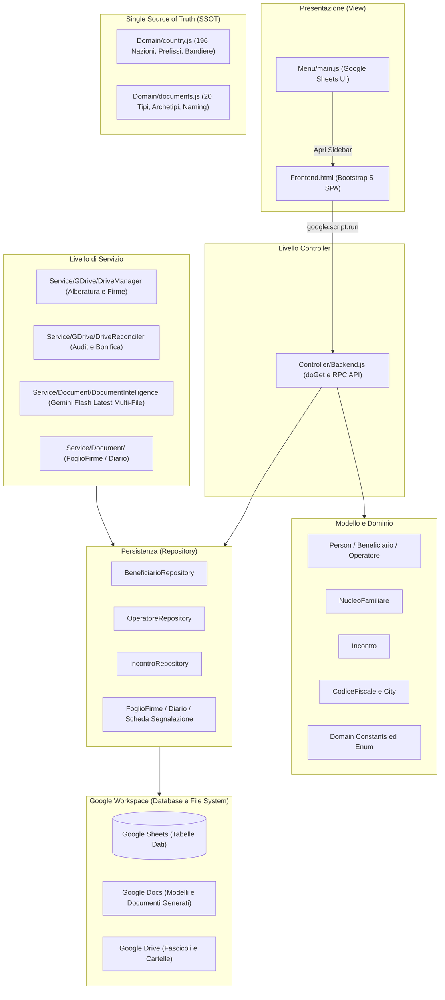

# La Bussola dell'Abitare — Web App e Sistema Gestionale

Documentazione tecnica, operativa e architetturale del software di gestione dello sportello per l'abitare **"La Bussola dell'Abitare"** (Municipio XI di Roma - Azzurra84).

---

## Indice dei Contenuti
1. [Cos'è questo Programma e Finalità](#1-cosè-questo-programma-e-finalità)
2. [Gestione e Aggiornamento: Comandi da Terminale e CI/CD](#2-gestione-e-aggiornamento-comandi-da-terminale-e-cicd)
3. [Filosofia Architetturale e Design Pattern](#3-filosofia-architetturale-e-design-pattern)
4. [Diagrammi UML del Sistema](#4-diagrammi-uml-del-sistema)
5. [Mappa delle Funzionalità](#5-mappa-delle-funzionalità)
6. [Punti Critici, Bug Rilevati e Possibili Errori](#6-punti-critici-bug-rilevati-e-possibili-errori)
7. [Suggerimenti e Buone Pratiche](#7-suggerimenti-e-buone-pratiche)
8. [Indice Completo della Documentazione (.md)](#8-indice-completo-della-documentazione-md)

---

## 1. Cos'è questo Programma e Finalità

### 1.1 Contesto Operativo
**La Bussola dell'Abitare** è un servizio sociale territoriale promosso nel **Municipio XI di Roma** e gestito dall'ente/cooperativa **Azzurra84**. La missione principale dello sportello è sostenere persone e nuclei familiari che affrontano vulnerabilità abitative, economiche e sociali attraverso:
- Accoglienza immediata e ascolto del bisogno abitativo.
- Presa in carico sociale e progettualità personalizzata.
- Assistenza nella gestione documentale (ISEE, documenti di soggiorno, residenza, contratti di locazione).
- Monitoraggio delle presenze e rendicontazione periodica nei confronti della pubblica amministrazione.

> [!NOTE]
> Per la documentazione formale sulle procedure operative, gli orari e l'organizzazione del personale (operatori e assistenti sociali), fare riferimento al documento [**Regolamento e Funzionamento dello Sportello**](file:///d:/Lorenzo/Public/#Work/Azzurra84/Bussola%20dell'Abitare/gas-webapp/docs/funzionamentoSportello.md) ([`docs/funzionamentoSportello.md`](docs/funzionamentoSportello.md)).

### 1.2 Obiettivo del Software
Questo progetto digitalizza e centralizza l'intera catena di lavoro dello sportello. Il programma converte un insieme di fogli di calcolo sparsi e modelli cartacei in un'**applicazione web integrata** con l'ecosistema **Google Workspace** (Google Sheets, Google Docs, Google Drive).

Il software opera secondo due modalità di accesso:
1. **Primo Livello (Accesso Libero / Front Office):** Condotto dagli operatori sociali (es. Lorenzo e Carlotta/Luana) per prima accoglienza, orientamento, registrazione incontro, generazione del Foglio Firme e redazione dell'eventuale Scheda di Segnalazione.
2. **Secondo Livello (Su Appuntamento / Servizio Specialistico):** Condotto dalle assistenti sociali (es. Valentina e Kristina/Rachele) a seguito della ricezione di una Scheda di Segnalazione, con apertura del fascicolo, gestione anagrafica approfondita e stesura dei piani d'intervento.

### 1.3 Modalità di Fruizione
Il programma offre due interfacce per gli utenti:
- **Web App autonoma:** Servita tramite l'URL generato dal deployment di Google Apps Script (`doGet(e)`), accessibile da qualsiasi browser desktop o tablet.
- **Sidebar integrata in Google Sheets:** Direttamente dal menu `Bussola dell'Abitare` > `Apri Sportello (Web App)` all'interno del foglio di calcolo gestionale principale (`SpreadsheetApp.getUi().showSidebar()`).

---

## 2. Gestione e Aggiornamento: Comandi da Terminale e CI/CD

Il progetto è sviluppato in locale (JavaScript moderno ES6+ con annotazioni JSDoc e TypeScript type-checking) e sincronizzato su **Google Apps Script** (GAS) tramite lo strumento ufficiale **`@google/clasp`** (Google Command Line Apps Script Projects).

### 2.1 File di Configurazione Chiave
- [`.clasp.json`](file:///d:/Lorenzo/Public/#Work/Azzurra84/Bussola%20dell'Abitare/gas-webapp/.clasp.json): Collega il workspace locale allo script Google tramite `scriptId` e imposta la cartella sorgente `./src`.
- [`.claspignore`](file:///d:/Lorenzo/Public/#Work/Azzurra84/Bussola%20dell'Abitare/gas-webapp/.claspignore): Definisce i file esclusi dall'invio su Apps Script (`node_modules`, `package.json`, cartelle `dist`, test locali).
- [`src/appsscript.json`](file:///d:/Lorenzo/Public/#Work/Azzurra84/Bussola%20dell'Abitare/gas-webapp/src/appsscript.json): Manifest del progetto (motore V8, fuso orario `Europe/Rome`, permessi Web App).
- [`.github/workflows/test.yml`](file:///d:/Lorenzo/Public/#Work/Azzurra84/Bussola%20dell'Abitare/gas-webapp/.github/workflows/test.yml): Workflow di Continuous Integration che esegue i test unitari offline e la verifica di sicurezza del manifest ad ogni push o Pull Request.
- [`.github/workflows/clasp-push.yml`](file:///d:/Lorenzo/Public/#Work/Azzurra84/Bussola%20dell'Abitare/gas-webapp/.github/workflows/clasp-push.yml): Workflow di Continuous Deployment che convalida i test ed effettua il push su Google Apps Script ad ogni push su `main`.
- [`.github/workflows/README.md`](file:///d:/Lorenzo/Public/#Work/Azzurra84/Bussola%20dell'Abitare/gas-webapp/.github/workflows/README.md): Documentazione tecnica delle pipeline CI/CD e delle automazioni GitHub Actions.

---

### 2.2 Guida ai Comandi da Terminale (PowerShell / Bash)

#### Configurazione della Chiave Google Gemini (Document Intelligence)
Per abilitare la lettura automatica con IA dei documenti di identità, permessi di soggiorno e ISEE:
1. Ottenere una chiave API gratuita da [Google AI Studio](https://aistudio.google.com/).
2. Aprire l'editor di Apps Script (`npx @google/clasp open`).
3. Andare su **Impostazioni progetto** (icona ingranaggio a sinistra) > **Proprietà dello script**.
4. Aggiungere la proprietà:
   - Proprietà: `GEMINI_API_KEY`
   - Valore: *(la tua chiave API Google AI Studio)*
   - *(Opzionale)* `GEMINI_MODEL`: `gemini-flash-latest` (impostato di default, con fallback automatico a cascata sui tier generici `gemini-flash-lite-latest` e `gemini-pro-latest`)

---

#### Setup iniziale dell'ambiente locale
```bash
# 1. Clonare il repository (se non già fatto)
git clone git@public_github:La-Bussola-dell-Abitare/gas-webapp.git
cd gas-webapp

# 2. Installare le dipendenze di sviluppo (TypeScript e definizioni tipi Google Apps Script)
npm install

# 3. Autenticarsi con il proprio account Google su Clasp
npx @google/clasp login
```
> [!NOTE]
> Il comando `clasp login` apre una finestra del browser per autorizzare le API di Google Apps Script. Le credenziali vengono memorizzate in `~/.clasprc.json`.

---

#### Flusso di Sviluppo e Modifica del Codice

```bash
# Scaricare l'ultima versione del codice da Google Apps Script (in caso di modifiche web)
npx @google/clasp pull

# Verificare lo stato dei file modificati localmente
git status

# Inviare manualmente le modifiche locali al progetto Google Apps Script
npx @google/clasp push

# Per inviare continuamente ad ogni salvataggio di file:
npx @google/clasp push --watch

# Aprire direttamente l'editor di Apps Script nel browser
npx @google/clasp open
```

---

#### Rilascio di Nuove Versioni (Deployment della Web App)
Quando si aggiorna il codice della Web App, per renderlo visibile agli operatori che utilizzano l'URL pubblico di produzione, è necessario creare o aggiornare il deployment:

```bash
# Elencare i deployment attivi e recuperare i relativi Deployment ID
npx @google/clasp deployments

# Creare un nuovo deployment con descrizione
npx @google/clasp deploy --description "Rilascio v2.2 - Aggiornamento maschera nuclei"

# Oppure aggiornare un deployment esistente (sostituire <DEPLOYMENT_ID>):
npx @google/clasp deploy -i <DEPLOYMENT_ID> --description "Hotfix v2.2.1"
```

---

#### Ciclo di Versioning Git e CI/CD Automatico
Il repository è configurato con due pipeline GitHub Actions automatiche:
1. **Continuous Integration (`test.yml`)**: Esegue ad ogni `push` e `pull_request` la suite di 39 test unitari offline e verifica che il manifest `src/appsscript.json` non contenga accessi pubblici anomali (`access: "MYSELF"`).
2. **Continuous Deployment (`clasp-push.yml`)**: Ad ogni `push` sul branch `main`, verifica preventivamente i test (`npm test`) e solo in caso di esito positivo sincronizza il codice sorgente su Google Apps Script tramite Clasp:

```bash
# Aggiungere i file modificati allo stage
git add .

# Creare il commit con un messaggio descrittivo
git commit -m "feat(nucleo): aggiunta gestione note e validazione CF"

# Effettuare il push su GitHub (attiva i workflow test.yml e clasp-push.yml)
git push origin main
```

> [!IMPORTANT]
> Affinché GitHub Actions esegua il push su Apps Script senza errori, nel repository GitHub (`Settings > Secrets and variables > Actions`) devono essere valorizzati i secret:
> - `CLASP_ACCESS_TOKEN`
> - `CLASP_REFRESH_TOKEN`
> - `CLASP_CLIENT_ID`
> - `CLASP_CLIENT_SECRET`

---

### 2.3 Testing Unitario e Protocollo di Collaudo WebApp

Per garantire massima affidabilità senza esporre la WebApp al pubblico a riposo, il progetto adotta una strategia a doppio livello:

#### 1. Test Unitari Offline ad Alta Velocità (`npm test`)
La logica di dominio, i modelli, i calcolatori fiscali e gli algoritmi di fuzzy matching sono convalidati localmente tramite il test runner nativo di **Node.js v25** (`node:test` e `node:assert`), senza alcuna dipendenza pesante o mock instabile di Google:
```bash
# Esecuzione istantanea suite di test (~300ms)
npm test

# Modalità osservatore continuo durante lo sviluppo
npm run test:watch
```
*(Documentazione completa in [`tests/README.md`](file:///d:/Lorenzo/Public/#Work/Azzurra84/Bussola%20dell'Abitare/gas-webapp/tests/README.md))*

#### 2. Protocollo di Collaudo da Browser (Deployment Fisso e Sicurezza)
Quando è necessario collaudare le funzionalità interattive direttamente dal browser:
- **Deployment ID Ufficiale Fisso**: `AKfycbzkY426RSsiBF19i2GRLd69idx3GbMKj4fZQIcg2G3INwXVSjTiRd-4MEtmp9IA0MFwMw`
- **URL WebApp Collaudo**: `https://script.google.com/macros/s/AKfycbzkY426RSsiBF19i2GRLd69idx3GbMKj4fZQIcg2G3INwXVSjTiRd-4MEtmp9IA0MFwMw/exec`
- **Nucleo di Test Riservato (SSOT)**: **Nucleo #3 (Lorenzo Mazza)**. Qualsiasi test live, spostamento file Drive o diagnostica deve operare esclusivamente su questo nucleo.

```bash
# 1. Apertura temporanea per il collaudo (imposta ANYONE_ANONYMOUS e aggiorna il deployment fisso)
npm run deploy:open

# 2. [Eseguire il collaudo da browser su Nucleo #3]

# 3. Chiusura tassativa dell'accesso prima del commit (ripristina MYSELF e aggiorna il deployment)
npm run deploy:close
```
*(Documentazione completa in [`scripts/README.md`](file:///d:/Lorenzo/Public/#Work/Azzurra84/Bussola%20dell'Abitare/gas-webapp/scripts/README.md))*

---

## 3. Filosofia Architetturale e Design Pattern

Il progetto adotta un'architettura enterprise a livelli, insolitamente pulita e strutturata per l'ambiente monolitico di Google Apps Script (GAS), dove normalmente tutto il codice condivide il global namespace.



### 3.1 Model-View-Controller (MVC)
1. **Model (`src/Models/` e `src/Domain/`):**
   - Incapsula entità del dominio (`Person`, `Beneficiario`, `Operatore`, `NucleoFamiliare`, `Incontro`, `CodiceFiscale`, `City`, `Address`).
   - Gestisce la validazione delle regole aziendali, l'ereditarietà OOP (`Beneficiario extends Person`, `Operatore extends Person`), la decodifica del codice catastale e il parsing anagrafico.
2. **View (`src/View/`):**
   - [`Frontend.html`](file:///d:/Lorenzo/Public/#Work/Azzurra84/Bussola%20dell'Abitare/gas-webapp/src/View/WebApp/Frontend.html): Single Page Application (SPA) reattiva senza framework pesanti (Vanilla JS + Bootstrap 5 + font Outfit + CSS personalizzato).
   - Comunica in modo asincrono con il server tramite l'API standard `google.script.run`.
   - [`src/View/Menu/main.js`](file:///d:/Lorenzo/Public/#Work/Azzurra84/Bussola%20dell'Abitare/gas-webapp/src/View/Menu/main.js): Inietta menu personalizzati nella barra degli strumenti di Google Sheets all'evento `onOpen()`.
   - Consulta [**Requisiti e Funzionamento Web App**](file:///d:/Lorenzo/Public/#Work/Azzurra84/Bussola%20dell'Abitare/gas-webapp/src/View/WebApp/webapp.md) ([`src/View/WebApp/webapp.md`](src/View/WebApp/webapp.md)) per le specifiche della UI.
3. **Controller (`src/Controller/Backend.js`):**
   - Fornisce l'endpoint web `doGet(e)` con `HtmlService`.
   - Espone funzioni di interfaccia richiamabili dal client (RPC) che ricevono parametri, coordinano i Model e i Repository e restituiscono oggetti JSON piani (POJO) o risposte standard `{ success: boolean, message: string }`.

### 3.2 Repository Pattern
- Separa la logica di business e le classi di dominio dal meccanismo fisico di memorizzazione (Google Sheets e Google Drive).
- **Risoluzione dinamica delle colonne:** I repository (`BeneficiarioRepository`, `IncontroRepository`, `OperatoreRepository`, `NucleoFamiliare`) non si affidano a numeri di colonna fissi (che si romperebbero se un utente inserisse una colonna nel foglio), bensì leggono la riga di intestazione ed estraggono gli indici tramite `findHeaderIndex(headers, ["nome", "cognome", ...])`.

### 3.3 Domain-Driven Design (DDD) e Type Safety con JSDoc
- I file in [`src/Domain/`](file:///d:/Lorenzo/Public/#Work/Azzurra84/Bussola%20dell'Abitare/gas-webapp/src/Domain/) definiscono dizionari immutabili con `Object.freeze` (`Abitazione`, `Relations`, `StatiCivili`, `WorkStatus`, `CountryByCitizenship`, `ISCED`, `EQF`).
- Con l'ausilio di [`jsconfig.json`](file:///d:/Lorenzo/Public/#Work/Azzurra84/Bussola%20dell'Abitare/gas-webapp/jsconfig.json), il codice beneficia dell'autocompletamento avanzato di TypeScript nell'editor pur rimanendo JavaScript nativo per Google Apps Script.

### 3.4 Lazy Loading e Caching Intelligente
- [`src/Utils/main.js`](file:///d:/Lorenzo/Public/#Work/Azzurra84/Bussola%20dell'Abitare/gas-webapp/src/Utils/main.js) implementa un meccanismo elegante di getter lazy su `globalThis` (`addGetter_`). Le chiamate pesanti come `SpreadsheetApp.getActiveSpreadsheet()` vengono eseguite solo al momento del primo reale accesso ed eseguite in cache interna.
- [`src/Utils/Config.js`](file:///d:/Lorenzo/Public/#Work/Azzurra84/Bussola%20dell'Abitare/gas-webapp/src/Utils/Config.js) centralizza gli ID delle cartelle e dei template di Google Drive con proprietà `get FOLDER()` e `get TEMPLATE()` memorizzate per non saturare le quote API di Drive.
- `CacheService.getScriptCache()` memorizza le interrogazioni geografiche (comuni, codici catastali Belfiore, coordinate) fino a 6 ore, evitando chiamate di rete ripetute.

---

## 4. Diagrammi UML del Sistema

Per consentire una comprensione approfondita e formale dell'architettura software e dei processi aziendali, sono stati redatti quattro documenti dedicati nella cartella [`docs/`](file:///d:/Lorenzo/Public/#Work/Azzurra84/Bussola%20dell'Abitare/gas-webapp/docs/):

| Tipologia di Diagramma | Documento Dedicato | Descrizione dei Contenuti |
| :--- | :--- | :--- |
| **Casi d'Uso (Use Case)** | [**`docs/uml_casi_uso.md`**](file:///d:/Lorenzo/Public/#Work/Azzurra84/Bussola%20dell'Abitare/gas-webapp/docs/uml_casi_uso.md) ([link relativo](docs/uml_casi_uso.md)) | Mappa completa delle interazioni tra attori (Operatore Sociale, Assistente Sociale, Coordinatore, Google Workspace API) e i casi d'uso coperti dai moduli Incontri, Nuclei, Documenti e Appuntamenti. |
| **Classi (Class Diagram)** | [**`docs/uml_classi.md`**](file:///d:/Lorenzo/Public/#Work/Azzurra84/Bussola%20dell'Abitare/gas-webapp/docs/uml_classi.md) ([link relativo](docs/uml_classi.md)) | Struttura OOP completa con ereditarietà (`Person` → `Beneficiario` / `Operatore`), aggregazioni (`NucleoFamiliare`, `Address`, `City`), Value Object (`CodiceFiscale`) e strato di persistenza (`Repository`). |
| **Sequenza (Sequence Diagrams)** | [**`docs/uml_sequenza.md`**](file:///d:/Lorenzo/Public/#Work/Azzurra84/Bussola%20dell'Abitare/gas-webapp/docs/uml_sequenza.md) ([link relativo](docs/uml_sequenza.md)) | Flussi temporali asincroni dettagliati: 1) Registrazione Incontro e Segnalazione, 2) Censimento Nucleo con decodifica istantanea CF, 3) Generazione Foglio Firme Google Doc, 4) Incrocio anagrafico per Monitoraggio Ufficiale. |
| **Attività (Activity Diagrams)** | [**`docs/uml_attivita.md`**](file:///d:/Lorenzo/Public/#Work/Azzurra84/Bussola%20dell'Abitare/gas-webapp/docs/uml_attivita.md) ([link relativo](docs/uml_attivita.md)) | Workflow operativi dello sportello: Accoglienza e smistamento 1° vs 2° Livello, Presa in carico del fascicolo specialistico, Routine giornaliere (Diario) e Routine mensili (Timesheet e Fogli Firme). |

---

## 5. Mappa delle Funzionalità

| Modulo / Funzionalità | Descrizione | File di Codice / Istruzioni | Stato |
| :--- | :--- | :--- | :---: |
| **Interfaccia Web App (SPA)** | Maschera responsive a 4 tab: Incontri, Nuclei, Documenti, Appuntamenti | [`Frontend.html`](file:///d:/Lorenzo/Public/#Work/Azzurra84/Bussola%20dell'Abitare/gas-webapp/src/View/WebApp/Frontend.html) • [Specifiche](file:///d:/Lorenzo/Public/#Work/Azzurra84/Bussola%20dell'Abitare/gas-webapp/src/View/WebApp/webapp.md) | ✅ Implementata |
| **Registrazione Incontri** | Form per operatori (1° livello) e assistenti (2° livello), con data, orari e note | [`Incontro.js`](file:///d:/Lorenzo/Public/#Work/Azzurra84/Bussola%20dell'Abitare/gas-webapp/src/Models/Meeting/Incontro.js), [`Backend.js`](file:///d:/Lorenzo/Public/#Work/Azzurra84/Bussola%20dell'Abitare/gas-webapp/src/Controller/Backend.js) | ✅ Implementata |
| **Visualizzazione e Filtro Incontri** | Tabella interattiva incontri con filtri per beneficiario, operatore e data | [`Frontend.html`](file:///d:/Lorenzo/Public/#Work/Azzurra84/Bussola%20dell'Abitare/gas-webapp/src/View/WebApp/Frontend.html) | ✅ Implementata |
| **Modifica Incontri** | Modifica di un incontro esistente sul foglio tramite identificazione a chiave | [`Incontro.js`](file:///d:/Lorenzo/Public/#Work/Azzurra84/Bussola%20dell'Abitare/gas-webapp/src/Models/Meeting/Incontro.js) | ✅ Implementata |
| **Gestione Nuclei Familiari** | Creazione atomica nucleo e intestatario (Dual-Mode) protetta da Script Lock (`submitNucleoCompleto`), generazione ID progressivo numerico (`generateNextId`) | [`NucleoFamiliare.js`](file:///d:/Lorenzo/Public/#Work/Azzurra84/Bussola%20dell'Abitare/gas-webapp/src/Models/Nucleo/NucleoFamiliare.js) • [`Backend.js`](file:///d:/Lorenzo/Public/#Work/Azzurra84/Bussola%20dell'Abitare/gas-webapp/src/Controller/Backend.js) • [Specifiche](file:///d:/Lorenzo/Public/#Work/Azzurra84/Bussola%20dell'Abitare/gas-webapp/src/Models/Nucleo/Istruzioni.md) | ✅ Implementata |
| **Alberatura Cartelle Google Drive** | Creazione e gestione gerarchica cartelle nucleo (`<id> - <Intestatario>`) e sottocartelle personali (`<Nome Cognome>`) | [`DriveManager.js`](file:///d:/Lorenzo/Public/#Work/Azzurra84/Bussola%20dell'Abitare/gas-webapp/src/Service/GDrive/DriveManager.js) • [Documentazione](file:///d:/Lorenzo/Public/#Work/Azzurra84/Bussola%20dell'Abitare/gas-webapp/src/Service/GDrive/README.md) | ✅ Implementata |
| **Acquisizione Firma Digitale** | Canvas HTML5 (PointerEvents) per firma con mouse, touch o penna, salvataggio PNG trasparente in Drive e sincronizzazione automatica | [`Frontend.html`](file:///d:/Lorenzo/Public/#Work/Azzurra84/Bussola%20dell'Abitare/gas-webapp/src/View/WebApp/Frontend.html), [`DriveManager.js`](file:///d:/Lorenzo/Public/#Work/Azzurra84/Bussola%20dell'Abitare/gas-webapp/src/Service/GDrive/DriveManager.js) | ✅ Implementata |
| **Fascicolo Documentale & Scadenze** | Foglio relazionale 'Documenti' con ID progressivo 1..N, semaforo scadenze (🔴 🟡 🟢 ⚪), importi economici (€) e link a Drive | [`Documento.js`](file:///d:/Lorenzo/Public/#Work/Azzurra84/Bussola%20dell'Abitare/gas-webapp/src/Models/Documenti/Documento.js), [`DocumentoRepository.js`](file:///d:/Lorenzo/Public/#Work/Azzurra84/Bussola%20dell'Abitare/gas-webapp/src/Repository/Documento.js) | ✅ Implementata |
| **Diagnostica e Riconciliazione Drive con IA** | Suite avanzata a 4 schede per audit Drive, rilevamento cartelle invertite/refusi (`analyzeFolderName`), deduplicazione Two-Tier (MD5 REST API v3), applicazione granulare per singolo caso o per tipologia, anteprima file integrata in-app (`#modal-preview-file`) e link Drive, spostamento atomico (`file.moveTo`), ridenominazione standard, sincronizzazione foglio 'Documenti' e allineamento anagrafico con diff interattivo tramite Gemini Flash | [`DriveReconciler.js`](file:///d:/Lorenzo/Public/#Work/Azzurra84/Bussola%20dell'Abitare/gas-webapp/src/Service/GDrive/DriveReconciler.js) • [Guida](file:///d:/Lorenzo/Public/#Work/Azzurra84/Bussola%20dell'Abitare/gas-webapp/src/Service/GDrive/README.md) | ✅ Implementata |
| **Smart Form-Filling Multi-File con IA (Gemini Flash)** | Computer Vision e OCR multimodale (`gemini-flash-latest`) per caricamento simultaneo multi-file (CIE fronte/retro, ISEE, TS), compressione istantanea Canvas, normalizzazione Title Case, autocompilazione modale nucleo/membro e archiviazione Drive | [`DocumentIntelligence.js`](file:///d:/Lorenzo/Public/#Work/Azzurra84/Bussola%20dell'Abitare/gas-webapp/src/Service/Document/DocumentIntelligence.js) • [`DriveManager.js`](file:///d:/Lorenzo/Public/#Work/Azzurra84/Bussola%20dell'Abitare/gas-webapp/src/Service/GDrive/DriveManager.js) | ✅ Implementata |
| **Single Source of Truth Nazioni** | Catalogo immutabile di 196 paesi, ISO, prefissi telefonici, bandiere grafiche e cittadinanze | [`country.js`](file:///d:/Lorenzo/Public/#Work/Azzurra84/Bussola%20dell'Abitare/gas-webapp/src/Domain/country.js) • [Guida](file:///d:/Lorenzo/Public/#Work/Azzurra84/Bussola%20dell'Abitare/gas-webapp/src/Domain/README.md) | ✅ Implementata |
| **Single Source of Truth Documenti** | Catalogo di 20 documenti, 5 archetipi temporali, regex di matching e naming standard `buildDocumentFileName` | [`documents.js`](file:///d:/Lorenzo/Public/#Work/Azzurra84/Bussola%20dell'Abitare/gas-webapp/src/Domain/documents.js) • [Guida](file:///d:/Lorenzo/Public/#Work/Azzurra84/Bussola%20dell'Abitare/gas-webapp/src/Domain/README.md) | ✅ Implementata |
| **Dropdown Dinamiche e Named Ranges** | Caricamento valori ammessi da Named Ranges Google Sheets con fallback su Domain e cache di 6 ore | [`LookupRepository.js`](file:///d:/Lorenzo/Public/#Work/Azzurra84/Bussola%20dell'Abitare/gas-webapp/src/Repository/LookupRepository.js) | ✅ Implementata |
| **Decodifica Codice Fiscale** | Validazione formale, calcolo CIN, estrazione sesso, data e comune/stato di nascita | [`CodiceFiscale.js`](file:///d:/Lorenzo/Public/#Work/Azzurra84/Bussola%20dell'Abitare/gas-webapp/src/Models/CodiceFiscale.js) | ✅ Implementata |
| **Scheda di Segnalazione Google Doc** | Creazione da template, sostituzione tag, gestione spunte (☑), firma e download PDF | [`SchedaSegnalazione.js`](file:///d:/Lorenzo/Public/#Work/Azzurra84/Bussola%20dell'Abitare/gas-webapp/src/Models/Documenti/SchedaSegnalazione/SchedaSegnalazione.js) | ✅ Implementata |
| **Foglio Firme Google Doc** | Duplicazione template e assegnazione metadati per mese/operatore/beneficiario | [`FoglioFirme.js`](file:///d:/Lorenzo/Public/#Work/Azzurra84/Bussola%20dell'Abitare/gas-webapp/src/Models/Documenti/FoglioFirme/FoglioFirme.js) | ✅ Implementata |
| **Diario Giornaliero Google Doc** | Creazione documento standard del giorno o copia da template | [`Diariogiornaliero.js`](file:///d:/Lorenzo/Public/#Work/Azzurra84/Bussola%20dell'Abitare/gas-webapp/src/Repository/Diariogiornaliero.js) | ✅ Implementata |
| **Riga Monitoraggio Ufficiale** | Inserimento riga nel foglio ministeriale con calcolo età e dati operatore/beneficiario | [`Backend.js`](file:///d:/Lorenzo/Public/#Work/Azzurra84/Bussola%20dell'Abitare/gas-webapp/src/Controller/Backend.js) | ✅ Implementata |
| **Gestione Appuntamenti** | Registrazione e visualizzazione appuntamenti su foglio dedicato | [`Backend.js`](file:///d:/Lorenzo/Public/#Work/Azzurra84/Bussola%20dell'Abitare/gas-webapp/src/Controller/Backend.js) | ✅ Implementata |
| **Modalità Debug & Diagnostica** | Intercettore RPC live (latenza ms e payload), ispettore DB in memoria, log compressione Canvas e Gemini Flash, trappola errori, esportazione report e toggle ID tecnici (scorciatoia Ctrl+Shift+D e modale impostazioni) | [`Frontend.html`](file:///d:/Lorenzo/Public/#Work/Azzurra84/Bussola%20dell'Abitare/gas-webapp/src/View/WebApp/Frontend.html) • [`Backend.js`](file:///d:/Lorenzo/Public/#Work/Azzurra84/Bussola%20dell'Abitare/gas-webapp/src/Controller/Backend.js) • [Specifiche](file:///d:/Lorenzo/Public/#Work/Azzurra84/Bussola%20dell'Abitare/gas-webapp/src/View/WebApp/webapp.md) | ✅ Implementata |
| **Sincronizzazione Google Contatti** | Creazione automatica del contatto Google alla registrazione del beneficiario | [Piano Automazione](file:///d:/Lorenzo/Public/#Work/Azzurra84/Bussola%20dell'Abitare/gas-webapp/docs/automazione.md) | ⏳ Da implementare |

---

## 6. Punti Critici, Bug Rilevati e Possibili Errori

Analisi dettagliata delle anomalie riscontrate durante la scansione del codice:

### 🟢 Criticità 1 (Risolta): Disallineamento Controller ↔ Repository per `Beneficiario`
Nel controller [`src/Controller/Backend.js`](file:///d:/Lorenzo/Public/#Work/Azzurra84/Bussola%20dell'Abitare/gas-webapp/src/Controller/Backend.js):
- `getBeneficiariObjects()` delega a [`BeneficiarioRepository.getAll()`](file:///d:/Lorenzo/Public/#Work/Azzurra84/Bussola%20dell'Abitare/gas-webapp/src/Repository/Beneficiario.js#L17)
- `submitBeneficiary(data)` delega a [`BeneficiarioRepository.add(data)`](file:///d:/Lorenzo/Public/#Work/Azzurra84/Bussola%20dell'Abitare/gas-webapp/src/Repository/Beneficiario.js#L83)
- `removeBeneficiary(cf)` delega a [`BeneficiarioRepository.removeByCF(cf)`](file:///d:/Lorenzo/Public/#Work/Azzurra84/Bussola%20dell'Abitare/gas-webapp/src/Repository/Beneficiario.js#L46)
- Inoltre, per conformità sia al Repository Pattern che al modello Active Record, la classe [`Beneficiario`](file:///d:/Lorenzo/Public/#Work/Azzurra84/Bussola%20dell'Abitare/gas-webapp/src/Models/Person/Beneficiari/Beneficiario.js) include i metodi statici facade `getAll()`, `add(data)`, `remove(cf)` e `removeByCF(cf)`.

---

### 🟢 Criticità 2 (Risolta): Metodo Factory `Beneficiario.fromRow()` Implementato
In [`src/Models/Person/Beneficiari/Beneficiario.js`](file:///d:/Lorenzo/Public/#Work/Azzurra84/Bussola%20dell'Abitare/gas-webapp/src/Models/Person/Beneficiari/Beneficiario.js):
- Implementato [`Beneficiario.fromRow(row, idx)`](file:///d:/Lorenzo/Public/#Work/Azzurra84/Bussola%20dell'Abitare/gas-webapp/src/Models/Person/Beneficiari/Beneficiario.js#L84-L180) che estrae in modo sicuro e resiliente tutti i campi anagrafici, sociali e l'oggetto `documents` (carta d'identità, passaporto, patente, permesso di soggiorno, tessera sanitaria) mappando dinamicamente gli indici del foglio e gestendo le conversioni di tipo (Date, booleani, interi).
- Idratazione in [`BeneficiarioRepository.getAll()`](file:///d:/Lorenzo/Public/#Work/Azzurra84/Bussola%20dell'Abitare/gas-webapp/src/Repository/Beneficiario.js#L35) pienamente operativa senza alcun rischio di eccezioni runtime.
---

### 🔴 Criticità 3: Variabili non definite e bug in `FoglioFirmeRepository`
In [`src/Repository/Fogliofirme.js`](file:///d:/Lorenzo/Public/#Work/Azzurra84/Bussola%20dell'Abitare/gas-webapp/src/Repository/Fogliofirme.js):
- Le variabili `folder`, `operator` e `client` in `get(foglioFirme)` non erano correttamente scoped rispetto ai parametri passati da `Backend.js`.
- Il costruttore di [`FoglioFirme.js`](file:///d:/Lorenzo/Public/#Work/Azzurra84/Bussola%20dell'Abitare/gas-webapp/src/Models/Documenti/FoglioFirme/FoglioFirme.js) prevedeva `(operator, client, date)` mentre il repository istanziava `new FoglioFirme(id, fileName, url)`. *(Nota: è stato introdotto il supporto ibrido retrocompatibile nel modello FoglioFirme)*.

---

### 🟡 Criticità 4: Codice di Test Eseguito al Top-Level (Rallentamento Globale)
In diversi file erano presenti istruzioni di test eseguite a livello globale (top-level):
- `0_City.js`: `let rome = new City("Roma"); console.log(rome);`
- `Address.js`: `let address = new Address("Via Roma", new City("Roma"), "00100");`
- `constants.js`: `testEnum("Coniuge");`

**Perché è grave in Google Apps Script:** In GAS tutti i file del progetto vengono valutati nel contesto globale all'avvio di qualsiasi invocazione (`doGet`, funzioni da foglio, trigger). Ogni volta che viene chiamata qualunque funzione, veniva istanziata la classe `City("Roma")` che effettuava chiamate HTTP sincrone verso GitHub o OpenStreetMap, rallentando ogni singola richiesta di diversi secondi! *(Queste istruzioni sono state incapsulate in funzioni di test)*.

---

### 🟡 Criticità 5: `UrlFetchApp` nelle Custom Functions di Google Sheets
Le formule custom per Google Sheets (come `CF_COMUNE` e `CF_STATO` in [`CodiceFiscale.js`](file:///d:/Lorenzo/Public/#Work/Azzurra84/Bussola%20dell'Abitare/gas-webapp/src/Models/CodiceFiscale.js#L364-L377)) invocano `CodiceFiscale.decodeBelfiore(codice)`, il quale usa `UrlFetchApp.fetch(...)` per interrogare GitHub.  
**Limitazione GAS:** Le formule personalizzate nelle celle dei fogli Google Sheets sono eseguite in una sandbox di sicurezza che **proibisce** le chiamate `UrlFetchApp`. Se la cella non trova il valore in cache, fallisce con errore di autorizzazione.

---

### 🟡 Criticità 6: Race Condition e Scritture Concorrenti (Mancanza di `LockService`)
Quando più operatori compilano contemporaneamente la Web App (es. due operatori che registrano incontri o creano nuclei allo stesso minuto):
- `sheet.getLastRow() + 1` e `NucleoFamiliare.generateNextId()` leggono lo stesso stato del foglio nello stesso momento.
- Rischio reale di sovrascrittura di righe o assegnazione dello stesso ID numerico a due nuclei diversi.
- È indispensabile applicare `LockService.getScriptLock()` nei metodi `add` e `update`.

---

### 🟡 Criticità 7: ID Template Mancante in `Config.js`
In [`src/Utils/Config.js`](file:///d:/Lorenzo/Public/#Work/Azzurra84/Bussola%20dell'Abitare/gas-webapp/src/Utils/Config.js):
```javascript
ID_TEMPLATEDIARIOGIORNALIERO: "",
```
La costante per il template del diario giornaliero è una stringa vuota. Anche se `DiarioGiornalieroRepository` possiede un fallback per creare un documento da zero, se un operatore configura un template Docs dedicato, la variabile deve essere valorizzata con l'ID reale del file Google Drive.

---

### 🟡 Criticità 8: File di Servizio Vuoti
I file [`src/Service/Document/Diariogiornaliero.js`](file:///d:/Lorenzo/Public/#Work/Azzurra84/Bussola%20dell'Abitare/gas-webapp/src/Service/Document/Diariogiornaliero.js) e [`src/Service/Document/Fogliofirme.js`](file:///d:/Lorenzo/Public/#Work/Azzurra84/Bussola%20dell'Abitare/gas-webapp/src/Service/Document/Fogliofirme.js) erano precedentemente a 0 byte. Sono stati provvisti di struttura base JSDoc e classi di servizio per future estensioni.

---

## 7. Suggerimenti e Buone Pratiche

### 7.1 Interventi Correttivi Immediati Prioritari

1. **Riconnettere `Backend.js` con `BeneficiarioRepository`:**
   Sostituire in `Backend.js` le chiamate `Beneficiario.getAll()` con `BeneficiarioRepository.getAll()`, `Beneficiario.add()` con `BeneficiarioRepository.add()`, e `Beneficiario.remove()` con `BeneficiarioRepository.removeByCF()`.

2. **Implementare `Beneficiario.fromRow()`:**
   Aggiungere alla classe `Beneficiario` il metodo factory analogo a quello di `Operatore`:
   ```javascript
   static fromRow(row, idx) {
     const nome = getSheetVal(row, idx, "nome", "");
     const cognome = getSheetVal(row, idx, "cognome", "");
     const cf = getSheetVal(row, idx, "cf", "");
     return new Beneficiario({
       name: nome,
       surname: cognome,
       taxCode: cf ? new CodiceFiscale(cf) : null,
       birthDate: getSheetVal(row, idx, "dataNascita", null),
       birthPlace: new City(getSheetVal(row, idx, "luogoNascita", "Roma")),
       email: getSheetVal(row, idx, "email", ""),
       phone: getSheetVal(row, idx, "telefono", ""),
       statoLavorativo: getSheetVal(row, idx, "statoLavorativo", ""),
       titoloStudio: getSheetVal(row, idx, "titoloStudio", ""),
       cittadinanza: getSheetVal(row, idx, "cittadinanza", "Italia"),
       residenza: getSheetVal(row, idx, "residenza", ""),
       domicilio: getSheetVal(row, idx, "domicilio", ""),
       assistenteSociale: getSheetVal(row, idx, "assistenteSociale", ""),
       rapportoIntestatario: getSheetVal(row, idx, "rapportoIntestatario", "Intestatario"),
       idNucleo: getSheetVal(row, idx, "idNucleo", ""),
       statoCivile: getSheetVal(row, idx, "statoCivile", ""),
       annoArrivo: getSheetVal(row, idx, "annoArrivo", null),
       documents: {
         cartaIdentita: getSheetVal(row, idx, "cartaIdentita", "Non posseduto"),
         passaporto: getSheetVal(row, idx, "passaporto", false) === true || getSheetVal(row, idx, "passaporto", "") === "true",
         patente: getSheetVal(row, idx, "patente", false) === true || getSheetVal(row, idx, "patente", "") === "true",
         permessoSoggiorno: getSheetVal(row, idx, "permessoSoggiorno", false) === true || getSheetVal(row, idx, "permessoSoggiorno", "") === "true",
         tesseraSanitaria: getSheetVal(row, idx, "tesseraSanitaria", false) === true || getSheetVal(row, idx, "tesseraSanitaria", "") === "true"
       }
     });
   }
   ```

3. **Rimuovere il codice top-level:**
   Mantenere incapsulate dentro funzioni di test (es. in [`src/Utils/Test.js`](file:///d:/Lorenzo/Public/#Work/Azzurra84/Bussola%20dell'Abitare/gas-webapp/src/Utils/Test.js)) tutte le istruzioni come `let rome = new City(...)` e `testEnum(...)`.

4. **Proteggere le scritture con `LockService`:**
   Nei metodi `IncontroRepository.add`, `NucleoFamiliare.add` e `BeneficiarioRepository.add`:
   ```javascript
   const lock = LockService.getScriptLock();
   try {
     lock.waitLock(10000); // attende fino a 10 secondi
     // ... operazione di lettura indice e salvataggio riga ...
   } finally {
     lock.releaseLock();
   }
   ```

### 7.2 Suggerimenti Evolutivi e di Architettura

- **Database Locale per Comuni e Codici Belfiore:** Anziché scaricare a ogni riavvio della cache un file JSON da GitHub con `UrlFetchApp`, caricare l'elenco dei comuni italiani (già presente in [`src/Models/Places/Elenco-comuni-italiani.csv`](file:///d:/Lorenzo/Public/#Work/Azzurra84/Bussola%20dell'Abitare/gas-webapp/src/Models/Places/Elenco-comuni-italiani.csv)) all'interno di un foglio di configurazione nascosto o in `PropertiesService`. Questo renderà le formule del foglio (`CF_COMUNE`) istantanee e conformi alle policy di sicurezza.
- **Automazione Cartelle Beneficiari:** Implementare un listener che all'inserimento di un nuovo nucleo o beneficiario crei automaticamente in Google Drive la cartella `ID - Nome Cognome` con permessi condivisi e vi collochi all'interno le Schede di Segnalazione e i file allegati.
- **Monitoraggio Errori Centralizzato:** Sfruttare Google Cloud Logging / Stackdriver (già abilitato nel manifest `"exceptionLogging": "STACKDRIVER"`) avvolgendo le chiamate del controller con logging strutturato per tracciare in tempo reale eventuali problemi riscontrati dagli operatori sul campo.

---

## 8. Indice Completo della Documentazione (.md)

Tutti i file di documentazione e specifica in formato Markdown presenti nel repository sono accessibili tramite i link sottostanti, raggruppati per tipologia:

### 8.1 Processi, Procedure e Funzionamento dello Sportello
- [**Regolamento e Funzionamento dello Sportello**](file:///d:/Lorenzo/Public/#Work/Azzurra84/Bussola%20dell'Abitare/gas-webapp/docs/funzionamentoSportello.md) ([`docs/funzionamentoSportello.md`](docs/funzionamentoSportello.md)):  
  Descrizione dettagliata della missione dello sportello, procedure operative di Primo Livello (front office libero) e Secondo Livello (assistenti sociali su appuntamento), ruoli e persone di riferimento (Lorenzo, Carlotta/Luana, Valentina, Kristina/Rachele), gestione dei fascicoli cartelle su Google Drive e routine quotidiane e mensili.
- [**Piano delle Automazioni da Sviluppare**](file:///d:/Lorenzo/Public/#Work/Azzurra84/Bussola%20dell'Abitare/gas-webapp/docs/automazione.md) ([`docs/automazione.md`](docs/automazione.md)):  
  Specifiche tecniche sui flussi di lavoro da automatizzare: per ogni nuovo beneficiario (creazione contatto Google e cartella Drive), per ogni visita (Foglio Firme individuale, Diario e riga Monitoraggio), per inizio/fine giornata e controlli di congruità (sanity checks su orari e durate).
- [**Note Agente**](file:///d:/Lorenzo/Public/#Work/Azzurra84/Bussola%20dell'Abitare/gas-webapp/docs/agent.md) ([`docs/agent.md`](docs/agent.md)):  
  Spazio riservato per annotazioni operative e istruzioni per agenti AI.

### 8.2 Architettura Software e Diagrammi UML
- [**Diagrammi dei Casi d'Uso (Use Case)**](file:///d:/Lorenzo/Public/#Work/Azzurra84/Bussola%20dell'Abitare/gas-webapp/docs/uml_casi_uso.md) ([`docs/uml_casi_uso.md`](docs/uml_casi_uso.md)):  
  Mappa completa delle interazioni tra attori (Operatore Sociale, Assistente Sociale, Coordinatore, Google Workspace APIs) e casi d'uso (Incontri, Nuclei, Documenti, Appuntamenti).
- [**Diagramma delle Classi (Class Diagram)**](file:///d:/Lorenzo/Public/#Work/Azzurra84/Bussola%20dell'Abitare/gas-webapp/docs/uml_classi.md) ([`docs/uml_classi.md`](docs/uml_classi.md)):  
  Struttura OOP del sistema, ereditarietà (`Person` → `Beneficiario` / `Operatore`), Value Objects (`CodiceFiscale`, `City`, `Address`), entità di aggregazione e Repository Pattern.
- [**Diagrammi di Sequenza (Sequence Diagrams)**](file:///d:/Lorenzo/Public/#Work/Azzurra84/Bussola%20dell'Abitare/gas-webapp/docs/uml_sequenza.md) ([`docs/uml_sequenza.md`](docs/uml_sequenza.md)):  
  Flussi temporali asincroni dettagliati per registrazione incontri e segnalazioni, censimento nucleo con autocompilazione CF, generazione Foglio Firme e aggregazione Monitoraggio Ufficiale.
- [**Diagrammi di Attività (Activity Diagrams)**](file:///d:/Lorenzo/Public/#Work/Azzurra84/Bussola%20dell'Abitare/gas-webapp/docs/uml_attivita.md) ([`docs/uml_attivita.md`](docs/uml_attivita.md)):  
  Workflow operativi dello sportello modellati con decisioni e join: accoglienza/smistamento a sportello, presa in carico del fascicolo di secondo livello e routine periodiche (giornaliere e mensili).

### 8.3 Specifiche Tecniche della Web App e Modelli Dati
- [**Requisiti e Funzionamento Web App**](file:///d:/Lorenzo/Public/#Work/Azzurra84/Bussola%20dell'Abitare/gas-webapp/src/View/WebApp/webapp.md) ([`src/View/WebApp/webapp.md`](src/View/WebApp/webapp.md)):  
  Specifiche architetturali, tecnologie frontend (Bootstrap 5, Single Page Application), principi di sincronizzazione tra oggetti JavaScript e fogli di calcolo Google, e backlog delle funzionalità.
- [**Infrastruttura di Testing Offline**](file:///d:/Lorenzo/Public/#Work/Azzurra84/Bussola%20dell'Abitare/gas-webapp/tests/README.md) ([`tests/README.md`](tests/README.md)):  
  Guida alla suite di test unitari con Node.js runner nativo (`node:test`), script loader `loadSrc.js` e test suite di dominio e modelli.
- [**Script Operativi e Deployment**](file:///d:/Lorenzo/Public/#Work/Azzurra84/Bussola%20dell'Abitare/gas-webapp/scripts/README.md) ([`scripts/README.md`](scripts/README.md)):  
  Automazione apertura e chiusura deployment di collaudo con ID fisso e gestione atomica del manifest `appsscript.json`.
- [**Specifiche Modello: Dati Beneficiari**](file:///d:/Lorenzo/Public/#Work/Azzurra84/Bussola%20dell'Abitare/gas-webapp/src/Models/Person/Beneficiari/Istruzioni.md) ([`src/Models/Person/Beneficiari/Istruzioni.md`](src/Models/Person/Beneficiari/Istruzioni.md)):  
  Tabella dettagliata di ogni campo dell'anagrafica beneficiario (tipi di dato, obbligatorietà, autocompletamento da CF, gestione documenti posseduti, status lavorativo e titolo di studio).
- [**Specifiche Modello: Nucleo Familiare**](file:///d:/Lorenzo/Public/#Work/Azzurra84/Bussola%20dell'Abitare/gas-webapp/src/Models/Nucleo/Istruzioni.md) ([`src/Models/Nucleo/Istruzioni.md`](src/Models/Nucleo/Istruzioni.md)):  
  Regole e vincoli sui dati del nucleo (generazione ID progressivo, CF intestatario, ISEE con 2 decimali, indirizzi geocodificati, bisogni e riferimenti dei servizi sociali).
- [**Specifiche Documento: Scheda di Segnalazione**](file:///d:/Lorenzo/Public/#Work/Azzurra84/Bussola%20dell'Abitare/gas-webapp/src/Models/Documenti/SchedaSegnalazione/Istruzioni.md) ([`src/Models/Documenti/SchedaSegnalazione/Istruzioni.md`](src/Models/Documenti/SchedaSegnalazione/Istruzioni.md)):  
  Regole di compilazione per l'invio al secondo livello, convenzione di denominazione del file Google Doc (`Scheda segnalazione <ID_Nucleo> (<Nome Intestatario>) <- <Nome Inviante>`), cartelle Drive di destinazione e campi di testata.
- [**Specifiche Documento: Foglio Firme Individuale**](file:///d:/Lorenzo/Public/#Work/Azzurra84/Bussola%20dell'Abitare/gas-webapp/src/Models/Documenti/FoglioFirme/Istruzioni.md) ([`src/Models/Documenti/FoglioFirme/Istruzioni.md`](src/Models/Documenti/FoglioFirme/Istruzioni.md)):  
  Convenzione di denominazione (`Foglio Firme individuale AAAA/MM - Nome Beneficiario (Nome Operatore)`), struttura tabellare con data, orari, calcolo automatico della durata in ore, firma dell'operatore, firma del beneficiario e totale a fine mese.

### 8.4 CI/CD, Automazione e Sicurezza
- [**Pipeline CI/CD e Automazione GitHub Actions**](file:///d:/Lorenzo/Public/#Work/Azzurra84/Bussola%20dell'Abitare/gas-webapp/.github/workflows/README.md) ([`.github/workflows/README.md`](.github/workflows/README.md)):  
  Documentazione tecnica dei workflow GitHub Actions (`test.yml` e `clasp-push.yml`), configurazione delle matrici Node.js, verifica di sicurezza del manifest `appsscript.json` e fail-safe pre-deploy.
