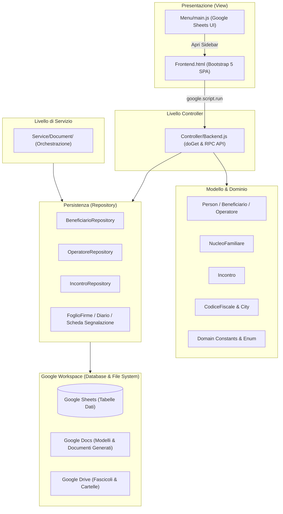

# La Bussola dell'Abitare — Web App & Sistema Gestionale

Documentazione tecnica, operativa e architetturale del software di gestione dello sportello per l'abitare **"La Bussola dell'Abitare"** (Municipio XI di Roma - Azzurra84).

---

## Indice dei Contenuti
1. [Cos'è questo Programma e Finalità](#1-cosè-questo-programma-e-finalità)
2. [Gestione e Aggiornamento: Comandi da Terminale e CI/CD](#2-gestione-e-aggiornamento-comandi-da-terminale-e-cicd)
3. [Filosofia Architetturale e Design Pattern](#3-filosofia-architetturale-e-design-pattern)
4. [Mappa delle Funzionalità](#4-mappa-delle-funzionalità)
5. [Punti Critici, Bug Rilevati e Possibili Errori](#5-punti-critici-bug-rilevati-e-possibili-errori)
6. [Suggerimenti e Buone Pratiche](#6-suggerimenti-e-buone-pratiche)

---

## 1. Cos'è questo Programma e Finalità

### 1.1 Contesto Operativo
**La Bussola dell'Abitare** è un servizio sociale territoriale promosso nel **Municipio XI di Roma** e gestito dall'ente/cooperativa **Azzurra84**. La missione principale dello sportello è sostenere persone e nuclei familiari che affrontano vulnerabilità abitative, economiche e sociali attraverso:
- Accoglienza immediata e ascolto del bisogno abitativo.
- Presa in carico sociale e progettualità personalizzata.
- Assistenza nella gestione documentale (ISEE, documenti di soggiorno, residenza, contratti di locazione).
- Monitoraggio delle presenze e rendicontazione periodica nei confronti della pubblica amministrazione.

### 1.2 Obiettivo del Software
Questo progetto digitalizza e centralizza l'intera catena di lavoro dello sportello. Il programma converte un insieme di fogli di calcolo sparsi e modelli cartacei in un'**applicazione web integrata** con l'ecosistema **Google Workspace** (Google Sheets, Google Docs, Google Drive).

Il software opera secondo due modalità di accesso:
1. **Primo Livello (Accesso Libero / Front Office):** Condotto dagli operatori sociali (es. Lorenzo e Carlotta/Luana) per prima accoglienza, orientamento, registrazione incontro, generazione del Foglio Firme e redazione dell'eventuale Scheda di Segnalazione.
2. **Secondo Livello (Su Appuntamento / Servizio Specialistico):** Condotto dalle assistenti sociali (es. Valentina e Kristina/Rachele) a seguito della ricezione di una Scheda di Segnalazione, con apertura del fascicolo, gestione anagrafica approfondita e stesura dei piani d'intervento.

### 1.3 Modalità di Fruizione
Il programma offre due interfacce per gli utenti:
- **Web App autonoma:** Servita tramite l'URL generato dal deployment di Google Apps Script (`doGet(e)`), accessibile da qualsiasi browser desktop o tablet.
- **Sidebar integrata in Google Sheets:** Direttamente dal menu `Bussola dell'Abitare` > `Apri Sportello (Web App)` all'interno del foglio di calcolo gestionale principale (`SpreadsheetApp.getUi().showSidebar()`).

---

## 2. Gestione e Aggiornamento: Comandi da Terminale e CI/CD

Il progetto è sviluppato in locale (JavaScript moderno ES6+ con annotazioni JSDoc e TypeScript type-checking) e sincronizzato su **Google Apps Script** (GAS) tramite lo strumento ufficiale **`@google/clasp`** (Google Command Line Apps Script Projects).

### 2.1 File di Configurazione Chiave
- [`.clasp.json`](file:///d:/Lorenzo/Public/#Work/Azzurra84/Bussola%20dell'Abitare/gas-webapp/.clasp.json): Collega il workspace locale allo script Google tramite `scriptId` e imposta la cartella sorgente `./src`.
- [`.claspignore`](file:///d:/Lorenzo/Public/#Work/Azzurra84/Bussola%20dell'Abitare/gas-webapp/.claspignore): Definisce i file esclusi dall'invio su Apps Script (`node_modules`, `package.json`, cartelle `dist`, test locali).
- [`src/appsscript.json`](file:///d:/Lorenzo/Public/#Work/Azzurra84/Bussola%20dell'Abitare/gas-webapp/src/appsscript.json): Manifest del progetto (motore V8, fuso orario `Europe/Rome`, permessi Web App).
- [`.github/workflows/clasp-push.yml`](file:///d:/Lorenzo/Public/#Work/Azzurra84/Bussola%20dell'Abitare/gas-webapp/.github/workflows/clasp-push.yml): Workflow GitHub Actions che sincronizza automaticamente il codice su Apps Script a ogni `git push` sul branch `main`.

---

### 2.2 Guida ai Comandi da Terminale (PowerShell / Bash)

#### Setup iniziale dell'ambiente locale
```bash
# 1. Clonare il repository (se non già fatto)
git clone git@public_github:La-Bussola-dell-Abitare/gas-webapp.git
cd gas-webapp

# 2. Installare le dipendenze di sviluppo (TypeScript e definizioni tipi Google Apps Script)
npm install

# 3. Autenticarsi con il proprio account Google su Clasp
npx @google/clasp login
```
> [!NOTE]
> Il comando `clasp login` apre una finestra del browser per autorizzare le API di Google Apps Script. Le credenziali vengono memorizzate in `~/.clasprc.json`.

---

#### Flusso di Sviluppo e Modifica del Codice

```bash
# Scaricare l'ultima versione del codice da Google Apps Script (in caso di modifiche web)
npx @google/clasp pull

# Verificare lo stato dei file modificati localmente
git status

# Inviare manualmente le modifiche locali al progetto Google Apps Script
npx @google/clasp push

# Per inviare continuamente ad ogni salvataggio di file:
npx @google/clasp push --watch

# Aprire direttamente l'editor di Apps Script nel browser
npx @google/clasp open
```

---

#### Rilascio di Nuove Versioni (Deployment della Web App)
Quando si aggiorna il codice della Web App, per renderlo visibile agli operatori che utilizzano l'URL pubblico di produzione, è necessario creare o aggiornare il deployment:

```bash
# Elencare i deployment attivi e recuperare i relativi Deployment ID
npx @google/clasp deployments

# Creare un nuovo deployment con descrizione
npx @google/clasp deploy --description "Rilascio v2.2 - Aggiornamento maschera nuclei"

# Oppure aggiornare un deployment esistente (sostituire <DEPLOYMENT_ID>):
npx @google/clasp deploy -i <DEPLOYMENT_ID> --description "Hotfix v2.2.1"
```

---

#### Ciclo di Versioning Git e CI/CD Automatico
Il repository è configurato per rilasciare automaticamente su Apps Script tramite GitHub Actions ad ogni push su `main`:

```bash
# Aggiungere i file modificati allo stage
git add .

# Creare il commit con un messaggio descrittivo
git commit -m "feat(nucleo): aggiunta gestione note e validazione CF"

# Effettuare il push su GitHub (attiva il workflow clasp-push.yml)
git push origin main
```

> [!IMPORTANT]
> Affinché GitHub Actions esegua il push su Apps Script senza errori, nel repository GitHub (`Settings > Secrets and variables > Actions`) devono essere valorizzati i secret:
> - `CLASP_ACCESS_TOKEN`
> - `CLASP_REFRESH_TOKEN`
> - `CLASP_CLIENT_ID`
> - `CLASP_CLIENT_SECRET`

---

## 3. Filosofia Architetturale e Design Pattern

Il progetto adotta un'architettura enterprise a livelli, insolitamente pulita e strutturata per l'ambiente monolitico di Google Apps Script (GAS), dove normalmente tutto il codice condivide il global namespace.



### 3.1 Model-View-Controller (MVC)
1. **Model (`src/Models/` & `src/Domain/`):**
   - Incapsula entità del dominio (`Person`, `Beneficiario`, `Operatore`, `NucleoFamiliare`, `Incontro`, `CodiceFiscale`, `City`, `Address`).
   - Gestisce la validazione delle regole aziendali, l'ereditarietà OOP (`Beneficiario extends Person`, `Operatore extends Person`), la decodifica del codice catastale e il parsing anagrafico.
2. **View (`src/View/`):**
   - [`Frontend.html`](file:///d:/Lorenzo/Public/#Work/Azzurra84/Bussola%20dell'Abitare/gas-webapp/src/View/WebApp/Frontend.html): Single Page Application (SPA) reattiva senza framework pesanti (Vanilla JS + Bootstrap 5 + font Outfit + CSS personalizzato).
   - Comunica in modo asincrono con il server tramite l'API standard `google.script.run`.
   - [`src/View/Menu/main.js`](file:///d:/Lorenzo/Public/#Work/Azzurra84/Bussola%20dell'Abitare/gas-webapp/src/View/Menu/main.js): Inietta menu personalizzati nella barra degli strumenti di Google Sheets all'evento `onOpen()`.
3. **Controller (`src/Controller/Backend.js`):**
   - Fornisce l'endpoint web `doGet(e)` con `HtmlService`.
   - Espone funzioni di interfaccia richiamabili dal client (RPC) che ricevono parametri, coordinano i Model e i Repository e restituiscono oggetti JSON piani (POJO) o risposte standard `{ success: boolean, message: string }`.

### 3.2 Repository Pattern
- Separa la logica di business e le classi di dominio dal meccanismo fisico di memorizzazione (Google Sheets e Google Drive).
- **Risoluzione dinamica delle colonne:** I repository (`BeneficiarioRepository`, `IncontroRepository`, `OperatoreRepository`, `NucleoFamiliare`) non si affidano a numeri di colonna fissi (che si romperebbero se un utente inserisse una colonna nel foglio), bensì leggono la riga di intestazione ed estraggono gli indici tramite `findHeaderIndex(headers, ["nome", "cognome", ...])`.

### 3.3 Domain-Driven Design (DDD) & Type Safety con JSDoc
- I file in [`src/Domain/`](file:///d:/Lorenzo/Public/#Work/Azzurra84/Bussola%20dell'Abitare/gas-webapp/src/Domain/) definiscono dizionari immutabili con `Object.freeze` (`Abitazione`, `Relations`, `StatiCivili`, `WorkStatus`, `CountryByCitizenship`, `ISCED`, `EQF`).
- Con l'ausilio di [`jsconfig.json`](file:///d:/Lorenzo/Public/#Work/Azzurra84/Bussola%20dell'Abitare/gas-webapp/jsconfig.json), il codice beneficia dell'autocompletamento avanzato di TypeScript nell'editor pur rimanendo JavaScript nativo per Google Apps Script.

### 3.4 Lazy Loading e Caching Intelligente
- [`src/Utils/main.js`](file:///d:/Lorenzo/Public/#Work/Azzurra84/Bussola%20dell'Abitare/gas-webapp/src/Utils/main.js) implementa un meccanismo elegante di getter lazy su `globalThis` (`addGetter_`). Le chiamate pesanti come `SpreadsheetApp.getActiveSpreadsheet()` vengono eseguite solo al momento del primo reale accesso ed eseguite in cache interna.
- [`src/Utils/Config.js`](file:///d:/Lorenzo/Public/#Work/Azzurra84/Bussola%20dell'Abitare/gas-webapp/src/Utils/Config.js) centralizza gli ID delle cartelle e dei template di Google Drive con proprietà `get FOLDER()` e `get TEMPLATE()` memorizzate per non saturare le quote API di Drive.
- `CacheService.getScriptCache()` memorizza le interrogazioni geografiche (comuni, codici catastali Belfiore, coordinate) fino a 6 ore, evitando chiamate di rete ripetute.

---

## 4. Mappa delle Funzionalità

| Modulo / Funzionalità | Descrizione | File Principali | Stato |
| :--- | :--- | :--- | :---: |
| **Interfaccia Web App (SPA)** | Maschera responsive a 4 tab: Incontri, Nuclei, Documenti, Appuntamenti | [`Frontend.html`](file:///d:/Lorenzo/Public/#Work/Azzurra84/Bussola%20dell'Abitare/gas-webapp/src/View/WebApp/Frontend.html) | ✅ Implementata |
| **Registrazione Incontri** | Form per operatori (1° livello) e assistenti (2° livello), con data, orari e note | [`Incontro.js`](file:///d:/Lorenzo/Public/#Work/Azzurra84/Bussola%20dell'Abitare/gas-webapp/src/Models/Meeting/Incontro.js), [`Backend.js`](file:///d:/Lorenzo/Public/#Work/Azzurra84/Bussola%20dell'Abitare/gas-webapp/src/Controller/Backend.js) | ✅ Implementata |
| **Visualizzazione & Filtro Incontri** | Tabella interattiva incontri con filtri per beneficiario, operatore e data | [`Frontend.html`](file:///d:/Lorenzo/Public/#Work/Azzurra84/Bussola%20dell'Abitare/gas-webapp/src/View/WebApp/Frontend.html) | ✅ Implementata |
| **Modifica Incontri** | Modifica di un incontro esistente sul foglio tramite identificazione a chiave | [`Incontro.js`](file:///d:/Lorenzo/Public/#Work/Azzurra84/Bussola%20dell'Abitare/gas-webapp/src/Models/Meeting/Incontro.js) | ✅ Implementata |
| **Gestione Nuclei Familiari** | Creazione e modifica nucleo con generazione ID progressivo numerico (`generateNextId`) | [`NucleoFamiliare.js`](file:///d:/Lorenzo/Public/#Work/Azzurra84/Bussola%20dell'Abitare/gas-webapp/src/Models/Nucleo/NucleoFamiliare.js) | ✅ Implementata |
| **Decodifica Codice Fiscale** | Validazione formale, calcolo CIN, estrazione sesso, data e comune/stato di nascita | [`CodiceFiscale.js`](file:///d:/Lorenzo/Public/#Work/Azzurra84/Bussola%20dell'Abitare/gas-webapp/src/Models/CodiceFiscale.js) | ✅ Implementata |
| **Formule Personalizzate Google Sheets** | `CF_DATA_NASCITA`, `CF_SESSO`, `CF_VALIDA`, `CF_COMUNE`, `CF_STATO`, `TITLECASE` | [`CodiceFiscale.js`](file:///d:/Lorenzo/Public/#Work/Azzurra84/Bussola%20dell'Abitare/gas-webapp/src/Models/CodiceFiscale.js), [`Utils.js`](file:///d:/Lorenzo/Public/#Work/Azzurra84/Bussola%20dell'Abitare/gas-webapp/src/Utils/Utils.js) | ✅ Implementata |
| **Scheda di Segnalazione Google Doc** | Creazione da template, sostituzione tag, gestione spunte (☑), firma e download PDF | [`SchedaSegnalazione.js`](file:///d:/Lorenzo/Public/#Work/Azzurra84/Bussola%20dell'Abitare/gas-webapp/src/Models/Documenti/SchedaSegnalazione/SchedaSegnalazione.js) | ✅ Implementata |
| **Foglio Firme Google Doc (Base)** | Duplicazione template e assegnazione metadati per mese/operatore/beneficiario | [`FoglioFirme.js`](file:///d:/Lorenzo/Public/#Work/Azzurra84/Bussola%20dell'Abitare/gas-webapp/src/Models/Documenti/FoglioFirme/FoglioFirme.js), [`Fogliofirme.js`](file:///d:/Lorenzo/Public/#Work/Azzurra84/Bussola%20dell'Abitare/gas-webapp/src/Repository/Fogliofirme.js) | ✅ Implementata |
| **Diario Giornaliero Google Doc (Base)** | Creazione documento standard del giorno o copia da template | [`Diariogiornaliero.js`](file:///d:/Lorenzo/Public/#Work/Azzurra84/Bussola%20dell'Abitare/gas-webapp/src/Repository/Diariogiornaliero.js) | ✅ Implementata |
| **Riga Monitoraggio Ufficiale** | Inserimento riga nel foglio ministeriale con calcolo età e dati operatore/beneficiario | [`Backend.js`](file:///d:/Lorenzo/Public/#Work/Azzurra84/Bussola%20dell'Abitare/gas-webapp/src/Controller/Backend.js#L348-L428) | ✅ Implementata |
| **Gestione Appuntamenti (Base)** | Registrazione e visualizzazione appuntamenti su foglio dedicato | [`Backend.js`](file:///d:/Lorenzo/Public/#Work/Azzurra84/Bussola%20dell'Abitare/gas-webapp/src/Controller/Backend.js#L290-L341) | ✅ Implementata |
| **Integrazione Membri nei Nuclei** | Modal aggiunta/modifica componente nel nucleo nel frontend | [`Frontend.html`](file:///d:/Lorenzo/Public/#Work/Azzurra84/Bussola%20dell'Abitare/gas-webapp/src/View/WebApp/Frontend.html) | 🟡 In corso |
| **CRUD Beneficiari nel Backend** | Collegamento tra maschera componenti e salvataggio sul foglio | [`Backend.js`](file:///d:/Lorenzo/Public/#Work/Azzurra84/Bussola%20dell'Abitare/gas-webapp/src/Controller/Backend.js), [`Beneficiario.js`](file:///d:/Lorenzo/Public/#Work/Azzurra84/Bussola%20dell'Abitare/gas-webapp/src/Repository/Beneficiario.js) | 🟡 In corso *(bloccato da bug)* |
| **Geocodifica e CAP automatici** | Autocompletamento e normalizzazione indirizzi con API Nominatim e comuni | [`0_City.js`](file:///d:/Lorenzo/Public/#Work/Azzurra84/Bussola%20dell'Abitare/gas-webapp/src/Models/Places/0_City.js), [`Address.js`](file:///d:/Lorenzo/Public/#Work/Azzurra84/Bussola%20dell'Abitare/gas-webapp/src/Models/Places/Address.js) | 🟡 In corso |
| **Creazione Cartella Drive Beneficiario** | Creazione automatica cartella `ID progressivo + Nome + Cognome` su Google Drive | Da implementare (in `docs/automazione.md`) | ⏳ Da implementare |
| **Popolamento Righe Foglio Firme** | Inserimento automatico righe con orari, firme e totale ore nei Google Doc | Da implementare (in `docs/automazione.md`) | ⏳ Da implementare |
| **Aggiunta Persone al Diario Giornaliero** | Aggiunta automatica dei beneficiari transitati nel doc del diario del giorno | Da implementare (in `docs/automazione.md`) | ⏳ Da implementare |
| **Sanity Checks su Orari e Visite** | Controlli di validazione (durata visita < 3h, nessuna sovrapposizione operatore) | Da implementare (in `docs/automazione.md`) | ⏳ Da implementare |
| **Sincronizzazione Google Contatti** | Creazione automatica del contatto Google alla registrazione del beneficiario | Da implementare (in `docs/automazione.md`) | ⏳ Da implementare |
| **Verifica Completezza Fascicolo** | Dashboard per verificare documenti o campi anagrafici mancanti | Da implementare (in `webapp.md`) | ⏳ Da implementare |

---

## 5. Punti Critici, Bug Rilevati e Possibili Errori

Analisi dettagliata delle anomalie riscontrate durante la scansione del codice:

### 🔴 Criticità 1: Disallineamento Controller ↔ Repository per `Beneficiario`
Nel controller [`src/Controller/Backend.js`](file:///d:/Lorenzo/Public/#Work/Azzurra84/Bussola%20dell'Abitare/gas-webapp/src/Controller/Backend.js):
- Riga 57: `Beneficiario.getAll().map(...)`
- Riga 134: `Beneficiario.add(data)`
- Riga 147: `Beneficiario.remove(cf)`

**Il Problema:** I metodi statici `getAll()`, `add()` e `removeByCF()` sono definiti nella classe [`BeneficiarioRepository`](file:///d:/Lorenzo/Public/#Work/Azzurra84/Bussola%20dell'Abitare/gas-webapp/src/Repository/Beneficiario.js), mentre la classe [`Beneficiario`](file:///d:/Lorenzo/Public/#Work/Azzurra84/Bussola%20dell'Abitare/gas-webapp/src/Models/Person/Beneficiari/Beneficiario.js) è una semplice classe di modello priva di questi metodi.  
**Conseguenza:** All'apertura della Web App, `getBeneficiariObjects()` va in eccezione (`Beneficiario.getAll is not a function`), viene intercettata dal `try/catch` e restituisce un array vuoto `[]`. Nessun beneficiario viene visualizzato nei nuclei e la registrazione/eliminazione di beneficiari fallisce.

---

### 🔴 Criticità 2: Metodo Factory `Beneficiario.fromRow()` Mancante
In [`src/Repository/Beneficiario.js`](file:///d:/Lorenzo/Public/#Work/Azzurra84/Bussola%20dell'Abitare/gas-webapp/src/Repository/Beneficiario.js#L27):
```javascript
list.push(Beneficiario.fromRow(row, idx));
```
A differenza di [`Operatore.fromRow(row, idx)`](file:///d:/Lorenzo/Public/#Work/Azzurra84/Bussola%20dell'Abitare/gas-webapp/src/Models/Person/Operatori/Operatore.js#L33-L60) che è correttamente implementato, `Beneficiario.fromRow` **non esiste** nel modello `Beneficiario.js`. Qualsiasi chiamata a `BeneficiarioRepository.getAll()` genera un'eccezione di runtime.

---

### 🔴 Criticità 3: Variabili non definite e bug in `FoglioFirmeRepository`
In [`src/Repository/Fogliofirme.js`](file:///d:/Lorenzo/Public/#Work/Azzurra84/Bussola%20dell'Abitare/gas-webapp/src/Repository/Fogliofirme.js#L11-L29):
```javascript
static get(foglioFirme) {
    const monthYear = foglioFirme.date.getFullYear() + "-" + ("0" + (foglioFirme.date.getMonth() + 1)).slice(-2);
    const existingFilesMatchingProperties = folder.searchFiles(
        `properties has { key='mese' and value='${monthYear}' ... and value='${operator}' ... and value='${client}' ...`
    );
```
- Le variabili `folder`, `operator` e `client` **non sono definite** all'interno del metodo (dovrebbero essere `CONFIG.FOGLIFIRME.FOLDER`, `foglioFirme.operator`, `foglioFirme.client`).
- In [`Backend.js` (riga 24)](file:///d:/Lorenzo/Public/#Work/Azzurra84/Bussola%20dell'Abitare/gas-webapp/src/Controller/Backend.js#L24), la chiamata è `FoglioFirmeRepository.get(operator, client, date, folder)`, passando 4 parametri invece di 1 oggetto.
- Alla riga 64 di `Fogliofirme.js`: `return new FoglioFirme(id, fileName, newFile.getUrl())`. Tuttavia il costruttore di [`FoglioFirme.js`](file:///d:/Lorenzo/Public/#Work/Azzurra84/Bussola%20dell'Abitare/gas-webapp/src/Models/Documenti/FoglioFirme/FoglioFirme.js) accetta `(operator, client, date)`, invertendo completamente i campi.

---

### 🟡 Criticità 4: Codice di Test Eseguito al Top-Level (Rallentamento Globale)
In diversi file sono presenti istruzioni di test eseguite a livello globale (top-level):
- [`src/Models/Places/0_City.js` (riga 145)](file:///d:/Lorenzo/Public/#Work/Azzurra84/Bussola%20dell'Abitare/gas-webapp/src/Models/Places/0_City.js#L145): `let rome = new City("Roma"); console.log(rome);`
- [`src/Models/Places/Address.js` (riga 28)](file:///d:/Lorenzo/Public/#Work/Azzurra84/Bussola%20dell'Abitare/gas-webapp/src/Models/Places/Address.js#L28): `let address = new Address("Via Roma", new City("Roma"), "00100");`
- [`src/Domain/constants.js` (riga 231)](file:///d:/Lorenzo/Public/#Work/Azzurra84/Bussola%20dell'Abitare/gas-webapp/src/Domain/constants.js#L231): `testEnum("Coniuge");`

**Perché è grave in Google Apps Script:** In GAS tutti i file del progetto vengono valutati nel contesto globale all'avvio di qualsiasi invocazione (`doGet`, funzioni da foglio, trigger). Ogni volta che viene chiamata qualunque funzione, viene instanziata la classe `City("Roma")` che effettua chiamate HTTP sincrone verso GitHub o OpenStreetMap, rallentando ogni singola richiesta di diversi secondi!

---

### 🟡 Criticità 5: `UrlFetchApp` nelle Custom Functions di Google Sheets
Le formule custom per Google Sheets (come `CF_COMUNE` e `CF_STATO` in [`CodiceFiscale.js`](file:///d:/Lorenzo/Public/#Work/Azzurra84/Bussola%20dell'Abitare/gas-webapp/src/Models/CodiceFiscale.js#L364-L377)) invocano `CodiceFiscale.decodeBelfiore(codice)`, il quale usa `UrlFetchApp.fetch(...)` per interrogare GitHub.  
**Limitazione GAS:** Le formule personalizzate nelle celle dei fogli Google Sheets sono eseguite in una sandbox di sicurezza che **proibisce** le chiamate `UrlFetchApp`. Se la cella non trova il valore in cache, fallisce con errore di autorizzazione.

---

### 🟡 Criticità 6: Race Condition e Scritture Concorrenti (Mancanza di `LockService`)
Quando più operatori compilano contemporaneamente la Web App (es. due operatori che registrano incontri o creano nuclei allo stesso minuto):
- `sheet.getLastRow() + 1` e `NucleoFamiliare.generateNextId()` leggono lo stesso stato del foglio nello stesso momento.
- Rischio reale di sovrascrittura di righe o assegnazione dello stesso ID numerico a due nuclei diversi.
- È indispensabile applicare `LockService.getScriptLock()` nei metodi `add` e `update`.

---

### 🟡 Criticità 7: ID Template Mancante in `Config.js`
In [`src/Utils/Config.js` (riga 22)](file:///d:/Lorenzo/Public/#Work/Azzurra84/Bussola%20dell'Abitare/gas-webapp/src/Utils/Config.js#L22):
```javascript
ID_TEMPLATEDIARIOGIORNALIERO: "",
```
La costante per il template del diario giornaliero è una stringa vuota. Anche se `DiarioGiornalieroRepository` possiede un fallback per creare un documento da zero, se un operatore configura un template Docs dedicato, la variabile deve essere valorizzata con l'ID reale del file Google Drive.

---

### 🟡 Criticità 8: File di Servizio Vuoti
I file [`src/Service/Document/Diariogiornaliero.js`](file:///d:/Lorenzo/Public/#Work/Azzurra84/Bussola%20dell'Abitare/gas-webapp/src/Service/Document/Diariogiornaliero.js) e [`src/Service/Document/Fogliofirme.js`](file:///d:/Lorenzo/Public/#Work/Azzurra84/Bussola%20dell'Abitare/gas-webapp/src/Service/Document/Fogliofirme.js) sono attualmente vuoti (0 byte). Fanno parte di un'architettura a servizi pianificata ma non ancora implementata.

---

## 6. Suggerimenti e Buone Pratiche

### 6.1 Interventi Correttivi Immediati Prioritari

1. **Riconnettere `Backend.js` con `BeneficiarioRepository`:**
   Sostituire in `Backend.js` le chiamate `Beneficiario.getAll()` con `BeneficiarioRepository.getAll()`, `Beneficiario.add()` con `BeneficiarioRepository.add()`, e `Beneficiario.remove()` con `BeneficiarioRepository.removeByCF()`.

2. **Implementare `Beneficiario.fromRow()`:**
   Aggiungere alla classe `Beneficiario` il metodo factory analogo a quello di `Operatore`:
   ```javascript
   static fromRow(row, idx) {
     const nome = getSheetVal(row, idx, "nome", "");
     const cognome = getSheetVal(row, idx, "cognome", "");
     const cf = getSheetVal(row, idx, "cf", "");
     return new Beneficiario({
       name: nome,
       surname: cognome,
       taxCode: cf ? new CodiceFiscale(cf) : null,
       birthDate: getSheetVal(row, idx, "dataNascita", null),
       birthPlace: new City(getSheetVal(row, idx, "luogoNascita", "Roma")),
       email: getSheetVal(row, idx, "email", ""),
       phone: getSheetVal(row, idx, "telefono", ""),
       statoLavorativo: getSheetVal(row, idx, "statoLavorativo", ""),
       titoloStudio: getSheetVal(row, idx, "titoloStudio", ""),
       cittadinanza: getSheetVal(row, idx, "cittadinanza", "Italiana"),
       residenza: getSheetVal(row, idx, "residenza", ""),
       domicilio: getSheetVal(row, idx, "domicilio", ""),
       assistenteSociale: getSheetVal(row, idx, "assistenteSociale", ""),
       rapportoIntestatario: getSheetVal(row, idx, "rapportoIntestatario", "Intestatario"),
       idNucleo: getSheetVal(row, idx, "idNucleo", ""),
       statoCivile: getSheetVal(row, idx, "statoCivile", ""),
       annoArrivo: getSheetVal(row, idx, "annoArrivo", null),
       documents: {
         cartaIdentita: getSheetVal(row, idx, "cartaIdentita", "Non posseduto"),
         passaporto: getSheetVal(row, idx, "passaporto", false) === true || getSheetVal(row, idx, "passaporto", "") === "true",
         patente: getSheetVal(row, idx, "patente", false) === true || getSheetVal(row, idx, "patente", "") === "true",
         permessoSoggiorno: getSheetVal(row, idx, "permessoSoggiorno", false) === true || getSheetVal(row, idx, "permessoSoggiorno", "") === "true",
         tesseraSanitaria: getSheetVal(row, idx, "tesseraSanitaria", false) === true || getSheetVal(row, idx, "tesseraSanitaria", "") === "true"
       }
     });
   }
   ```

3. **Rimuovere il codice top-level:**
   Eliminare o racchiudere dentro funzioni di test (es. in [`src/Utils/Test.js`](file:///d:/Lorenzo/Public/#Work/Azzurra84/Bussola%20dell'Abitare/gas-webapp/src/Utils/Test.js)) tutte le istruzioni come `let rome = new City(...)` e `testEnum(...)`.

4. **Proteggere le scritture con `LockService`:**
   Nei metodi `IncontroRepository.add`, `NucleoFamiliare.add` e `BeneficiarioRepository.add`:
   ```javascript
   const lock = LockService.getScriptLock();
   try {
     lock.waitLock(10000); // attende fino a 10 secondi
     // ... operazione di lettura indice e salvataggio riga ...
   } finally {
     lock.releaseLock();
   }
   ```

### 6.2 Suggerimenti Evolutivi e di Architettura

- **Database Locale per Comuni e Codici Belfiore:** Anziché scaricare a ogni riavvio della cache un file JSON da GitHub con `UrlFetchApp`, caricare l'elenco dei comuni italiani (già presente in [`src/Models/Places/Elenco-comuni-italiani.csv`](file:///d:/Lorenzo/Public/#Work/Azzurra84/Bussola%20dell'Abitare/gas-webapp/src/Models/Places/Elenco-comuni-italiani.csv)) all'interno di un foglio di configurazione nascosto o in `PropertiesService`. Questo renderà le formule del foglio (`CF_COMUNE`) istantanee e conformi alle policy di sicurezza.
- **Automazione Cartelle Beneficiari:** Implementare un listener che all'inserimento di un nuovo nucleo o beneficiario crei automaticamente in Google Drive la cartella `ID - Nome Cognome` con permessi condivisi e vi collochi all'interno le Schede di Segnalazione e i file allegati.
- **Monitoraggio Errori Centralizzato:** Sfruttare Google Cloud Logging / Stackdriver (già abilitato nel manifest `"exceptionLogging": "STACKDRIVER"`) avvolgendo le chiamate del controller con logging strutturato per tracciare in tempo reale eventuali problemi riscontrati dagli operatori sul campo.
