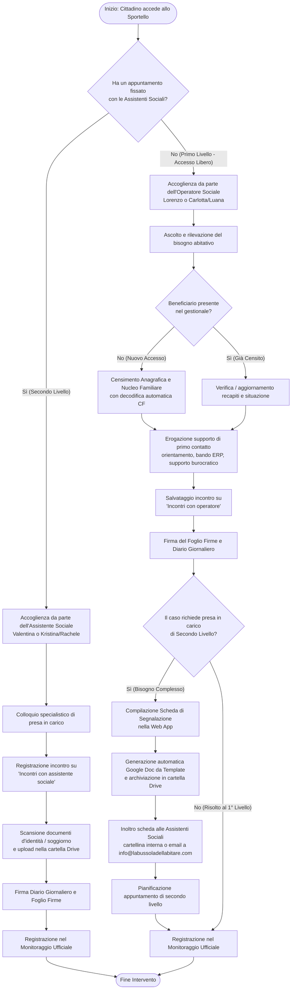
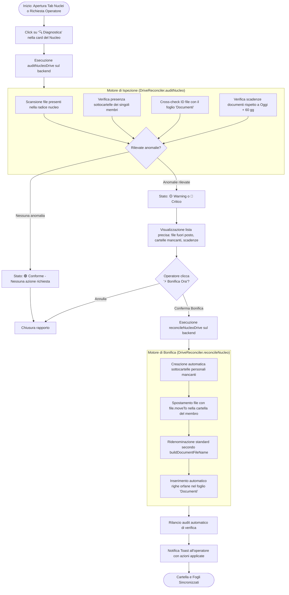

# Diagrammi UML di Attività (Activity Diagrams)

Documentazione dei processi operativi e dei flussi di lavoro (workflow) dello sportello sociale **"La Bussola dell'Abitare"** (Municipio XI di Roma - Azzurra84), conformi alle direttive illustrate in [`funzionamentoSportello.md`](file:///d:/Lorenzo/Public/#Work/Azzurra84/Bussola%20dell'Abitare/gas-webapp/docs/funzionamentoSportello.md) e [`automazione.md`](file:///d:/Lorenzo/Public/#Work/Azzurra84/Bussola%20dell'Abitare/gas-webapp/docs/automazione.md).

---

## 1. Attività 1: Processo di Accoglienza e Smistamento a Sportello

Rappresenta l'intero ciclo operativo che si innesca quando un cittadino accede fisicamente allo sportello, con biforcazione tra accesso libero (1° livello) e colloquio specialistico su appuntamento (2° livello).

---

## 2. Attività 2: Processo di Presa in Carico e Gestione del Fascicolo (Secondo Livello)

Descrive le attività svolte dalle assistenti sociali a partire dalla ricezione di una Scheda di Segnalazione proveniente dagli operatori interni o da servizi terzi (Municipio XI, associazioni di territorio).

---

## 3. Attività 3: Flusso delle Routine Ricorrenti (Giornaliera e Mensile)

Rappresenta le procedure periodiche di apertura/chiusura giornata e rendicontazione mensile previste dal capitolato del servizio.

---

## 4. Attività 4: Processo di Onboarding e Compilazione Rapida con Smart Document Intelligence (IA)

Descrive il flusso operatore supportato dall'Intelligenza Artificiale multimodale (`gemini-2.5-flash`) per l'estrazione batch, l'ottimizzazione client-side su Canvas, il popolamento istantaneo dell'anagrafica con normalizzazione Title Case e l'archiviazione automatica dei file su Google Drive e foglio `Documenti`.

```mermaid
flowchart TD
    Start([Inizio: Nuovo Beneficiario o Nucleo allo Sportello]) --> OpenModal[Operatore apre Modale 'Crea Nucleo' o 'Aggiungi / Modifica Membro']
    OpenModal --> Choice{L'operatore ha a disposizione<br/>uno o più documenti/foto?}
    
    %% Flusso Manuale
    Choice -- "No (Inserimento Manuale)" --> ManualInput[Digitazione manuale Codice Fiscale, Nome, Cognome, Dati Nascita]
    ManualInput --> DecodeCF[Decodifica deterministica automatica CF]
    
    %% Flusso con IA
    Choice -- "Sì (CIE, PdS, ISEE, Patente, TS)" --> DragDrop[Operatore trascina uno o più file nella dropzone IA ✨]
    DragDrop --> Compress[Compressione client-side su HTML5 Canvas<br/>max 1600px, JPEG 0.82 in <50ms]
    Compress --> CallGemini[Chiamata RPC: smartClassifyDocuments -> Gemini Flash 2.5]
    CallGemini --> BatchVision[Analisi multimodale unificata con Schema JSON forzato]
    BatchVision --> Normalize[Normalizzazione deterministica Title Case & Toponomastica<br/>es. D'Angelo, Reggio nell'Emilia PR]
    Normalize --> Autofill[Autocompilazione campi anagrafici, ISEE, residenza e bandierina]
    Autofill --> AddQueue[Aggiunta file al vassoio documenti pendenti con badge rimovibili]
    
    DecodeCF --> CheckData
    AddQueue --> CheckData[Operatore controlla a colpo d'occhio l'accuratezza dei dati]
    
    CheckData --> SignRequired{È richiesta l'acquisizione<br/>della firma autografa?}
    SignRequired -- "Sì" --> OpenCanvas[Apertura Canvas HTML5 W3C PointerEvents]
    OpenCanvas --> SignDraw[Beneficiario firma su schermo touch o penna stylus]
    SignDraw --> SaveSig[Salvataggio PNG trasparente nella cartella personale Drive]
    SaveSig --> SaveAction
    SignRequired -- "No / Già Acquisita" --> SaveAction
    
    SaveAction[Operatore clicca 'Salva Nucleo' o 'Salva Membro'] --> SaveRecord[Salvataggio record nel foglio 'Beneficiari' o 'Nuclei']
    SaveRecord --> UploadDrive[Salvataggio automatico file pendenti in Google Drive<br/>cartella nucleo o personale in base allo scope]
    UploadDrive --> SyncDoc[Censimento righe nel foglio relazionale 'Documenti']
    SyncDoc --> End([Fine Onboarding con Fascicolo Aggiornato])
```

---

## 5. Attività 5: Ciclo di Diagnostica, Bonifica e Riconciliazione File System Drive

Rappresenta il processo di auto-riparazione (Auto-Healing) con cui il sistema riconcilia i file caricati manualmente fuori dalle procedure standard.

