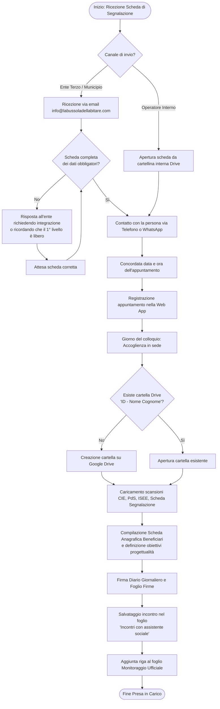
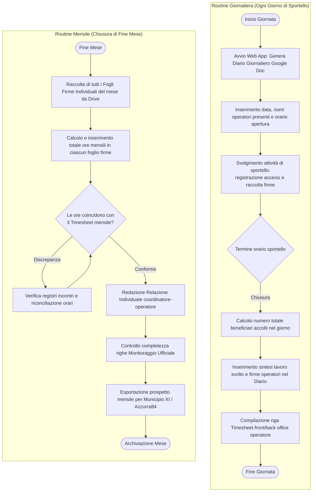
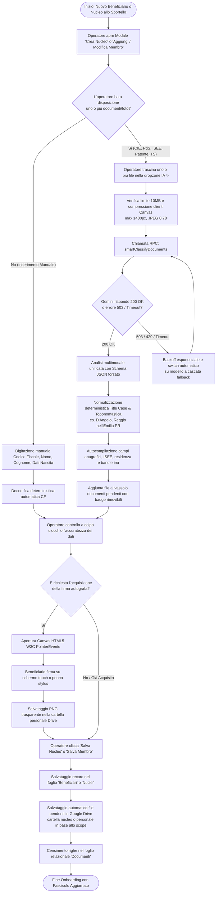
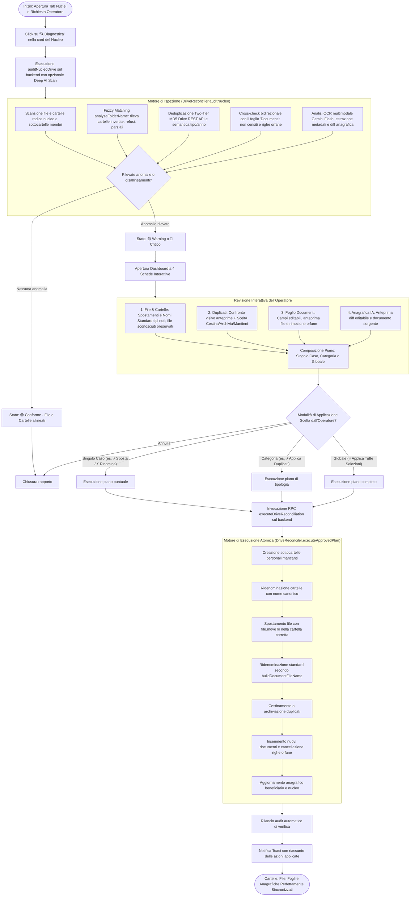
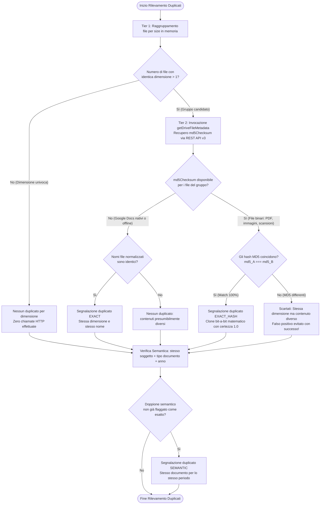
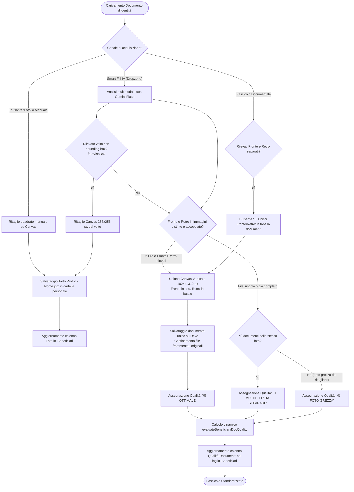

# Diagrammi UML di Attività (Activity Diagrams)

Documentazione dei processi operativi e dei flussi di lavoro (workflow) dello sportello sociale **"La Bussola dell'Abitare"** (Municipio XI di Roma - Azzurra84), conformi alle direttive illustrate in [`funzionamentoSportello.md`](file:///d:/Lorenzo/Public/#Work/Azzurra84/Bussola%20dell'Abitare/gas-webapp/docs/funzionamentoSportello.md) e [`automazione.md`](file:///d:/Lorenzo/Public/#Work/Azzurra84/Bussola%20dell'Abitare/gas-webapp/docs/automazione.md).

---

## 1. Attività 1: Processo di Accoglienza e Smistamento a Sportello

Rappresenta l'intero ciclo operativo che si innesca quando un cittadino accede fisicamente allo sportello, con biforcazione tra accesso libero (1° livello) e colloquio specialistico su appuntamento (2° livello).

---

## 2. Attività 2: Processo di Presa in Carico e Gestione del Fascicolo (Secondo Livello)

Descrive le attività svolte dalle assistenti sociali a partire dalla ricezione di una Scheda di Segnalazione proveniente dagli operatori interni o da servizi terzi (Municipio XI, associazioni di territorio).

---

## 3. Attività 3: Flusso delle Routine Ricorrenti (Giornaliera e Mensile)

Rappresenta le procedure periodiche di apertura/chiusura giornata e rendicontazione mensile previste dal capitolato del servizio.

---

## 4. Attività 4: Processo di Onboarding e Compilazione Rapida con Smart Document Intelligence (IA)

Descrive il flusso operatore supportato dall'Intelligenza Artificiale multimodale (`gemini-flash-latest`, con fallback su `gemini-flash-lite-latest` e `gemini-pro-latest`) per l'estrazione batch, l'ottimizzazione client-side su Canvas, il popolamento istantaneo dell'anagrafica con normalizzazione Title Case e l'archiviazione automatica dei file su Google Drive e foglio `Documenti`.

---

## 5. Attività 5: Ciclo di Diagnostica Avanzata, Bonifica e Riconciliazione Drive con IA

Rappresenta il processo di auto-riparazione (Auto-Healing) e riconciliazione controllata con cui il sistema analizza il file system Drive, rileva duplicati, corregge cartelle errate o invertite tramite fuzzy matching, sincronizza il foglio 'Documenti' e allinea l'anagrafica con Google Gemini Flash.

---

## 5. Attività 5: Algoritmo di Deduplicazione File Ibrido a Due Livelli (Two-Tier MD5 & Semantico)

Descrive la logica di deduplicazione a due livelli implementata in [`DriveReconciler.js`](file:///d:/Lorenzo/Public/#Work/Azzurra84/Bussola%20dell'Abitare/gas-webapp/src/Service/GDrive/DriveReconciler.js). La strategia combina velocità in memoria (Tier 1 su dimensione byte) con la precisione crittografica (Tier 2 su `md5Checksum` da Drive API v3) senza scaricare i blob dal cloud, azzerando i falsi positivi.

---

## 7. Attività 7: Processo di Discovery, Estrazione Multimodale IA e Importazione Controllata (Drive &rarr; Sheets)

Descrive il flusso decisionale e operativo con cui le cartelle presenti su Google Drive non ancora catalogate nei fogli di calcolo vengono scoperte, ispezionate con Google Gemini Flash multimodale, normalizzate secondo le regole grammaticali italiane e importate in modo sicuro e atomico.

```mermaid
flowchart TD
    Start([Operatore clicca 'Importa da Drive']) --> SelectMode{Attivare scansione profonda IA?<br/>deepAIScan}
    
    SelectMode -- "Sì" --> SetDeepAI[Flag deepAIScan = true]
    SelectMode -- "No" --> SetFastScan[Flag deepAIScan = false<br/>Solo nomi cartelle e metadati file]
    
    SetDeepAI --> ScanFolders[Scansione cartelle radice in CONFIG.FOLDER_BENEFICIARI_ROOT_ID]
    SetFastScan --> ScanFolders

    ScanFolders --> FilterSystem{Cartella di sistema o già catalogata?<br/>_Archivio, _Template o ID presente}
    FilterSystem -- "Sì" --> SkipFolder[Ignora cartella]
    FilterSystem -- "No" --> ParseFolder[Estrazione intestatario e componenti da sottocartelle]

    ParseFolder --> NormNames[Applicazione Title Case / Proper Case<br/>normalizeProperCase su intestatario e componenti]
    
    NormNames --> CheckAIScan{deepAIScan attivo?}
    CheckAIScan -- "Sì" --> InspectDocs[OCR Multimodale Gemini Flash su file di radice e sottocartelle]
    InspectDocs --> ExtractFullBio[Estrazione CF, data/luogo nascita, residenza, cittadinanza, ISEE, scadenze]
    ExtractFullBio --> NormGeo[Normalizzazione luoghi e indirizzi con normalizeCity e normalizeAddress]
    NormGeo --> RenderUI[Presentazione fascicoli nella modale interattiva]
    CheckAIScan -- "No" --> RenderUI

    RenderUI --> InitCheckboxes[Inizializzazione checkbox: tutte DESELEZIONATE per sicurezza]
    InitCheckboxes --> UserChoice{Modalità di importazione scelta}

    UserChoice -- "Click 'Importa' su singola riga" --> SingleImport[Isolamento record per data-folder-id<br/>Importazione immediata del solo fascicolo selezionato]
    UserChoice -- "Spunta caselle + 'Importa Selezionati'" --> BatchImport[Rilevamento delle sole righe spuntate manualmente]

    SingleImport --> StartLock[Acquisizione LockService.getScriptLock]
    BatchImport --> StartLock

    StartLock --> SaveNucleo[Inserimento/aggiornamento riga in 'Nuclei Familiari' con idCartella]
    SaveNucleo --> SaveMembers[Inserimento/collegamento beneficiari in 'Beneficiari' con anagrafica completa]
    SaveMembers --> SaveDocs[Inserimento file in 'Documenti' con ID Drive e scadenze]
    SaveDocs --> RenameDrive[Ridenominazione cartella Drive nel formato canonico '<ID> - <Nome Intestatario>']
    RenameDrive --> ReleaseLock[Rilascio LockService]

    ReleaseLock --> UpdateUI[Rimozione visiva delle righe importate dalla tabella e notifica Toast]
    UpdateUI --> End([Fine Importazione Fascicoli])
```

---

## 8. Attività 8: Standardizzazione Documenti, Ritaglio Avatar Canvas ed Unione Fronte/Retro

Rappresenta il flusso decisionale e operativo per garantire che ogni documento d'identità caricato nel sistema rispetti gli standard grafici: ritaglio automatico della fototessera per l'avatar del beneficiario, ricomposizione di Fronte e Retro su singola pagina verticale $1024 \times 1312$ px, e tracciamento qualitativo del fascicolo.

