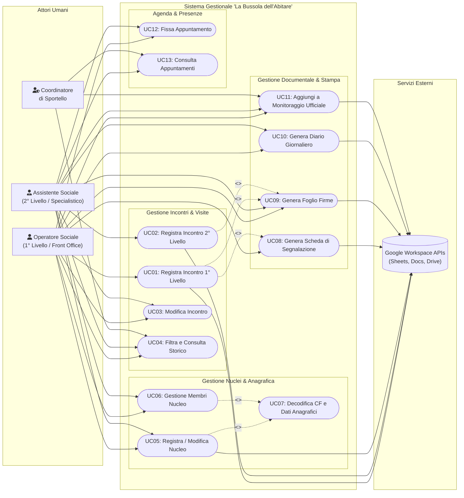

# Diagrammi UML dei Casi d'Uso (Use Case Diagrams)

Documentazione formale dei casi d'uso del software gestionale per lo sportello sociale **"La Bussola dell'Abitare"** (Municipio XI di Roma - Azzurra84).

---

## 1. Mappa Generale dei Casi d'Uso

Il sistema prevede quattro attori principali (umani e sistemici):
1. **Operatore Sociale (1° Livello - Front Office):** Gestisce l'accoglienza libera, l'ascolto dei bisogni, la registrazione dei colloqui di primo contatto e l'invio al secondo livello.
2. **Assistente Sociale (2° Livello - Specialistico):** Riceve su appuntamento, prende in carico i casi complessi, definisce i piani personalizzati e compila le anagrafiche approfondite.
3. **Coordinatore di Sportello:** Monitora l'andamento del servizio, verifica la conformità documentale e supervisiona il monitoraggio ministeriale/municipale.
4. **Google Workspace (Attore Sistemico / Backend):** Fornisce i servizi cloud per la persistenza tabellare (Sheets), la generazione di documenti (Docs) e l'archiviazione (Drive).

---

## 2. Descrizione Dettagliata dei Principali Casi d'Uso

### UC01: Registrazione Incontro di Primo Livello
- **Attore Primario:** Operatore Sociale.
- **Precondizioni:** L'operatore ha aperto la Web App o la Sidebar su Google Sheets e ha selezionato la scheda "Incontri & Visite".
- **Flusso Principale:**
  1. L'operatore inserisce il nome del beneficiario (avvalendosi dell'autocompletamento con codice fiscale).
  2. Seleziona il proprio nominativo dall'elenco degli operatori accreditati.
  3. Imposta la tipologia su "Primo Livello (Operatore)".
  4. Inserisce la data dell'incontro, l'orario di inizio e di fine.
  5. Seleziona l'attività svolta (es. accoglienza, orientamento, supporto burocratico) e digita la descrizione sintetica del colloquio.
  6. Valuta se il caso richiede invio al secondo livello (interruttore "Richiede Segnalazione").
  7. Invia il form.
  8. Il sistema valida i campi obbligatori, memorizza la riga nel foglio Google *"Incontri con operatore"* e aggiorna la tabella in tempo reale.
- **Estensioni (<<extend>>):**
  - Se "Richiede Segnalazione" è impostato su "Sì", il sistema abilita la compilazione e generazione contestuale della Scheda di Segnalazione (UC08).
- **Postcondizioni:** L'incontro è registrato nel foglio e disponibile per la rendicontazione oraria del Foglio Firme mensile.

---

### UC05: Registrazione / Modifica Nucleo Familiare
- **Attore Primario:** Operatore Sociale / Assistente Sociale.
- **Precondizioni:** Accesso alla scheda "Nuclei & Persone".
- **Flusso Principale:**
  1. L'utente inserisce il Codice Fiscale dell'intestatario della scheda.
  2. Il sistema esegue la decodifica istantanea del CF (UC07), ricavando sesso, data di nascita e comune/stato di nascita.
  3. L'utente compila i dati economici (valore ISEE), l'indirizzo di residenza e l'eventuale domicilio effettivo.
  4. Vengono descritti la problematica del caso, gli obiettivi di progettualità personalizzata, la tipologia di richiesta e la sistemazione abitativa attuale (da elenco tipizzato: locazione, casa rifugio, senza dimora, ecc.).
  5. Viene specificato il riferimento dei servizi sociali (assistente sociale) e del medico di base.
  6. In fase di invio:
     - Se è un **nuovo nucleo**: il sistema calcola automaticamente il prossimo ID progressivo numerico (`generateNextId`) e scrive la riga nel foglio *"Nuclei Familiari"*.
     - Se è una **modifica**: il sistema individua la riga dell'ID esistente e ne sovrascrive i campi.
- **Postcondizioni:** Il nucleo è memorizzato ed è possibile associarvi i singoli componenti familiari.

---

### UC07: Decodifica e Validazione Codice Fiscale
- **Attori:** Sistema (innescato dall'operatore durante l'inserimento).
- **Flusso Principale:**
  1. L'utente digita o incolla una stringa di 16 caratteri alfanumerici.
  2. Il sistema verifica la correttezza formale della sequenza tramite espressione regolare.
  3. Viene risolta l'eventuale omocodia sostituendo le lettere con i rispettivi numeri originari.
  4. Viene calcolato il carattere di controllo (CIN) mediante l'algoritmo ministeriale a pesi alternati (pari/dispari).
  5. Se valido, vengono estratti:
     - Giorno, mese e anno di nascita (con scarto secolare `> 40` per il genere femminile).
     - Genere ('M' o 'F').
     - Codice catastale Belfiore (4 caratteri) del comune o dello stato estero.
  6. Il sistema decodifica il nome del comune o stato estero consultando la cache interna (`CacheService`) o le tabelle catastali.
  7. I campi del form (data nascita, genere, comune) vengono popolati automaticamente.

---

### UC08: Generazione Scheda di Segnalazione
- **Attore Primario:** Operatore Sociale.
- **Precondizioni:** L'incontro evidenzia bisogni complessi da trasferire all'assistente sociale di secondo livello.
- **Flusso Principale:**
  1. L'operatore compila i recapiti dell'inviante, i dati del beneficiario e la sintesi del bisogno.
  2. Spunta le caselle relative alla presa in carico richiesta (es. iscrizione, emergenza abitativa, accompagnamento).
  3. Seleziona la firma digitale o allega la firma autografa.
  4. Il sistema recupera il template Google Docs configurato (`CONFIG.ID_TEMPLATESCHEDASEGNALAZIONE`) e ne crea una copia nella cartella dedicata su Drive.
  5. Vengono sostituiti tutti i segnaposto `{tag}`, spuntate le caselle `[x]` e incorporata l'immagine della firma.
  6. Il file viene rinominato secondo lo standard:  
     `Scheda segnalazione <ID_Nucleo> (<Nome Intestatario>) <- <Nome Inviante>`.
  7. L'operatore riceve il link per aprire il documento Google Docs o scaricare direttamente la versione PDF.

---

### UC09: Generazione Foglio Firme Individuale
- **Attore Primario:** Operatore Sociale / Assistente Sociale.
- **Precondizioni:** Sono stati registrati incontri tra un determinato operatore e un beneficiario nel corso del mese.
- **Flusso Principale:**
  1. L'utente seleziona l'operatore, il beneficiario e il mese/anno di riferimento (es. "2026-07").
  2. Il sistema cerca se esiste già un foglio firme per la terna specificata su Google Drive.
  3. Se non esiste:
     - Duplica il template Google Docs (`CONFIG.FOGLIFIRME.TEMPLATE_ID`) nella cartella preposta.
     - Assegna al file il nome standard `AAAA-MM Nome Beneficiario (Nome Operatore)`.
     - Imposta le proprietà personalizzate di Drive per consentire la successiva ricerca rapida.
     - Sostituisce i segnaposto di testata (`{data}`, `{operatore}`, `{cliente}`).
  4. L'utente ottiene il link diretto al documento per la firma e la stampa.

---

### UC11: Aggiunta Riga al Monitoraggio Ufficiale
- **Attori:** Operatore Sociale / Assistente Sociale / Coordinatore.
- **Precondizioni:** È avvenuto un accesso allo sportello con presa in carico.
- **Flusso Principale:**
  1. L'operatore seleziona l'incontro o inserisce operatore e beneficiario.
  2. Il sistema cerca la corrispondenza anagrafica dell'operatore nel foglio *"Operatori"* per estrarne qualifica, ruolo e tipologia.
  3. Cerca il beneficiario nel foglio *"Beneficiari"* tramite Codice Fiscale, ricavando sesso, cittadinanza, condizione occupazionale e titolo di studio.
  4. Calcola l'età anagrafica esatta alla data corrente.
  5. Accoda una riga strutturata nel foglio *"Monitoraggio Ufficiale"* (o *"MONITORAGGIO UFFICIALE ACCESSI GIORNALIERI"*), valorizzando anche i parametri costanti di progetto (Municipio XI, Annualità QSFP, CIG, Titolo Progetto).
