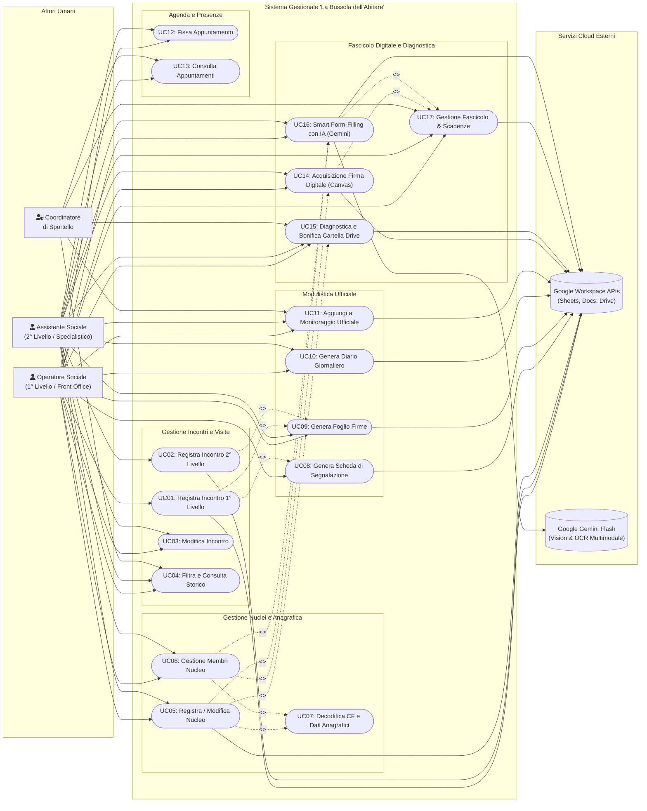

# Diagrammi UML dei Casi d'Uso (Use Case Diagrams)

Documentazione formale dei casi d'uso del software gestionale per lo sportello sociale **"La Bussola dell'Abitare"** (Municipio XI di Roma - Azzurra84).

---

## 1. Mappa Generale dei Casi d'Uso

Il sistema prevede quattro attori principali (umani e sistemici):
1. **Operatore Sociale (1° Livello - Front Office):** Gestisce l'accoglienza libera, l'ascolto dei bisogni, la registrazione dei colloqui di primo contatto, l'acquisizione della firma e l'invio al secondo livello.
2. **Assistente Sociale (2° Livello - Specialistico):** Riceve su appuntamento, prende in carico i casi complessi, definisce i piani personalizzati, gestisce il fascicolo documentale e verifica le scadenze.
3. **Coordinatore di Sportello:** Monitora l'andamento del servizio, verifica la conformità documentale, supervisiona la bonifica Drive e il monitoraggio ministeriale/municipale.
4. **Google Workspace & Google Gemini (Attori Sistemici / Backend):** Forniscono i servizi cloud per la persistenza tabellare (Sheets), la generazione di documenti (Docs), l'archiviazione gerarchica (Drive) e la Computer Vision multimodale con IA (Gemini Flash).

---

## 2. Descrizione Dettagliata dei Casi d'Uso

### UC01: Registrazione Incontro di Primo Livello
- **Attore Primario:** Operatore Sociale.
- **Flusso:** L'operatore inserisce beneficiario, data, orari e bisogni rilevati. Se il caso richiede supporto specialistico, attiva il flag di segnalazione al secondo livello.

### UC05: Registrazione e Modifica Nucleo Familiare
- **Attori:** Operatore Sociale, Assistente Sociale.
- **Flusso:** Gestione in modalità Dual-Mode: creazione atomica di nuovo nucleo e intestatario con Script Lock oppure associazione a un beneficiario già registrato. Assegna l'ID progressivo incrementale e individua o crea la cartella Google Drive `<id> - <Intestatario>`.

### UC14: Acquisizione Firma Digitale Beneficiario (Canvas HTML5)
- **Attori:** Beneficiario (firmatario), Operatore Sociale / Assistente Sociale.
- **Precondizioni:** L'operatore apre la modale di firma per il beneficiario.
- **Flusso Principale:**
  1. Il cittadino appone la propria firma sul Canvas interattivo (utilizzando dita su touchscreen, mouse o penna stylus).
  2. L'operatore clicca su "Salva Firma nel Drive".
  3. Il sistema converte il canvas in PNG trasparente, rimuove eventuali vecchie firme dalla sottocartella personale del membro in Drive e carica il nuovo file `Firma [Nome] [Cognome].png`.
  4. L'ID file viene salvato nella colonna `Firma` di `Beneficiari` e contestualmente registrato nel foglio `Documenti` (archetipo `UNICO`).
  5. La firma salvata diventa immediatamente disponibile per i template di Foglio Firme e Diario.

### UC15: Diagnostica Avanzata e Riconciliazione Interattiva Drive con IA (Drive Reconciler)
- **Attori:** Operatore Sociale, Assistente Sociale, Coordinatore, Google Gemini Flash.
- **Flusso Principale:**
  1. L'operatore apre la card di un nucleo e clicca su `🔍 Diagnostica` (con opzione per attivare l'Analisi IA Gemini Flash).
  2. Il sistema esamina la cartella Drive del nucleo e le sottocartelle dei singoli membri, identificando cartelle invertite (`Cognome Nome`), refusi, file fuori posto nella radice nucleo (`MISPLACED_FILE`), sottocartelle mancanti, file non standard, duplicati (esatti per dimensione/hash o semantici per periodo) e righe orfane nel foglio `Documenti`.
  3. L'operatore visualizza una dashboard a 4 schede interattive (File/Cartelle, Duplicati, Foglio Documenti, Anagrafica IA).
  4. L'operatore personalizza le azioni: sceglie il destino dei duplicati (cestina, archivia, mantieni), ritocca eventuali nomi file o campi di censimento, ed esamina l'anteprima diff dei dati anagrafici estratti da Gemini Flash (CF, luogo nascita con provincia, ISEE).
  5. L'operatore clicca su `⚡ Applica Azioni Selezionate (N)`.
  6. Il motore `DriveReconciler.executeApprovedPlan` esegue in modo atomico le sole azioni approvate: crea cartelle, rinomina con `folder.setName`, sposta con `file.moveTo`, cestina con `file.setTrashed(true)`, inserisce nuovi record in `Documenti`, rimuove righe orfane e aggiorna i fogli `Beneficiari` e `Nuclei Familiari`.

### UC16: Smart Form-Filling Multi-File da Documento con IA (Google Gemini Flash)
- **Attori:** Operatore Sociale, Assistente Sociale.
- **Flusso Principale:**
  1. In fase di creazione del nucleo (`UC05`) o compilazione della scheda beneficiario (`UC06`), l'operatore trascina una o più foto o scansioni PDF (es. CIE fronte e retro, ISEE, Tessera Sanitaria) nella dropzone con icona ✨.
  2. Il frontend ottimizza istantaneamente le immagini tramite HTML5 Canvas (`optimizeFileForUpload`), ridimensionandole a un massimo di 1600px con qualità JPEG 0.82 (riducendo le dimensioni da ~12 MB a ~300 KB in meno di 50 ms).
  3. Il frontend converte i file in Base64 e invoca `smartClassifyDocuments` via RPC.
  4. Il backend effettua una singola chiamata multimodale batch a `gemini-2.5-flash` forzando lo schema JSON strutturato e applicando la normalizzazione deterministica Title Case (iniziale maiuscola per nome, cognome e comune di nascita, sigla provincia in maiuscolo, es. `Reggio nell'Emilia (RE)`).
  5. I campi anagrafici, la residenza, l'ISEE e la bandierina della cittadinanza si autocompilano in 1-2 secondi.
  6. I documenti analizzati vengono mostrati in un vassoio di anteprima con badge rimovibili (`pendingDocs`).
  7. Al salvataggio della scheda, i file fisici vengono archiviati su Google Drive (nella cartella nucleo o personale in base allo scope) tramite `DriveManager.saveDocumentFile` e registrati automaticamente nel foglio `Documenti`. Vengono definitivamente superate le vecchie caselle di spunta manuali.

### UC17: Gestione Fascicolo Documentale e Tracciamento Scadenze
- **Attori:** Operatore Sociale, Assistente Sociale, Coordinatore.
- **Flusso Principale:**
  1. L'operatore consulta la scheda del beneficiario o la tabella generale in `tab-documenti`.
  2. Il sistema calcola dinamicamente lo stato di validità semaforico (🔴 Scaduto, 🟡 In Scadenza entro 60 gg, 🟢 Valido, ⚪ Permanente).
  3. L'operatore registra nuovi documenti o aggiorna quelli esistenti con importi economici in € (ISEE, affitto) e date di rilascio/scadenza.
  4. Il sistema assegna l'ID progressivo numerico da 1 e mantiene il fascicolo perfettamente sincronizzato con Google Drive.
