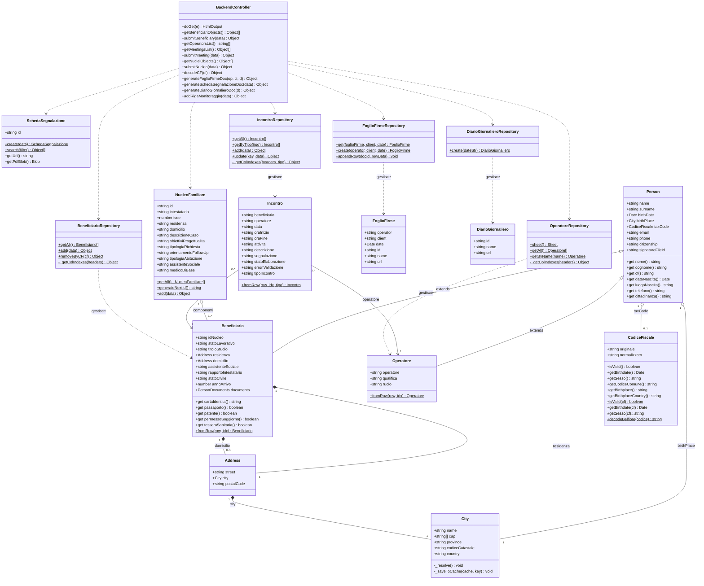

# Diagramma UML delle Classi (Class Diagram)

Documentazione dell'architettura Object-Oriented (OOP) del sistema **"La Bussola dell'Abitare"**, organizzata secondo il pattern **MVC (Model-View-Controller)** e **Repository Pattern**.

---

## 1. Diagramma Generale delle Classi

---

## 2. Descrizione Dettagliata dei Modelli

### 2.1 Modello `Person` e Gerarchia di Ereditarietà
- **[`Person`](file:///d:/Lorenzo/Public/#Work/Azzurra84/Bussola%20dell'Abitare/gas-webapp/src/Models/Person/0_Person.js):** Modello base astratto per qualsiasi persona fisica trattata dallo sportello. Raccoglie gli attributi anagrafici essenziali (nome, cognome, data e comune di nascita, codice fiscale, contatti telefonici ed e-mail, cittadinanza e ID Drive della firma autografa digitalizzata). Fornisce proprietà alias con getter in lingua italiana (`nome`, `cognome`, `cf`, `dataNascita`, `luogoNascita`) per mantenere la piena retrocompatibilità con i vecchi script.
- **[`Beneficiario`](file:///d:/Lorenzo/Public/#Work/Azzurra84/Bussola%20dell'Abitare/gas-webapp/src/Models/Person/Beneficiari/Beneficiario.js):** Estende `Person` aggiungendo i metadati di presa in carico: ID del nucleo familiare di appartenenza, stato occupazionale (`WorkStatus`), titolo di studio (`ISCED`/`EQF`), indirizzo di residenza e di domicilio effettivo (modellate con la classe `Address`), ente o assistente sociale di riferimento, grado di parentela rispetto all'intestatario (`Relations`) e l'oggetto strutturato `documents` contenente la disponibilità dei titoli di identità e soggiorno (carta d'identità, passaporto, patente, permesso di soggiorno, tessera sanitaria).
- **[`Operatore`](file:///d:/Lorenzo/Public/#Work/Azzurra84/Bussola%20dell'Abitare/gas-webapp/src/Models/Person/Operatori/Operatore.js):** Estende `Person` aggiungendo la qualifica professionale (es. "Operatore Sociale", "Assistente Sociale"), il ruolo operativo assegnato (es. "Accoglienza", "Front Office", "Secondo Livello") e la sigla operatore. Include il metodo factory statico `fromRow(row, idx)` per l'idratazione istantanea da Google Sheets.

---

### 2.2 Value Objects e Componenti Geografici
- **[`CodiceFiscale`](file:///d:/Lorenzo/Public/#Work/Azzurra84/Bussola%20dell'Abitare/gas-webapp/src/Models/CodiceFiscale.js):** Incapsula la logica deterministica del Codice Fiscale italiano secondo il D.M. 23/12/1976.
  - Implementa la normalizzazione delle omocodie (`_decodificaOmocodia`) sostituendo le lettere con le cifre originali nelle posizioni numeriche.
  - Calcola il carattere di controllo CIN (`_calcolaCarattereControllo`) sommando i valori ponderati per le posizioni pari e dispari.
  - Decodifica il comune o stato estero di nascita interrogando i codici Belfiore (H501 per Roma, Z112 per Romania, ecc.) con caching locale su `CacheService`.
- **[`City`](file:///d:/Lorenzo/Public/#Work/Azzurra84/Bussola%20dell'Abitare/gas-webapp/src/Models/Places/0_City.js):** Rappresenta un'entità geografica. Tramite cache e chiamate a servizi pubblici (comuni-json e OpenStreetMap Nominatim), risolve provincia, lista dei CAP ammessi, codice catastale e nazione.
- **[`Address`](file:///d:/Lorenzo/Public/#Work/Azzurra84/Bussola%20dell'Abitare/gas-webapp/src/Models/Places/Address.js):** Associa via e civico (`street`) all'oggetto `City` e al `postalCode` (CAP).

---

### 2.3 Nucleo Familiare e Incontri
- **[`NucleoFamiliare`](file:///d:/Lorenzo/Public/#Work/Azzurra84/Bussola%20dell'Abitare/gas-webapp/src/Models/Nucleo/NucleoFamiliare.js):** Rappresenta l'unità di convivenza e progettualità assistita.
  - Genera l'ID numerico incrementale (`generateNextId()`) verificando il massimo valore attualmente presente nel foglio Google.
  - Memorizza le dimensioni socio-economiche (valore ISEE con 2 decimali, descrizione anamnestica del caso, obiettivi d'intervento, bisogni prioritari, sistemazione abitativa, medico di base e servizio sociale).
- **[`Incontro`](file:///d:/Lorenzo/Public/#Work/Azzurra84/Bussola%20dell'Abitare/gas-webapp/src/Models/Meeting/Incontro.js):** Traccia ogni singolo colloquio o accesso a sportello, memorizzando beneficiario, operatore, data, intervallo orario (`oraInizio` e `oraFine`), tipologia di attività, esito, stato di elaborazione ed eventuale flag di segnalazione al secondo livello.

---

### 2.4 Repository Layer (Persistenza e Isolamento Fogli)
I Repository incapsulano le letture e scritture verso i fogli Google e Google Drive, isolando la complessità delle API di Apps Script (`SpreadsheetApp`, `DriveApp`, `DocumentApp`).
- **`BeneficiarioRepository`:** Mappa le righe del foglio "Beneficiari", gestisce l'aggiornamento e la cancellazione per CF con verifica di unicità.
- **`OperatoreRepository`:** Fornisce la lista degli operatori e la ricerca per nominativo.
- **`IncontroRepository`:** Gestisce la persistenza separata nei due fogli "Incontri con operatore" (1° livello) e "Incontri con assistente sociale" (2° livello), supportando anche l'aggiornamento di righe esistenti.
- **`FoglioFirmeRepository` / `DiarioGiornalieroRepository` / `SchedaSegnalazione`:** Coordinano la duplicazione dei template Google Docs, la sostituzione dei segnaposto e l'archiviazione organizzata nelle cartelle Google Drive.
