# Diagramma UML delle Classi (Class Diagram)

Documentazione dell'architettura Object-Oriented (OOP) del sistema **"La Bussola dell'Abitare"**, organizzata secondo i pattern **MVC (Model-View-Controller)**, **Repository Pattern** e **Domain-Driven Design (DDD)**.

---

## 1. Diagramma Generale delle Classi

```mermaid
classDiagram
    direction TB

    %% =========================================================================
    %% DOMAIN LAYER (SINGLE SOURCE OF TRUTH)
    %% =========================================================================
    class Countries {
        <<SSOT Domain>>
        +CountryRecord[] Countries
        +CountryRecord[] CountryByName
        +CountryRecord[] CountryByISO
        +CountryRecord[] CountryByPhone
        +findCountry(query)$ CountryRecord
        +findCountryByPhone(phone)$ CountryRecord
        +normalizeCountryName(name)$ string
        +filterCountries(query)$ CountryRecord[]
    }

    class DocumentsCatalog {
        <<SSOT Domain>>
        +DocumentRecord[] Documents
        +DocumentRecord[] DocumentById
        +DocumentRecord[] DocumentByName
        +findDocumentType(query)$ DocumentRecord
        +buildDocumentFileName(doc, persona, ext)$ string
        +getDocumentCategories()$ string[]
        +getDocumentsByCategory(categoria)$ DocumentRecord[]
    }

    class EducationCatalog {
        <<SSOT Domain>>
        +string[] TitoliStudio
        +ISCED ISCED
        +EQF EQF
        +LISTA_TITOLI_STUDIO()$ string[][]
    }

    %% =========================================================================
    %% MODELLO PERSONA ED EREDITARIETÀ
    %% =========================================================================
    class Person {
        <<abstract>>
        +string name
        +string surname
        +Date birthDate
        +City birthPlace
        +CodiceFiscale taxCode
        +string email
        +string phone
        +string citizenship
        +string signatureFileId
        +get nome() string
        +get cognome() string
        +get cf() string
        +get dataNascita() Date
        +get luogoNascita() string
        +get telefono() string
        +get cittadinanza() string
    }

    class Beneficiario {
        +string idNucleo
        +string statoLavorativo
        +string titoloStudio
        +Address residenza
        +Address domicilio
        +string assistenteSociale
        +string rapportoIntestatario
        +string statoCivile
        +number annoArrivo
        +string idCartella
        +string firma
        +PersonDocuments documents
        +get cartaIdentita() string
        +get passaporto() boolean
        +get patente() boolean
        +get permessoSoggiorno() boolean
        +get tesseraSanitaria() boolean
        +fromRow(row, idx)$ Beneficiario
    }

    class Operatore {
        +string operatore
        +string qualifica
        +string ruolo
        +string email
        +fromRow(row, idx)$ Operatore
    }

    Person <|-- Beneficiario : extends
    Person <|-- Operatore : extends
    Beneficiario --> Countries : citizenship

    %% =========================================================================
    %% VALUE OBJECTS E GEOGRAFIA
    %% =========================================================================
    class CodiceFiscale {
        +string originale
        +string normalizzato
        +isValid() boolean
        +getBirthdate() Date
        +getSesso() string
        +getCodiceComune() string
        +getBirthplace() string
        +getBirthplaceCountry() string
        +isValid(cf)$ boolean
        +getBirthdate(cf)$ Date
        +getSesso(cf)$ string
        +decodeBelfiore(codice)$ string
    }

    class City {
        +string name
        +string[] cap
        +string province
        +string codiceCatastale
        +string country
        -_resolve() void
        -_saveToCache(cache, key) void
    }

    class Address {
        +string street
        +City city
        +string postalCode
    }

    Person "1" o-- "0..1" CodiceFiscale : taxCode
    Person "1" o-- "1" City : birthPlace
    Address "1" *-- "1" City : city
    Beneficiario "1" *-- "1" Address : residenza
    Beneficiario "1" *-- "0..1" Address : domicilio

    %% =========================================================================
    %% NUCLEO FAMILIARE E FASCICOLO DOCUMENTALE
    %% =========================================================================
    class NucleoFamiliare {
        +string id
        +string intestatario
        +number isee
        +string residenza
        +string domicilio
        +string descrizioneCaso
        +string obiettiviProgettualita
        +string tipologiaRichiesta
        +string orientamentoFollowUp
        +string tipologiaAbitazione
        +string assistenteSociale
        +string medicoDiBase
        +string[] serviziDaAttivare
        +string idCartella
        +getAll()$ NucleoFamiliare[]
        +generateNextId()$ string
        +add(data)$ Object
        +updateDriveInfo(id, updates)$ void
    }

    class Documento {
        +number id
        +string intestatario
        +string tipo
        +string categoria
        +number valore
        +string dataEmissione
        +string dataScadenza
        +string idDrive
        +string note
        +string dataInserimento
        +getStatoScadenza(refDate)$ DocumentoStatoScadenza
        +getGiorniAllaScadenza(refDate)$ number
        +getUrlDrive()$ string
        +getDocRecord()$ DocumentRecord
        +toObject()$ Object
        +fromRow(row, idx)$ Documento
    }

    NucleoFamiliare "1" o-- "0..*" Beneficiario : componenti
    Beneficiario "1" -- "0..*" Documento : intestatario (CF)
    Documento --> DocumentsCatalog : tipo/archetipo

    %% =========================================================================
    %% INCONTRI E MODULISTICA GOOGLE DOCS
    %% =========================================================================
    class Incontro {
        +string beneficiario
        +string operatore
        +string data
        +string oraInizio
        +string oraFine
        +string attivita
        +string descrizione
        +string segnalazione
        +string statoElaborazione
        +string erroriValidazione
        +string tipoIncontro
        +fromRow(row, idx, tipo)$ Incontro
    }

    class FoglioFirme {
        +string operator
        +string client
        +Date date
        +string id
        +string name
        +string url
    }

    class DiarioGiornaliero {
        +string id
        +string name
        +string url
    }

    class SchedaSegnalazione {
        +string id
        +create(data)$ SchedaSegnalazione
        +search(filter)$ Object[]
        +getUrl() string
        +getPdfBlob() Blob
    }

    Incontro "0..*" --> "1" Beneficiario : beneficiario
    Incontro "0..*" --> "1" Operatore : operatore

    %% =========================================================================
    %% REPOSITORY LAYER (PERSISTENZA)
    %% =========================================================================
    class BeneficiarioRepository {
        +getAll()$ Beneficiario[]
        +add(data)$ Object
        +removeByCF(cf)$ Object
        +updateDriveInfo(cf, updates)$ void
        -_getColIndexes(headers)$ Object
    }

    class DocumentoRepository {
        +getSheet()$ Sheet
        +generateNextId()$ number
        +getAll()$ Documento[]
        +getByCF(cf)$ Documento[]
        +getById(id)$ Documento
        +add(data)$ Object
        +removeById(id)$ Object
        +removeByDriveId(driveId)$ Object
        +getScadenzeCritiche(days)$ Documento[]
        -_getColIndexes(headers)$ Object
    }

    class OperatoreRepository {
        +sheet()$ Sheet
        +getAll()$ Operatore[]
        +getByName(name)$ Operatore
        -_getColIndexes(headers)$ Object
    }

    class IncontroRepository {
        +getAll()$ Incontro[]
        +getByTipo(tipo)$ Incontro[]
        +add(data)$ Object
        +update(key, data)$ Object
        -_getColIndexes(headers, tipo)$ Object
    }

    class LookupRepository {
        +CACHE_KEY$ string
        +CACHE_TTL$ number
        +getAll(forceRefresh)$ Object
        +getDefaults()$ Object
        +clearCache()$ void
    }

    BeneficiarioRepository ..> Beneficiario : gestisce
    DocumentoRepository ..> Documento : gestisce
    OperatoreRepository ..> Operatore : gestisce
    IncontroRepository ..> Incontro : gestisce

    %% =========================================================================
    %% SERVICE LAYER (DRIVE, IA, BONIFICA)
    %% =========================================================================
    class DriveManager {
        +getOrCreateNucleoFolder(id, name)$ Object
        +getOrCreateBeneficiarioFolder(cf)$ Object
        +saveBeneficiarySignature(cf, base64)$ Object
        +saveDocumentFile(cf, docPayload, nucleoId)$ Object
        +scanBeneficiarioDocuments(cf)$ Object
        +scanNucleoDocuments(id)$ Object
    }

    class DriveReconciler {
        +getDriveFileMetadata(fileId, cache)$ Object
        +auditNucleo(nucleoId, options)$ NucleoAuditReport
        +inspectFileWithAI(fileId)$ Object
        +executeApprovedPlan(nucleoId, approvedPlan)$ Object
        +reconcileNucleo(nucleoId, options)$ Object
        +auditArchive()$ Object
    }

    class DocumentIntelligence {
        +isAvailable()$ boolean
        +analyzeBlob(blob)$ Object
        +analyzeBlobs(blobs)$ Object
        +smartClassifyBase64(base64, mime, name)$ Object
        +smartClassifyMultipleBase64(filesArray)$ Object
    }

    class DataIntegrityService {
        +auditBeneficiari(options)$ Object
        +autoHeal(selectedIssueIds, options)$ Object
        -_getBenColIndexes(headers)$ Object
    }

    class DomainSyncService {
        +KEYS$ Object
        +SHEETS$ Object
        +saveTwoTier(key, value)$ void
        +getTwoTier(key)$ string
        +syncBeneficiari(ss)$ Object
        +syncDocumenti(ss)$ Object[]
        +syncSportelli(ss)$ Object
        +syncOperatori(ss)$ Object[]
        +syncOrari(ss)$ Object[]
        +syncBundle(ben, doc, spo)$ Object
        +syncAllLookupsToProperties()$ Object
        +autoAdjustNamedRange(sheet, name, col)$ void
        +handleEdit(e)$ void
    }

    DriveReconciler ..> DriveManager : sposta/crea
    DriveReconciler ..> DocumentoRepository : censisce
    DriveReconciler ..> DocumentIntelligence : OCR/Vision
    DriveManager ..> DocumentoRepository : registra firma e documenti
    DataIntegrityService ..> BeneficiarioRepository : verifica dati
    DataIntegrityService ..> NucleoFamiliare : verifica relazioni

    %% =========================================================================
    %% CONTROLLER
    %% =========================================================================
    class BackendController {
        +doGet(e) HtmlOutput
        +getInitialAppData(forceRefresh) Object
        +submitBeneficiary(data) Object
        +removeBeneficiary(cf) Object
        +submitNucleoCompleto(payload) Object
        +getDocumentiObjects(cf) Object[]
        +submitDocumento(data) Object
        +removeDocumento(id) Object
        +saveBeneficiarySignature(cf, base64) Object
        +auditNucleoDrive(nucleoId) Object
        +reconcileNucleoDrive(nucleoId, options) Object
        +smartClassifyDocument(base64, mime, name) Object
        +smartClassifyDocuments(filesArray) Object
        +checkGeminiStatus() Object
        +pingBackend() Object
    }

    class DebugManager {
        <<Frontend Singleton>>
        +boolean isEnabled
        +boolean showTechIds
        +boolean isHUDOpen
        +string currentTab
        +DebugLog[] logs
        +DebugStats stats
        +init() void
        +toggle(forceState) void
        +toggleTechIds(forceState) void
        +toggleHUD(forceState) void
        +switchTab(tabName) void
        +installRPCInterceptor() void
        +log(category, summary, details, level, latency) void
        +logAI(type, details) void
        +logCanvasCompression(originalBytes, compressedBytes, durationMs) void
        +pingServer() Promise
        +copyDiagnosticsReport() void
        +clearLogs() void
    }

    BackendController ..> BeneficiarioRepository
    BackendController ..> DocumentoRepository
    BackendController ..> OperatoreRepository
    BackendController ..> IncontroRepository
    BackendController ..> NucleoFamiliare
    BackendController ..> DriveManager
    BackendController ..> DriveReconciler
    BackendController ..> DocumentIntelligence
    BackendController ..> LookupRepository
    DebugManager ..> BackendController : RPC proxy & ping
```

---

## 2. Descrizione Dettagliata dei Modelli

### 2.1 Catalogo di Dominio (SSOT)
- **[`Countries`](file:///d:/Lorenzo/Public/#Work/Azzurra84/Bussola%20dell'Abitare/gas-webapp/src/Domain/country.js):** Catalogo immutabile di 196 nazioni che unifica denominazioni italiane, cittadinanze al singolare, codici ISO a due lettere, prefissi telefonici internazionali e bandiere emoji/SVG.
- **[`DocumentsCatalog`](file:///d:/Lorenzo/Public/#Work/Azzurra84/Bussola%20dell'Abitare/gas-webapp/src/Domain/documents.js):** Catalogo immutabile di 20 tipologie documentali con 5 archetipi temporali (`SCADENZA`, `ANNUALE`, `PERIODICO`, `CONTRATTO`, `UNICO`), regex di matching, scope (*persona*, *nucleo*, *entrambi*) e naming engine `buildDocumentFileName`.

---

### 2.2 Modello `Person` e Gerarchia di Ereditarietà
- **[`Person`](file:///d:/Lorenzo/Public/#Work/Azzurra84/Bussola%20dell'Abitare/gas-webapp/src/Models/Person/0_Person.js):** Modello base astratto per qualsiasi persona fisica. Gestisce anagrafica universale (nome, cognome, data di nascita, codice fiscale, contatti, cittadinanza e firma).
- **[`Beneficiario`](file:///d:/Lorenzo/Public/#Work/Azzurra84/Bussola%20dell'Abitare/gas-webapp/src/Models/Person/Beneficiari/Beneficiario.js):** Estende `Person` aggiungendo ID nucleo, stato occupazionale, titolo di studio, residenza/domicilio, presa in carico dei servizi sociali, parentela con l'intestatario, stato civile, anno arrivo in Italia, `idCartella` personale Drive e ID file `firma`.
- **[`Operatore`](file:///d:/Lorenzo/Public/#Work/Azzurra84/Bussola%20dell'Abitare/gas-webapp/src/Models/Person/Operatori/Operatore.js):** Estende `Person` aggiungendo qualifica professionale, ruolo operativo e sigla.

---

### 2.3 Nucleo Familiare, Fascicolo e Incontri
- **[`NucleoFamiliare`](file:///d:/Lorenzo/Public/#Work/Azzurra84/Bussola%20dell'Abitare/gas-webapp/src/Models/Nucleo/NucleoFamiliare.js):** Rappresenta il nucleo assistito. Gestisce l'ID incrementale (`generateNextId()`), l'intestatario, l'ISEE del nucleo, le dimensioni socio-abitative e l'`idCartella` su Google Drive.
- **[`Documento`](file:///d:/Lorenzo/Public/#Work/Azzurra84/Bussola%20dell'Abitare/gas-webapp/src/Models/Documenti/Documento.js):** Rappresenta il singolo documento registrato nel fascicolo relazionale sul foglio **`Documenti`**. Calcola lo stato di validità semaforico (`SCADUTO`, `IN_SCADENZA`, `VALIDO`, `PERMANENTE`), i giorni residui alla scadenza e gestisce valori numerici in € (ISEE, affitto).
- **[`Incontro`](file:///d:/Lorenzo/Public/#Work/Azzurra84/Bussola%20dell'Abitare/gas-webapp/src/Models/Meeting/Incontro.js):** Modella i colloqui di 1° livello (operatore) e 2° livello (assistente sociale), con orari, attività, segnalazione e note.

---

### 2.4 Service Layer (Drive, Bonifica e IA)
- **[`DriveManager`](file:///d:/Lorenzo/Public/#Work/Azzurra84/Bussola%20dell'Abitare/gas-webapp/src/Service/GDrive/DriveManager.js):** Gestisce l'alberatura delle cartelle (`<id> - <Intestatario>` e sottocartelle `<Nome Cognome>`), l'archiviazione di firme autografe PNG trasparenti, l'archiviazione automatica di file documentali con naming standard e la scansione in tempo reale dei file con metadati.
- **[`DriveReconciler`](file:///d:/Lorenzo/Public/#Work/Azzurra84/Bussola%20dell'Abitare/gas-webapp/src/Service/GDrive/DriveReconciler.js):** Motore avanzato di diagnostica e riconciliazione automatica e interattiva: individua cartelle invertite (`Cognome Nome`) o con refusi tramite fuzzy matching, file fuori posto nella radice nucleo, cartelle mancanti, file non standard, duplicati esatti/semantici e righe orfane nel foglio `Documenti`. Con l'ausilio di Gemini Flash (`DocumentIntelligence`), esegue l'ispezione OCR semantica e genera la tabella diff per allineare i dati anagrafici di beneficiari e nuclei.
- **[`DocumentIntelligence`](file:///d:/Lorenzo/Public/#Work/Azzurra84/Bussola%20dell'Abitare/gas-webapp/src/Service/Document/DocumentIntelligence.js):** Servizio di Computer Vision e OCR multimodale basato su Google Gemini (`gemini-flash-latest`, con fallback su `gemini-flash-lite-latest` e `gemini-pro-latest`) con supporto multi-file, schema JSON vincolato e normalizzazione deterministica Title Case per autocompilare istantaneamente anagrafiche e nuclei.
- **[`DataIntegrityService`](file:///d:/Lorenzo/Public/#Work/Azzurra84/Bussola%20dell'Abitare/gas-webapp/src/Service/Validation/DataIntegrityService.js):** Motore di integrità relazionale e Auto-Healing: verifica l'unicità del caponucleo, rileva beneficiari orfani, cartelle Drive mancanti o duplicate e conflitti anagrafici/CF, offrendo la correzione puntuale o l'Auto-Healing in blocco.

---

### 2.5 Repository Layer (Persistenza e Isolamento)
- **`BeneficiarioRepository`:** Persistenza su foglio `Beneficiari`.
- **`DocumentoRepository`:** Persistenza su foglio relazionale `Documenti`, auto-increment progressivo `generateNextId()` da 1, gestione scadenze critiche.
- **`IncontroRepository`:** Persistenza su `Incontri con operatore` e `Incontri con assistente sociale`.
- **`OperatoreRepository`:** Anagrafica del personale.
- **`LookupRepository`:** Cache e lettura Named Ranges con fallback di dominio.

---

### 2.6 Controller Backend
- **[`BackendController` (`Backend.js`)](file:///d:/Lorenzo/Public/#Work/Azzurra84/Bussola%20dell'Abitare/gas-webapp/src/Controller/Backend.js):** Gateway RPC (`google.script.run`) che espone i metodi per la Web App, aggregando lo stato iniziale in `getInitialAppData()`, serializzando le operazioni concorrenti con `LockService` e fornendo l'endpoint diagnostico `pingBackend()`.

---

### 2.7 Frontend Diagnostics & Debug Singleton
- **[`DebugManager` (`Frontend.html`)](file:///d:/Lorenzo/Public/#Work/Azzurra84/Bussola%20dell'Abitare/gas-webapp/src/View/WebApp/Frontend.html):** Singleton frontend che gestisce l'intercettazione `google.script.run`, calcola le latenze RPC in tempo reale, monitora lo stato del database in memoria (`dbBeneficiaries`, `dbNuclei`, `dbMeetings`, `dbDocumenti`), registra i log di compressione Canvas e di Gemini Flash, traccia gli errori globali e controlla la visualizzazione degli ID tecnici (`showTechIds`).
