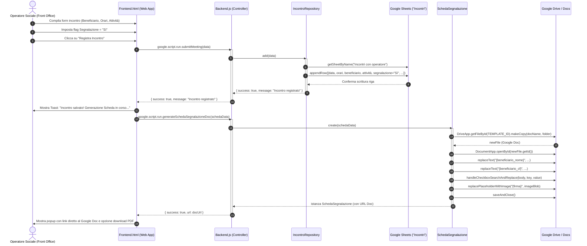
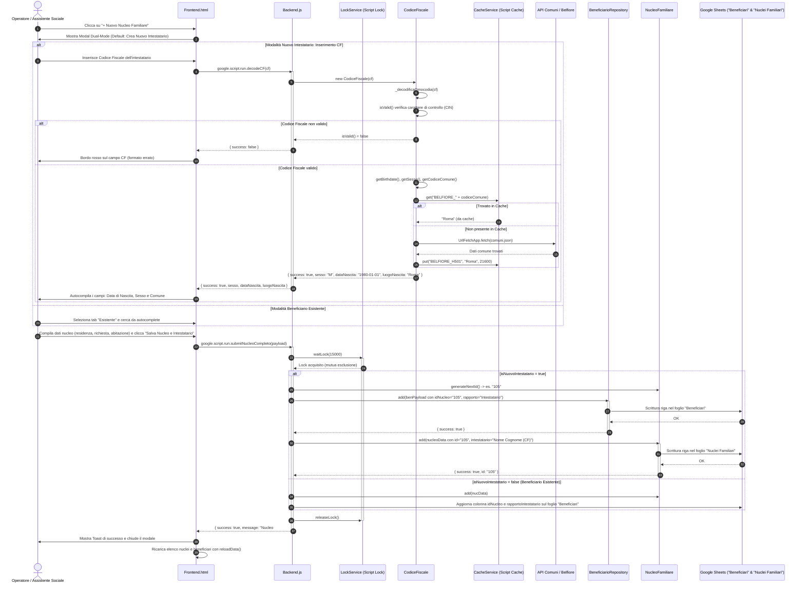
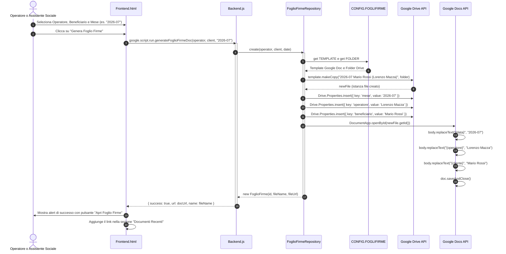
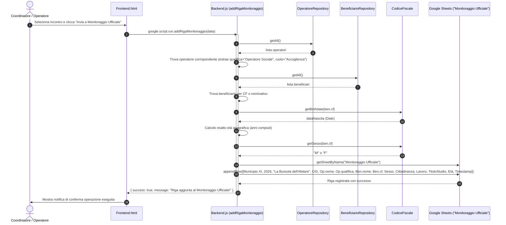

# Diagrammi UML di Sequenza (Sequence Diagrams)

Documentazione dei flussi di interazione temporale tra i componenti del sistema gestionale **"La Bussola dell'Abitare"**:
- **Client:** Interfaccia Web App Single Page (`Frontend.html`).
- **Server:** Controller di backend (`Backend.js`).
- **Domain e Models:** Modelli orientati agli oggetti (`CodiceFiscale`, `NucleoFamiliare`, `SchedaSegnalazione`).
- **Repository:** Strato di persistenza (`IncontroRepository`, `FoglioFirmeRepository`, `BeneficiarioRepository`, `OperatoreRepository`).
- **Servizi Google Workspace:** `SpreadsheetApp`, `DriveApp`, `DocumentApp`, `CacheService`.

---

## 1. Sequenza 1: Registrazione Incontro e Segnalazione al Secondo Livello

Descrive il flusso in cui un operatore di primo livello accoglie un beneficiario, registra l'incontro su Google Sheets e, riscontrando bisogni specialistici, genera la Scheda di Segnalazione per il secondo livello.

---

## 2. Sequenza 2: Censimento Nucleo Familiare e Creazione Atomica dell'Intestatario

Illustra l'interazione tra la selezione Dual-Mode (creazione nuovo beneficiario intestatario vs selezione esistente), l'algoritmo di decodifica istantanea del Codice Fiscale e il salvataggio atomico tramite `submitNucleoCompleto` protetto da `LockService`.

---

## 3. Sequenza 3: Generazione del Foglio Firme Individuale Mensile

Mostra come il sistema evita duplicazioni controllando l'esistenza del file prima di generarne uno nuovo dal template Google Docs predefinito.

---

## 4. Sequenza 4: Incrocio Dati e Compilazione Monitoraggio Ufficiale

Rappresenta l'automazione della riga del file di monitoraggio ministeriale/municipale mediante aggregazione asincrona tra le anagrafiche del beneficiario, i dati professionali dell'operatore e il calcolo dell'età.

