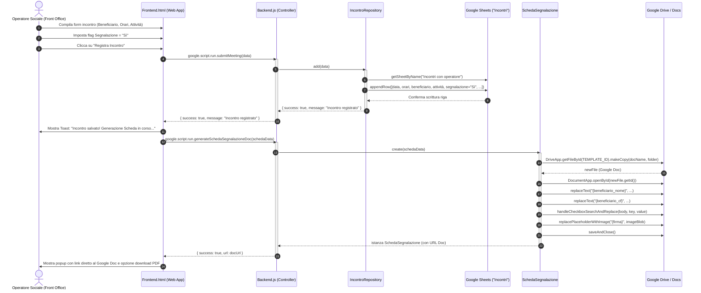
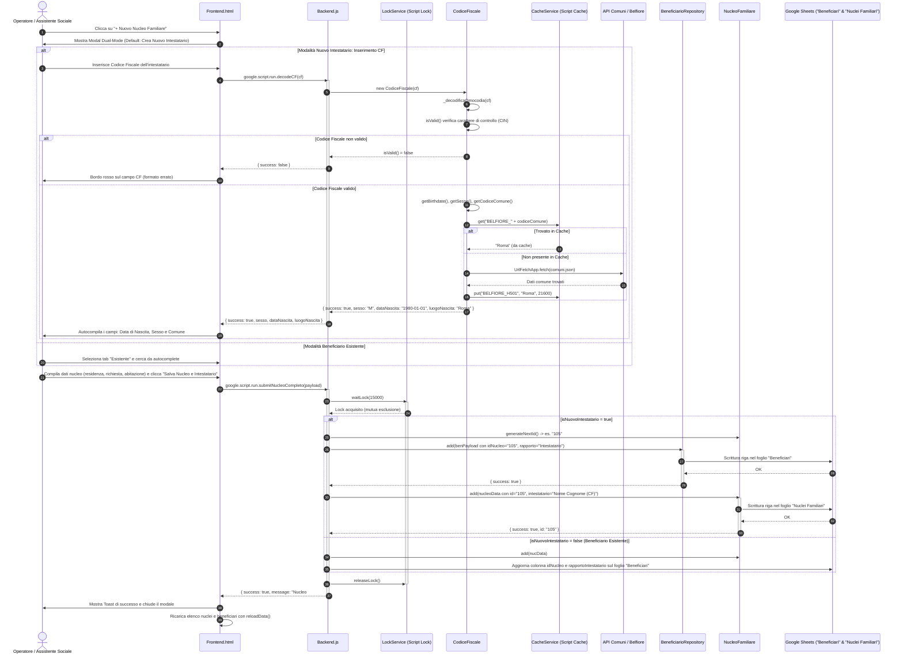
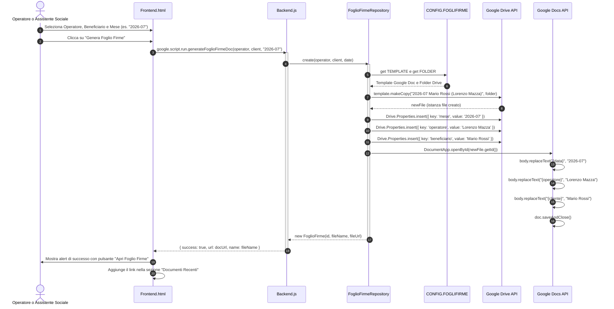
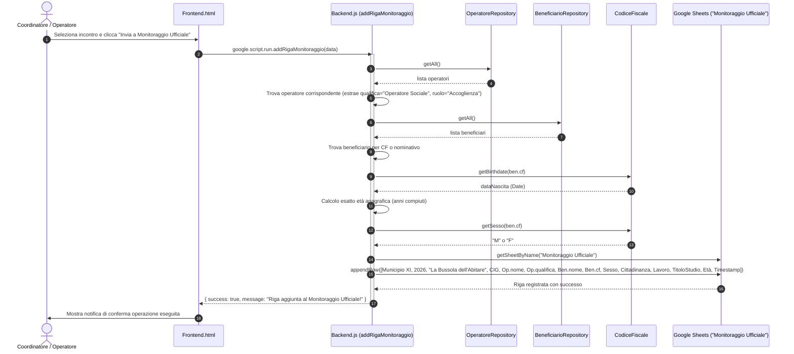
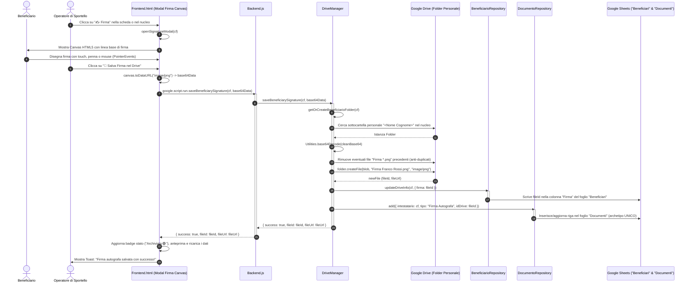
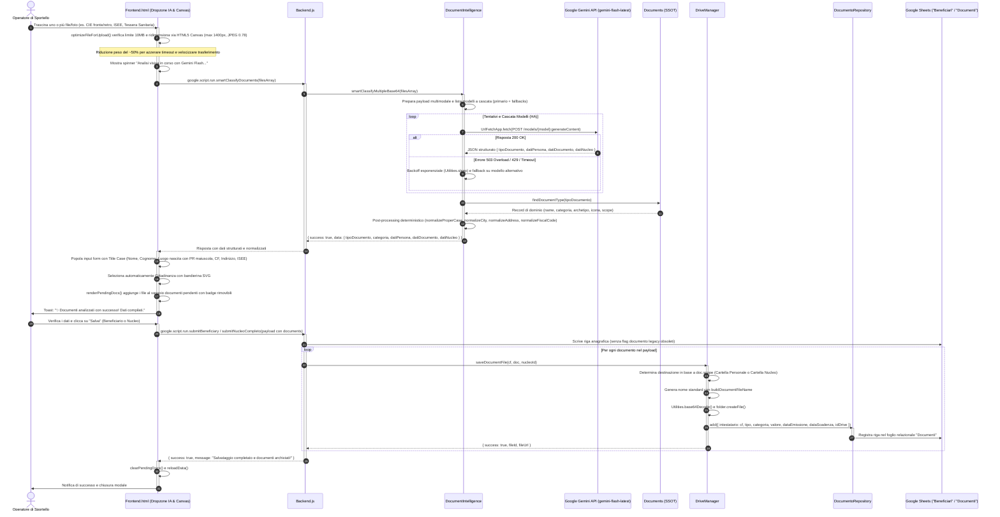
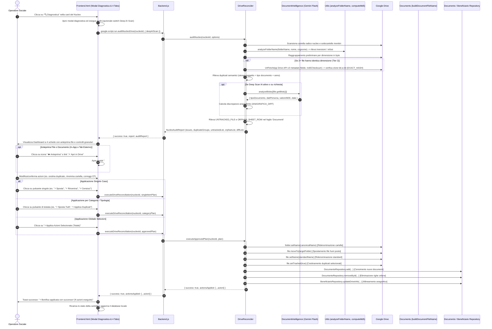
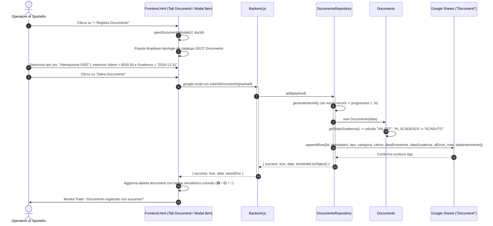
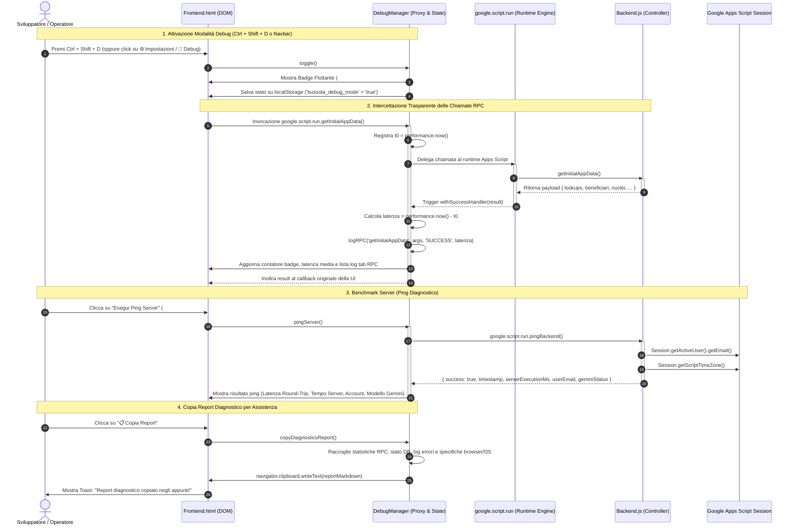
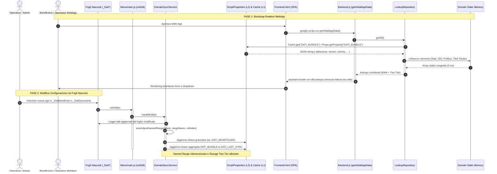

# Diagrammi UML di Sequenza (Sequence Diagrams)

Documentazione dei flussi di interazione temporale tra i componenti del sistema gestionale **"La Bussola dell'Abitare"**:
- **Client:** Interfaccia Web App Single Page (`Frontend.html`).
- **Server:** Controller di backend (`Backend.js`).
- **Domain e Models:** Modelli orientati agli oggetti (`CodiceFiscale`, `NucleoFamiliare`, `SchedaSegnalazione`).
- **Repository:** Strato di persistenza (`IncontroRepository`, `FoglioFirmeRepository`, `BeneficiarioRepository`, `OperatoreRepository`).
- **Servizi Google Workspace:** `SpreadsheetApp`, `DriveApp`, `DocumentApp`, `CacheService`.

---

## 1. Sequenza 1: Registrazione Incontro e Segnalazione al Secondo Livello

Descrive il flusso in cui un operatore di primo livello accoglie un beneficiario, registra l'incontro su Google Sheets e, riscontrando bisogni specialistici, genera la Scheda di Segnalazione per il secondo livello.

---

## 2. Sequenza 2: Censimento Nucleo Familiare e Creazione Atomica dell'Intestatario

Illustra l'interazione tra la selezione Dual-Mode (creazione nuovo beneficiario intestatario vs selezione esistente), l'algoritmo di decodifica istantanea del Codice Fiscale e il salvataggio atomico tramite `submitNucleoCompleto` protetto da `LockService`.

---

## 3. Sequenza 3: Generazione del Foglio Firme Individuale Mensile

Mostra come il sistema evita duplicazioni controllando l'esistenza del file prima di generarne uno nuovo dal template Google Docs predefinito.

---

## 4. Sequenza 4: Incrocio Dati e Compilazione Monitoraggio Ufficiale

Rappresenta l'automazione della riga del file di monitoraggio ministeriale/municipale mediante aggregazione asincrona tra le anagrafiche del beneficiario, i dati professionali dell'operatore e il calcolo dell'età.

---

## 5. Sequenza 5: Acquisizione Firma Digitale Beneficiario su Canvas HTML5

Descrive il flusso con cui l'operatore fa apporre la firma autografa al beneficiario direttamente su schermo touch o con mouse/penna, procedendo al salvataggio in formato PNG trasparente nella cartella Drive personale e alla sincronizzazione con i fogli 'Beneficiari' e 'Documenti'.

---

## 6. Sequenza 6: Smart Form-Filling Multi-File & Document Intelligence con Google Gemini Flash

Illustra l'interazione tra l'area di rilascio documenti (drag & drop multi-file), l'ottimizzazione grafica su Canvas client-side, il servizio multimodale Google Gemini (`gemini-flash-latest`, con fallback su `gemini-flash-lite-latest` e `gemini-pro-latest`), la normalizzazione deterministica Title Case e l'archiviazione automatica in Google Drive e foglio `Documenti`.

---

## 7. Sequenza 7: Diagnostica Avanzata e Riconciliazione Interattiva Drive con IA

Descrive la procedura di audit approfondito e bonifica controllata eseguita da `DriveReconciler` con supporto di Google Gemini Flash: individuazione di cartelle invertite (`Cognome Nome`), refusi, file fuori posto, duplicati esatti/semantici, righe orfane e allineamento anagrafico con anteprima diff prima dell'esecuzione selettiva.

---

## 8. Sequenza 8: Gestione del Fascicolo Documentale e Tracciamento Scadenze Relazionale

Mostra il ciclo di registrazione e monitoraggio dei documenti e delle relative scadenze (ISEE con valore in €, titoli di soggiorno con data scadenza, permessi).

---

## 9. Sequenza 9: Modalità Debug Real-Time, Intercettazione RPC e Diagnostica di Sistema

Descrive il ciclo di vita della modalità di debug: attivazione con scorciatoia `Ctrl + Shift + D` o da interfaccia, intercettazione a bassa invasività delle chiamate RPC tramite JavaScript `Proxy`, monitoraggio delle latenze di rete, ping diagnostico verso `pingBackend()` e generazione del report completo per il supporto tecnico.

---

## 11. Sequenza 11: Architettura a Doppio Canale per Valori di Convalida (Lookups) e Sincronizzazione onEdit

Descrive il flusso ad altissima reattività:
1. All'avvio della WebApp (`getInitialAppData`), i dati generali universali sono letti direttamente in RAM dai moduli `Domain/` (**0 ms**), mentre i dati di sportello sono recuperati da `CacheService` / `ScriptProperties` (**2-15 ms**), senza alcuna chiamata a `SpreadsheetApp`.
2. Alle modifiche manuali sui fogli `_Dati*`, il trigger `onEdit(e)` esegue la sincronizzazione chirurgica aggiornando ScriptProperties, Cache RAM e ridimensionando automaticamente i Named Ranges.

