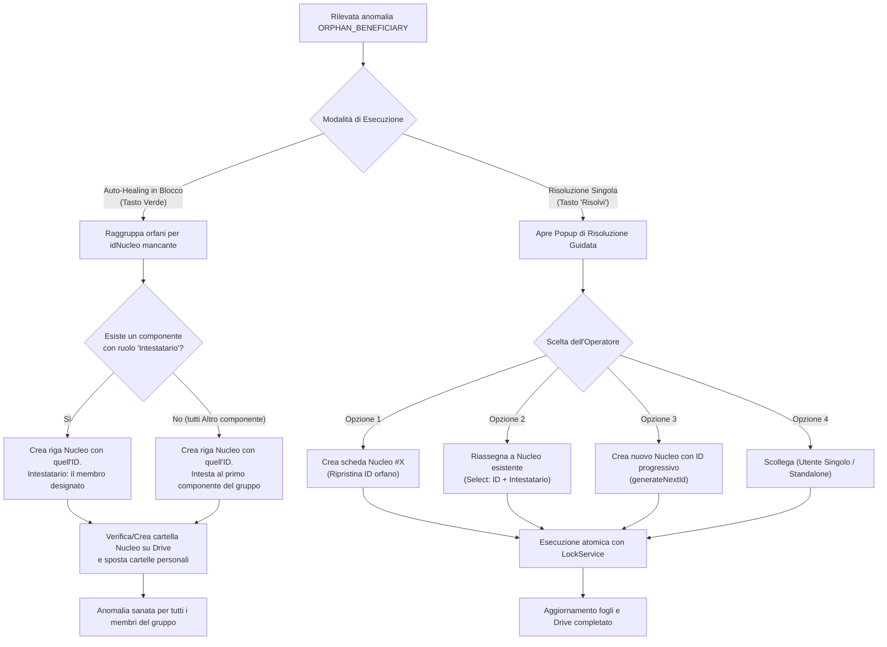

# Piano di Risoluzione: Beneficiari Associati a Nuclei Inesistenti (Orphan Beneficiaries)

Questo piano definisce l'architettura, le regole di business e i flussi operativi per rilevare e sanare l'anomalia relazionale in cui un beneficiario nel foglio `Beneficiari` possiede un `idNucleo` non presente nella tabella `Nuclei familiari` (`ORPHAN_BENEFICIARY`).

---

## 1. Origine e Anatomia dell'Anomalia

Nel database relazionale a fogli di calcolo ("La Bussola dell'Abitare"), l'integrità referenziale tra persone e nuclei non è garantita da vincoli di foreign key a livello di database engine, ma dall'applicazione. 

L'anomalia `ORPHAN_BENEFICIARY` si manifesta quando:
1. **Refuso di digitazione (Typo)**: L'operatore inserisce a mano l'ID nucleo sbagliando una cifra (es. digita `12` invece di `21`, oppure `5 ` con spazi o `Nucleo 4`).
2. **Cancellazione accidentale del Nucleo**: Una riga nel foglio *Nuclei familiari* viene cancellata manualmente, ma i beneficiari collegati rimangono orfani nel foglio *Beneficiari*.
3. **Inserimento anticipato (Pre-popolamento)**: Un beneficiario viene registrato anticipando un ID nucleo concordato a voce prima che la scheda del nucleo sia stata effettivamente creata.
4. **Gruppi orfani multipli**: Più membri della stessa famiglia (es. genitore e figli) condividono lo stesso `idNucleo` inesistente.

---

## 2. Le 4 Strategie di Risoluzione

Il sistema adotta un approccio ibrido: **Auto-Healing automatico in blocco** per i casi standard e univoci, e **Risoluzione guidata interattiva** con finestra modale per le casistiche che richiedono una scelta dell'operatore.

| Strategia | Nome | Quando si applica | Azione del Sistema | Impatto su Google Drive |
| :--- | :--- | :--- | :--- | :--- |
| **1** | **Auto-Creazione Scheda Nucleo (Ripristino Referenziale)** | • Invocazione Auto-Healing in Blocco<br>• Orfano contrassegnato come *Intestatario* (o unico orfano con quell'ID) | Crea la riga mancante in *Nuclei familiari* mantenendo lo stesso `idNucleo` orfano. Intesta la scheda al beneficiario con stato *"Attivo"*. | Se non esiste, crea la cartella del nucleo su Drive (`<id> - <Cognome> <Nome>`) e vi sposta la cartella personale del beneficiario. |
| **2** | **Riassegnazione a Nucleo Esistente (Fix Refuso)** | • Risoluzione puntuale da Dialog<br>• L'operatore riconosce che l'ID era un refuso di digitazione | Menu a tendina con ricerca su tutti i nuclei esistenti. Aggiorna `idNucleo` nel foglio *Beneficiari* con l'ID selezionato. | Sposta la cartella del beneficiario all'interno della cartella del nuovo nucleo assegnato. |
| **3** | **Migrazione su Nuovo Nucleo Progressivo** | • Risoluzione puntuale da Dialog<br>• Il caso richiede un nuovo nucleo pulito e formale | Invoca `NucleoFamiliare.generateNextId()` (es. #42), crea la nuova scheda nucleo e aggiorna il beneficiario come Intestatario di questo nuovo ID. | Crea nuova cartella nucleo progressiva e vi sposta i documenti dell'utente. |
| **4** | **Scollegamento / Utente Singolo (Standalone)** | • Risoluzione puntuale da Dialog<br>• Persona non associata ad alcun nucleo familiare (es. contatto una tantum) | Svuota la cella `idNucleo` e imposta il ruolo a vuoto o *"Singolo"*. | Sposta o mantiene la cartella personale direttamente nella root beneficiari. |

---

## 3. Flusso Decisionale e Algoritmo di Risoluzione



---

## 4. Dettagli Implementativi

### 4.1 Modifiche al Servizio `DataIntegrityService.js`
1. **Raggruppamento per ID orfano in `autoHeal()`**:
   - Evita la creazione di duplicati quando più righe beneficiario fanno riferimento allo stesso ID nucleo inesistente.
   - Per ciascun `idNucleo` mancante, seleziona il caponucleo naturale (chi ha `ruolo === 'Intestatario'`) o il primo beneficiario.
   - Crea una sola riga nel foglio *Nuclei familiari* con `id = idNucleoOrfano`.
2. **Nuovo metodo atomico `resolveOrphanBeneficiary()`**:
   ```javascript
   static resolveOrphanBeneficiary({ rowIdx, actionType, targetNucleoId, newRole })
   ```
   - Supporta i 4 tipi di azione: `"RECREATE_NUCLEO"`, `"REASSIGN_EXISTING"`, `"CREATE_NEW_PROGRESSIVE"`, `"UNLINK_STANDALONE"`.
   - Protetto da `LockService.getScriptLock()` per evitare corse critiche con altri operatori o con la WebApp.

### 4.2 Aggiornamento a `NucleoFamiliare.js`
- Modificare `NucleoFamiliare.add(data)` per permettere l'inserimento forzato dell'ID originale (`data.forceId = true` o se `data.id` è fornito esplicitamente per una nuova riga), evitando che venga sovrascritto da `generateNextId()` durante il ripristino referenziale.

### 4.3 Aggiornamento dell'Interfaccia `DialogIntegrityAudit.html`
- Quando l'anomalia cliccata ha `type === "ORPHAN_BENEFICIARY"`:
  - Il pulsante *"Risolvi"* apre un modale compatto (o espande un accordion inline) con 4 opzioni radio e l'anteprima:
    1. 🔘 **Crea scheda Nucleo #{ID}**: Crea la scheda intestata a *{Nome Cognome}*.
    2. 🔘 **Riassegna a nucleo esistente**: Mostra una `<select>` filtrabile con tutti i nuclei attivi nel sistema.
    3. 🔘 **Assegna a un nuovo nucleo indipendente**: Calcola e mostra in anteprima il prossimo ID libero (es. `#18`).
    4. 🔘 **Rimuovi nucleo (Beneficiario singolo)**: Svuota l'associazione.

### 4.4 Sincronizzazione Google Drive (`DriveApp`)
- Se il beneficiario possiede già una sottocartella personale registrata (`idCartella`), la risoluzione controlla se la cartella si trova nella posizione corretta:
  - In caso di **riassegnazione** o **nuovo nucleo**, la cartella personale del beneficiario viene spostata come sottocartella del nuovo nucleo.
  - In caso di **scollegamento**, viene spostata sotto la radice `FOLDER_BENEFICIARI_ROOT`.

---

## 5. Piano di Verifica e Test

1. **Test Unitari Offline (`tests/unit/dataIntegrity.test.js`)**:
   - Test `AutoHeal ORPHAN_BENEFICIARY (Singolo)`: verifica la creazione della riga nucleo con l'ID preservato e intestatario coincidente.
   - Test `AutoHeal ORPHAN_BENEFICIARY (Multipli)`: verifica che 3 beneficiari con lo stesso `idNucleo` inesistente generino un solo nucleo e tutti risultino sanati.
   - Test `resolveOrphanBeneficiary - REASSIGN_EXISTING`: verifica l'aggiornamento corretto del valore `idNucleo` nel beneficiario.
   - Test `resolveOrphanBeneficiary - UNLINK_STANDALONE`: verifica la cancellazione di `idNucleo` e la normalizzazione del ruolo.
2. **Esecuzione Suite**:
   - `npm test` per verificare che tutti i 53+ test passino senza regressioni.

---

## 6. Prossimi Passi Operativi

Dopo l'approvazione del presente piano:
1. Implementare l'algoritmo di risoluzione orfani in `DataIntegrityService.js` (sia `autoHeal` che metodo puntuale).
2. Estendere `NucleoFamiliare.js` per supportare il ripristino di schede con ID preservato.
3. Arricchire l'interfaccia utente in `DialogIntegrityAudit.html` con il selettore guidato a 4 opzioni.
4. Aggiornare e completare i test unitari in `tests/unit/dataIntegrity.test.js`.
5. Rimuovere `plans/plan_orphan_beneficiary_resolution.md` al completamento, come da protocollo concordato.
