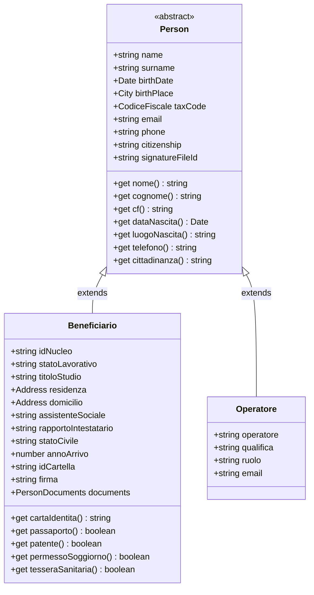

# Gerarchia Anagrafica delle Persone (`src/Models/Person`)

## 1. Responsabilità Architetturale

La cartella `src/Models/Person` definisce la gerarchia Object-Oriented (OOP) delle entità umane gestite dallo sportello sociale:
- **`0_Person.js`**: Classe base astratta che incapsula tutte le caratteristiche comuni a ogni persona.
- **`Beneficiari/Beneficiario.js`**: Modello specializzato per gli utenti accolti dallo sportello (cittadini richiedenti supporto abitativo).
- **`Operatori/Operatore.js`**: Modello per il personale e gli operatori dell'équipe multidisciplinare (operatori sociali di 1° livello, assistenti sociali di 2° livello, coordinatori).

---

## 2. Dettaglio dei File

### `0_Person.js` — Classe Base Astratta
Incapsula le proprietà e i comportamenti universali:
- Nome e Cognome normalizzati in Title Case.
- Data di nascita (istanza `Date` o fallback stringa ISO).
- Luogo di nascita e decodifica geografica.
- Codice Fiscale tramite il value object [`CodiceFiscale`](file:///d:/Lorenzo/Public/#Work/Azzurra84/Bussola%20dell'Abitare/gas-webapp/src/Models/CodiceFiscale.js).
- Contatti (telefono con prefisso internazionale, email).
- Cittadinanza risolta tramite il modello SSOT [`country.js`](file:///d:/Lorenzo/Public/#Work/Azzurra84/Bussola%20dell'Abitare/gas-webapp/src/Domain/country.js).

### `Operatori/Operatore.js` — Personale dello Sportello
Rappresenta un membro dell'équipe registrato nel foglio **`Operatori`**:
- Mappatura su: `Nome Cognome`, `Qualifica` (*Operatore Sociale*, *Assistente Sociale*, *Coordinatore*), `Ruolo` (*Front Office*, *Specialistico*), `Email`.
- Utilizzato per popolare i menu a tendina e per associare la firma e la responsabilità nei Fogli Firme, nei Diari Giornalieri e nel Monitoraggio Ufficiale.
