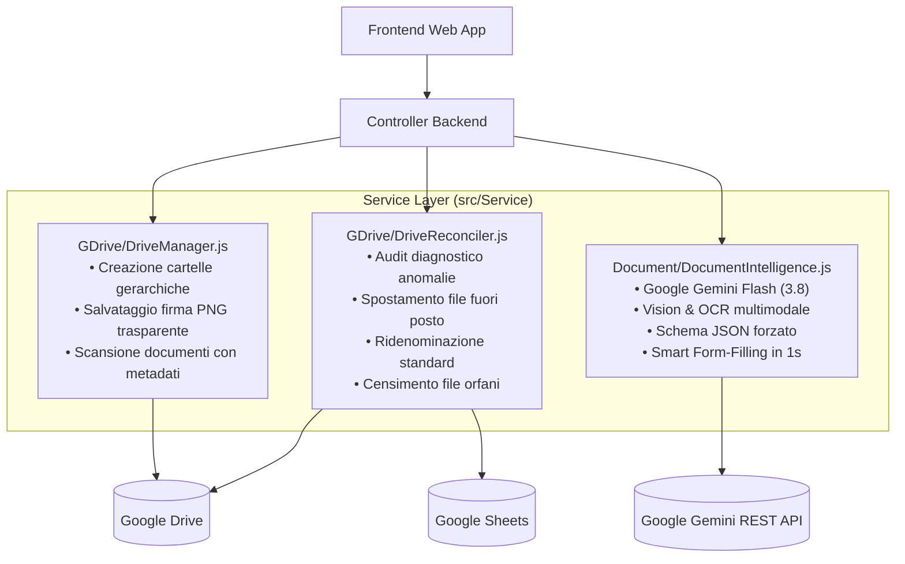

# Layer dei Servizi Applicativi (`src/Service`)

## 1. Responsabilità Architetturale

La cartella `src/Service` ospita i servizi specializzati responsabili dell'interazione con l'ecosistema cloud di Google Workspace e l'Intelligenza Artificiale:
- **`GDrive/`**: gestione gerarchica delle cartelle, archiviazione firme autografe, diagnostica e riconciliazione automatica del file system.
- **`Document/`**: intelligenza documentale multimodale con Google Gemini (`gemini-3.8-flash`) e automazione della modulistica ufficiale (Fogli Firme e Diari).
- **`GDocs/`**: servizi specifici per l'interazione con l'API Google Docs.
- **`GSheet/`**: utilità di esportazione e formattazione per Google Sheets.

---

## 2. Panoramica dei Servizi

