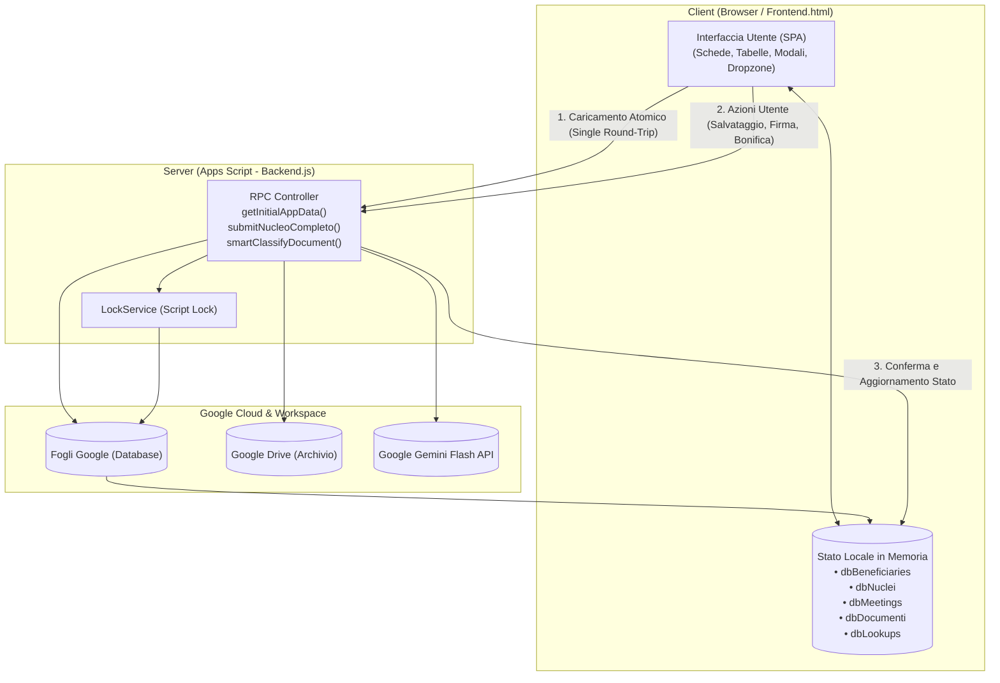

# Architettura e Funzionamento della Web App (`src/View/WebApp`)

## 1. Visione Generale e Stack Tecnologico

L'interfaccia utente dello sportello sociale "La Bussola dell'Abitare" è un'applicazione web **Single Page Application (SPA)** progettata per operare all'interno dell'ambiente Google Apps Script (`HtmlService`), ottimizzata sia per l'utilizzo da desktop che da tablet/smartphone in mobilità.

### Tecnologie Utilizzate:
- **Framework UI**: Bootstrap 5.3 (grid responsive, modali, alert, utility tipografiche).
- **Iconografia**: Bootstrap Icons e Flag Icons (libreria SVG/CSS per la resa ad alta risoluzione delle bandiere nazionali).
- **Firma Digitale**: HTML5 Canvas nativo integrato con le API **W3C PointerEvents** (gestione unificata di mouse, touch capacitivo per dita e penne stylus con eliminazione automatica dello scroll accidentale).
- **Computer Vision & OCR**: Integrazione client-server con Google Gemini (`gemini-flash-latest`) per la scansione visuale dei documenti e l'autocompilazione rapida dei form.
- **Compressione Immagini Client-Side**: HTML5 Canvas nativo per il downsampling e l'ottimizzazione istantanea dei file grafici prima del trasferimento via RPC (`google.script.run`), abbattendo i tempi di upload da smartphone da 20 secondi a meno di 1 secondo.
- **Comunicazione Server**: Protocollo asincrono `google.script.run` con gestione nativa dei callback `withSuccessHandler` e `withFailureHandler`.

---

## 2. Architettura di Sincronizzazione Dati

La Web App adotta un modello architetturale disaccoppiato basato su **stato locale reattivo (Client Cache)**:

### Regole Fondamentali:
1. **Nessuna Manipolazione Diretta**: Il client non interagisce mai direttamente con i fogli Google o le cartelle Drive. Ogni operazione passa attraverso il Controller di backend.
2. **Caricamento Atomico all'Avvio (`getInitialAppData`)**: All'apertura della pagina, una singola chiamata RPC scarica l'intero snapshot applicativo, azzerando i conflitti di concorrenza (`LockService`) e garantendo la reattività istantanea dei filtri e delle ricerche.
3. **Resilienza Multi-Dispositivo**: Quando più operatori lavorano contemporaneamente allo sportello, le registrazioni critiche (come la creazione del nucleo con intestatario) sono serializzate dal `LockService` di backend, mentre l'interfaccia client fornisce feedback visivi immediati (Toast colorati e indicatori di caricamento) ricaricando lo stato aggiornato.

---

## 3. Moduli Funzionali dell'Applicazione

### A. Scheda 1: Incontri e Colloqui (`tab-incontri`)
- **Registrazione Colloqui**: Form per inserire data, orari (`HH:mm`), operatore di riferimento, tipologia di intervento e descrizione del bisogno.
- **Biforcazione 1° e 2° Livello**: Supporta sia l'accoglienza libera che i colloqui specialistici su appuntamento.
- **Inoltro al Secondo Livello**: Con un semplice flag (*Segnalazione = Sì*), predispone l'incontro per la generazione della Scheda di Segnalazione ufficiale.
- **Filtri e Ricerca**: Ricerca full-text istantanea per operatore, beneficiario o testo descrittivo.

---

### B. Scheda 2: Nuclei Familiari e Componenti (`tab-nuclei`)
- **Card Informative**: Ogni nucleo è presentato in una card visiva con riassunto dell'intestatario, indirizzo, valore ISEE, data dell'ultimo contatto e conteggio incontri.
- **Gestione Componenti**: All'interno della card è possibile:
  - Visualizzare l'elenco dei membri con i relativi gradi di parentela.
  - Aprire la cartella personale Google Drive del singolo membro.
  - Verificare lo stato della firma autografa (badge verde o arancione) e acquisirla.
  - Modificare l'anagrafica o rimuovere il componente.
- **Discovery & Importazione Nuclei da Google Drive (`#modal-drive-discovery`)**:
  - Pulsante dedicato `📥 Importa da Drive` nella toolbar della scheda *Nuclei e Persone*.
  - Scansiona la cartella radice [`CONFIG.FOLDER_BENEFICIARI_ROOT_ID`](file:///d:/Lorenzo/Public/#Work/Azzurra84/Bussola%20dell'Abitare/gas-webapp/src/Utils/Config.js) alla ricerca di fascicoli fisici non ancora catalogati a foglio.
  - Tabella interattiva che elenca per ogni cartella non catalogata: ID rilevato o progressivo suggerito, intestatario e componenti dedotti dalle sottocartelle, documenti di nucleo e personali, e link diretto per aprire la cartella Drive.
  - **Dati Anagrafici e Proper Case**: applica automaticamente la normalizzazione grammaticale italiana (Title Case / Proper Case per nomi e cognomi, formato standard per comuni e province, e normalizzazione indirizzi).
  - Campi editabili (ID, Nome, Cognome, CF) per verificare o correggere i dati prima dell'importazione.
  - **Scansione IA Multimodale Estesa (Gemini Flash)**: switch opzionale per analizzare i documenti (sia nella radice del nucleo che nelle sottocartelle personali) estraendo data e luogo di nascita, residenza, cittadinanza, scadenze documenti e importo ISEE, visualizzati come badge descrittivi nella tabella.
  - **Selezione Sicura e Importazione Isolata**: le caselle di spunta e il selettore globale master sono deselezionati per impostazione predefinita per evitare importazioni accidentali di massa. L'operatore può scegliere di importare un singolo nucleo specifico con `⚡ Importa` (azione isolata per `data-folder-id`, senza alterare la coda) oppure selezionare manualmente i nuclei desiderati e premere `⚡ Importa Selezionati`. L'esecuzione atomica registra i dati in *Nuclei Familiari*, *Beneficiari* (con tutti i campi anagrafici) e *Documenti*, normalizzando la cartella Drive in `<ID> - <Nome Intestatario>`.
- **Diagnostica Drive Integrata (`#modal-diagnostica-drive`)**: Il pulsante `🔍 Diagnostica` su ogni card apre una suite interattiva a 4 schede per l'audit e la riconciliazione selettiva:
  - **Switch Deep Scan IA (Gemini Flash)**: attiva l'analisi OCR del contenuto dei documenti per estrarre metadati certi e scadenze.
  - **Scheda 1: 📁 File & Cartelle**: rileva sottocartelle personali mancanti, cartelle con nomi invertiti (`Rossi Mario`), refusi o nomi parziali, file fuori posto (radice vs cartella personale) e file con nomi non conformi allo standard `buildDocumentFileName`, permettendo all'operatore di approvare o modificare i nomi con checkbox interattive. I file non riconosciuti o generici (`ALTRO`) mantengono intatto il loro nome originale e non vengono proposti per la ridenominazione.
  - **Scheda 2: 📑 Gestione Duplicati**: visualizza coppie o gruppi di file rilevati con architettura Two-Tier:
    - **`EXACT_HASH` (Clone Bit-a-Bit 100%)**: badge rosso con impronta digitale (`<i class="bi bi-fingerprint"></i> Hash MD5 Identico - Clone 100%`) e visualizzazione dell'hash MD5 abbreviato nei metadati tecnici (estratto nativamente da Drive API v3 senza scaricare byte).
    - **`EXACT`**: duplicati per stessa dimensione in byte e nome normalizzato (file speciali o Google Docs senza checksum).
    - **`SEMANTIC`**: stesso documento e periodo per il medesimo soggetto.
    - Per ogni duplicato, l'operatore può scegliere selettivamente: `Cestina Duplicato` (spostamento nel cestino di Google Drive e cancellazione logica dal foglio *Documenti*), `Sposta in _Archivio` (spostamento nella cartella sicura `_Archivio` del nucleo) o `Mantieni Entrambi`.
  - **Scheda 3: 📊 Sincronizzazione Foglio 'Documenti'**: censisce con un click i file presenti su Drive ma non registrati nel foglio (con campi editabili per tipo, intestatario, scadenza e valore) ed elenca le righe orfane (file cancellati su Drive) per l'eliminazione controllata.
  - **Scheda 4: 👤 Allineamento Dati Anagrafici (IA)**: mostra una tabella diff interattiva tra i dati estratti dai documenti con Gemini Flash e quelli registrati nei fogli *Beneficiari* e *Nuclei Familiari* (Codice Fiscale, Nome/Cognome Title Case, Luogo di Nascita con provincia, Residenza, Valore ISEE), permettendo di modificare i campi prima di applicare l'aggiornamento atomico.
  - **Applicazione Granulare delle Decisioni**:
    - **Per Singolo Caso**: ogni singola riga di ogni scheda dispone di un pulsante di azione diretta immediata (`⚡ Crea`, `⚡ Rinomina`, `⚡ Sposta`, `⚡ Censisci`, `⚡ Elimina Riga`, `⚡ Applica`) che esegue solo quella specifica decisione con feedback visivo e aggiornamento reattivo dell'audit.
    - **Per Categoria / Tipologia**: intestazioni di sezione dotate di pulsanti aggregati (`⚡ Crea Tutte le Cartelle`, `⚡ Rinomina Tutte`, `⚡ Sposta Tutti i File Fuori Posto`, `⚡ Applica Tutte le Azioni Duplicati`, `⚡ Censisci Tutti i File Selezionati`, `⚡ Elimina Tutte le Righe Orfane`, `⚡ Applica Tutti i Diff Anagrafici`).
    - **Globale**: pulsante footer `⚡ Applica Azioni Selezionate (N)` per applicare l'intero set approvato in una singola transazione.
  - **Anteprima File Google Drive Integrata (`#modal-preview-file`)**:
    - Finestra modale con visualizzatore Google Drive `/preview` integrato per consultare istantaneamente PDF, immagini e documenti senza lasciare la schermata.
    - Pulsanti `👁️ Anteprima` e link esterno diretto `Apri in Drive ↗` (`/view`) presenti su tutti i file: per file da riordinare/rinominare, confronto affiancato originale vs duplicato, file non censiti e documento sorgente delle discrepanze anagrafiche rilevate da Gemini Flash.
- **Creazione Nucleo Dual-Mode (`#modal-nucleo`)**: Permette di creare un nucleo associando un beneficiario già registrato oppure censendo contestualmente un nuovo intestatario in modo atomico. Include:
  - Dropzone con Intelligenza Artificiale Gemini Flash (`#ai-smart-fill-nuc`) per caricare documenti in batch (es. CIE, ISEE, Tessera Sanitaria).
  - Ottimizzazione Canvas lato client (ridimensionamento a 1400px e qualità 0.78 per dimezzare il peso dei file mantenendo nitido l'OCR) e controllo di sicurezza anti-timeout sui PDF (massimo 10MB con messaggio guida operatore).
  - Gestione resiliente e tollerante ai guasti con retry automatico e cascata fallback multimodale in caso di congestione temporanea (HTTP 503 o timeout dei server Google).
  - Autocompilazione istantanea sia dei dati anagrafici dell'intestatario che dei campi del nucleo (es. valore ISEE, residenza).
  - Selettore dinamico a checkbox "Servizi da attivare" popolato dalle tipologie ammesse dello sportello.
  - Vassoio di anteprima e gestione dei documenti allegati che vengono salvati direttamente nella cartella Drive corretta (nucleo o membro) e censiti nel foglio `Documenti`.

---

### C. Scheda 3: Documentazione e Fascicolo (`tab-documenti`)
1. **Fascicolo Documentale e Scadenze**:
   - Tabella completa di tutti i documenti registrati nel foglio `Documenti`.
   - **Semafori delle Scadenze**:
     - 🔴 **Scaduto**: data di scadenza superata.
     - 🟡 **In Scadenza**: scade entro 60 giorni (con indicazione giorni residui).
     - 🟢 **Valido**: scadenza oltre i 60 giorni.
     - ⚪ **Permanente**: documenti senza scadenza (Firma, CF).
   - Filtri per ricerca testuale, per Categoria (*Anagrafica*, *Soggiorno*, *Economica*, *Abitativa*...) e per stato di scadenza.
   - Pulsante `+ Registra Documento` per inserire o aggiornare metadati e valori economici (€).
2. **Verifica Conformità Drive**:
   - Pulsante `Verifica Conformità Drive` per lanciare l'audit globale su tutti i nuclei censiti.
3. **Generatori Modulistica Google Docs**:
   - Generazione del **Foglio Firme Individuale** mensile.
   - Compilazione del **Diario Giornaliero** di sportello.
   - Redazione della **Scheda di Segnalazione** al secondo livello.
   - Aggiunta guidata al **Monitoraggio Ufficiale QSFP** (con calcolo automatico dell'età e dei dati anagrafici dal Codice Fiscale).

---

### D. Scheda 4: Appuntamenti (`tab-appuntamenti`)
- Pianificazione dei colloqui di secondo livello con calendario date, orario e note operative.
- Collegamento rapido con i recapiti telefonici e email dei beneficiari.

---

## 4. Componenti di Interazione Avanzata

### 1. Acquisizione Firma Digitale (`#modal-signature`)
- Interfaccia con Canvas HTML5 sensibile alla pressione e al tratto.
- Supporta disegno con mouse, dita su touchscreen e penne stylus (W3C PointerEvents).
- Controlli per pulizia tratto (`Cancella / Pulisci`) o upload alternativo di file immagine.
- Linea guida visiva di allineamento e salvataggio automatico in formato PNG trasparente nella cartella Drive personale.

### 2. Smart Form-Filling Multi-File con IA Gemini Flash e Compressione Canvas (`#ai-smart-fill-ben` & `#ai-smart-fill-nuc`)
- **Dropzone Universale**: Collocata sia nella modale anagrafica beneficiario/membro (`#modal-beneficiary`) che nella modale di creazione nucleo (`#modal-nucleo`).
- **Compressione Immagini Client-Side su Canvas**:
  - Le foto ad altissima risoluzione scattate da smartphone (10-15 MB) vengono ridimensionate proporzionalmente nel browser prima dell'invio (risoluzione massima 1600px, JPEG quality 0.82).
  - La dimensione del payload si riduce da ~15 MB a ~300 KB in 30-50 millisecondi, azzerando le latenze di trasmissione della rete ed evitando timeout o superamento quote RPC.
- **Analisi Simultanea Multi-File (Multimodal Batch)**:
  - Consente di trascinare o selezionare contemporaneamente più file o pagine (es. Carta d'Identità fronte e retro, oppure CIE + Tessera Sanitaria + ISEE).
  - Il backend invia tutte le parti al modello multimodale `gemini-flash-latest` (con cascata di fallback sui tier `gemini-flash-lite-latest` e `gemini-pro-latest`) in un'unica chiamata atomica, unificando le informazioni estratte.
- **Normalizzazione Rigorosa Title Case e Toponomastica**:
  - Nomi, cognomi e luoghi di nascita vengono formattati con la prima lettera maiuscola, gestendo correttamente cognomi con apostrofo (es. `D'Angelo`, `Dell'Amore`) e preposizioni.
  - La sigla della provincia italiana viene rigorosamente formattata in maiuscolo (es. `Reggio nell'Emilia (RE)`).
  - L'indirizzo di residenza viene normalizzato (es. `Via`, `Piazza`) e il Codice Fiscale viene forzato in maiuscolo a 16 caratteri.
- **Vassoio Documenti Pendenti (`pendingDocs`) e Archiviazione Drive**:
  - I file caricati compaiono come badge rimovibili con visualizzazione del tipo documento, nome file e dimensione ottimizzata.
  - Al click su "Salva Nucleo" o "Salva Membro", i file pendenti vengono inoltrati al backend e salvati automaticamente su Google Drive tramite `DriveManager.saveDocumentFile`:
    - I documenti personali (es. CIE, Tessera Sanitaria) finiscono nella cartella personale del membro (`<Nome Cognome>`).
    - I documenti a livello di nucleo (es. ISEE, Stato di Famiglia) vengono archiviati nella radice del nucleo (`<ID> - <Intestatario>`).
    - Ogni file salvato viene contestualmente censito nel foglio `Documenti` con il relativo ID Drive, tipo, categoria, date e importi economici.
  - Sono state definitivamente eliminate le vecchie caselle di spunta (checkbox) manuali dal form e dal foglio `Beneficiari`: la Single Source of Truth è ora il fascicolo relazionale `Documenti`.

### 3. Dropdown Internazionali con Bandierine Grafiche
- Gestione integrata del catalogo `Countries` (SSOT):
  - Ricerca istantanea per nome nazione, prefisso o codice ISO.
  - Rendering vettoriale della bandiera sia nel bottone di selezione che nella lista dei suggerimenti.
  - Separazione pulita tra prefisso telefonico (es. `+39`, `+212`) e numero locale.

### 4. Navigazione a Schede Resiliente & Diagnostica Integrata dei Nuclei
- **Componenti Nativi `<button type="button">`**:
  - I link di navigazione della navbar (`menu-incontri`, `menu-nuclei`, `menu-documenti`, `menu-appuntamenti`) utilizzano elementi semantici nativi `<button type="button">` al posto di ancore `<a>` con pseudo-protocolli `href="javascript:void(0)"`.
  - Questa scelta elimina alla radice qualsiasi interferenza con le Content Security Policy (CSP) imposte dall'ambiente iframe di Google Apps Script (`userCodeAppPanel`).
  - Gli elementi grafici interni (icone SVG, testi) hanno proprietà CSS `pointer-events: none;` per garantire che il target dell'evento sia sempre l'elemento di navigazione.
- **Scoping Rigoroso della Classe `.active`**:
  - Il cambio scheda (`showTab`) circoscrive la rimozione della classe `.active` esclusivamente ai bottoni della testata principale (`.app-header .app-top-nav .nav-link`), evitando di deselezionare inavvertitamente i tab secondari interni alle finestre modali (es. le 4 schede di `#modal-diagnostica-drive`).
- **Rendering Reattivo Completo per Tutti i Tab**:
  - Ogni transizione a `tab-nuclei`, `tab-incontri`, `tab-appuntamenti` o `tab-documenti` invoca la rispettiva funzione di rendering (`renderNucleiList`, `renderMeetingsTable`, `renderAppointmentsTable`, `renderAllDocumentiTable`) racchiusa in blocchi `try/catch` individuali, garantendo che un eventuale errore in una tabella non blocchi la visibilità del pannello.
- **Integrazione Diagnostica Drive per Singolo Nucleo**:
  - Ciascun nucleo familiare nella scheda *Nuclei e Persone* include direttamente sulla propria card il pulsante `🔍 Diagnostica` (`runNucleoHealthCheck(nucleoId, this)`), garantendo l'accesso alla suite di audit e riconciliazione granulare senza appesantire la navbar globale con pulsanti ridondanti.

### 4.1 Sistema Notifiche Toast Sovraordinato (`showToast`, `#toast-container`)
- **Posizionamento e Stacking Context (`z-index: 10050`)**:
  - Il contenitore `#toast-container` (`.toast-container-custom`) è ancorato in alto a destra (`top: 24px; right: 24px;` su desktop e `top: 16px; left: 16px; right: 16px;` su schermi mobili).
  - Utilizza `align-items: flex-end` con larghezza automatica (`width: auto`, `max-width: calc(100vw - 48px)`) per assicurare che tutti i toast si allineino a filo destro a esattamente **24px reali** dal margine dello schermo.
  - Lo `z-index: 10050` garantisce che le notifiche galleggino con assoluta certezza **al di sopra** delle finestre modali (`.modal` a `1055`), delle anteprime (`#modal-preview-file` a `1070`), dei drawer diagnostici (`1090`) e del backdrop oscurato (`1050`), eliminando qualsiasi fenomeno di occlusione visiva durante la compilazione dei form di inserimento o modifica.
  - La proprietà `pointer-events: none;` sul container garantisce che l'area trasparente non intercetti click destinati ai form sottostanti, mentre `pointer-events: auto;` sui singoli toast ne consente l'interazione diretta.
- **Formattazione Semantica & Icone di Stato**:
  - Ciascun toast include automaticamente un'icona SVG contestuale di Bootstrap Icons:
    - 🔴 **Errore** (`type === "error"`): icona `bi-exclamation-octagon-fill`, sfondo rosso `bg-danger`, durata prolungata a 6,5 secondi e pulsante di chiusura immediata.
    - 🟢 **Successo** (`type === "success"`): icona `bi-check-circle-fill`, sfondo verde `bg-success`, durata 4 secondi.
    - 🟡 **Attenzione** (`type === "warning"`): icona `bi-exclamation-triangle-fill`, sfondo giallo `bg-warning text-dark`, durata 4 secondi.
    - 🔵 **Info** (`type === "info"`): icona `bi-info-circle-fill`, sfondo blu `bg-primary`, durata 4 secondi.

### 5. Modalità Debug Real-Time & Pannello Diagnostica (`DebugManager`, `#debug-drawer`, `#modal-settings`)
- **Scorciatoia da Tastiera Globale**: La combinazione `Ctrl + Shift + D` (o `Cmd + Shift + D` su macOS) attiva/disattiva istantaneamente la modalità di debug senza ricaricare la pagina.
- **Punti di Accesso UI**:
  - **Pulsante `⚙️ Impostazioni`** nella navbar: apre la modale `#modal-settings` per gestire la modalità debug, abilitare gli ID tecnici, eseguire il ping di benchmark del server (`pingBackend()`) e resettare la cache locale (`localStorage`).
  - **Pulsante `🐞 Debug`** nella navbar: apre/chiude rapidamente il cassetto di diagnostica.
  - **Footer dell'applicazione**: visualizza lo stato corrente (`Debug: Disattivato` / `Attivo`), la versione del software e il promemoria della scorciatoia da tastiera.
- **HUD Badge Flottante (`#debug-floating-badge`)**:
  - Fissato nell'angolo inferiore destro (z-index 1080) con indicatore di stato pulsante, conteggio delle chiamate RPC con latenza media e badge rosso reattivo per gli errori.
- **Console Drawer di Diagnostica (`#debug-drawer`)**:
  - Finestra a scomparsa laterale organizzata in 4 tab operative:
    1. **⚡ Live RPC Monitor**: intercetta tutte le chiamate `google.script.run` tramite `Proxy` JavaScript, misurando la latenza in millisecondi ed evidenziando con tag colorati lo stato (`SUCCESS` o `ERROR`), con visualizzazione ad albero dei parametri e delle risposte JSON.
    2. **💾 Stato Database**: ispettore in tempo reale delle collezioni in memoria (`dbBeneficiaries`, `dbNuclei`, `dbMeetings`, `dbDocumenti`, `dbLookups`) con conteggio record e pulsante per scaricare o ispezionare il dump JSON.
    3. **🧠 AI & File**: storico dettagliato delle ottimizzazioni Canvas (risparmio % e KB originali vs compressi, tempo impiegato) e delle chiamate a Google Gemini (`gemini-flash-latest`) con riepilogo dei campi estratti.
    4. **🔴 Error Log**: trappola per errori globali (`window.onerror` e `unhandledrejection`), tracciamento eccezioni con stack trace e pulsante **`📋 Copia Report Diagnostico`** per salvare negli appunti un report completo da inviare al supporto tecnico.
- **Visualizzazione ID Tecnici (`showTechIds`) & Folder ID di Debug**:
  - Nel fascicolo documenti, l'interruttore applica la classe `.show-tech-ids` al `<body>`, rendendo visibili in tabella gli identificativi di riga del foglio di calcolo (`RowID: #X`) e i file ID di Google Drive (`DriveID: ...`).
  - Nelle schede dei **Nuclei** e dei **Membri**, gli identificativi alfanumerici delle cartelle Drive (`idCartella`) sono **completamente rimossi dall'interfaccia standard** per non ingombrare la vista dell'operatore, e compaiono esclusivamente quando la **Modalità Debug** è attiva (`body.debug-mode-active`) con il prefisso `🐞`. In alternativa, l'operatore può aprire direttamente le cartelle tramite gli appositi pulsanti `📁 Cartella Nucleo` e `📁 Cartella`.

---

## 5. Riferimenti di Codice e Link Utili
- Controller di Backend: [Backend.js](file:///d:/Lorenzo/Public/#Work/Azzurra84/Bussola%20dell'Abitare/gas-webapp/src/Controller/Backend.js)
- Documentazione Controller: [README.md](file:///d:/Lorenzo/Public/#Work/Azzurra84/Bussola%20dell'Abitare/gas-webapp/src/Controller/README.md)
- Template Frontend: [Frontend.html](file:///d:/Lorenzo/Public/#Work/Azzurra84/Bussola%20dell'Abitare/gas-webapp/src/View/WebApp/Frontend.html)
- Diagrammi di Sequenza: [uml_sequenza.md](file:///d:/Lorenzo/Public/#Work/Azzurra84/Bussola%20dell'Abitare/gas-webapp/docs/uml_sequenza.md)
- Diagrammi delle Classi: [uml_classi.md](file:///d:/Lorenzo/Public/#Work/Azzurra84/Bussola%20dell'Abitare/gas-webapp/docs/uml_classi.md)
