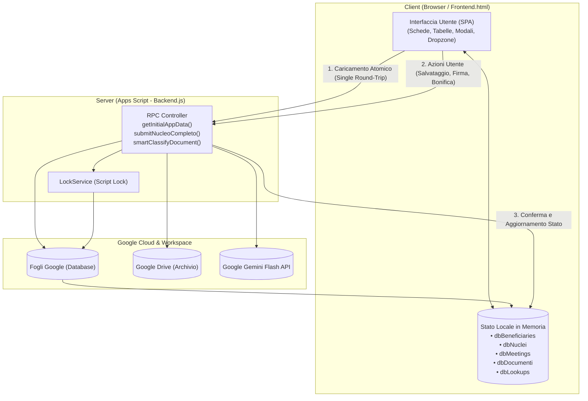

# Architettura e Funzionamento della Web App (`src/View/WebApp`)

## 1. Visione Generale e Stack Tecnologico

L'interfaccia utente dello sportello sociale "La Bussola dell'Abitare" è un'applicazione web **Single Page Application (SPA)** progettata per operare all'interno dell'ambiente Google Apps Script (`HtmlService`), ottimizzata sia per l'utilizzo da desktop che da tablet/smartphone in mobilità.

### Tecnologie Utilizzate:
- **Framework UI**: Bootstrap 5.3 (grid responsive, modali, alert, utility tipografiche).
- **Iconografia**: Bootstrap Icons e Flag Icons (libreria SVG/CSS per la resa ad alta risoluzione delle bandiere nazionali).
- **Firma Digitale**: HTML5 Canvas nativo integrato con le API **W3C PointerEvents** (gestione unificata di mouse, touch capacitivo per dita e penne stylus con eliminazione automatica dello scroll accidentale).
- **Computer Vision & OCR**: Integrazione client-server con Google Gemini Flash (`gemini-3.8-flash`) per la scansione visuale dei documenti e l'autocompilazione rapida dei form.
- **Comunicazione Server**: Protocollo asincrono `google.script.run` con gestione nativa dei callback `withSuccessHandler` e `withFailureHandler`.

---

## 2. Architettura di Sincronizzazione Dati

La Web App adotta un modello architetturale disaccoppiato basato su **stato locale reattivo (Client Cache)**:

### Regole Fondamentali:
1. **Nessuna Manipolazione Diretta**: Il client non interagisce mai direttamente con i fogli Google o le cartelle Drive. Ogni operazione passa attraverso il Controller di backend.
2. **Caricamento Atomico all'Avvio (`getInitialAppData`)**: All'apertura della pagina, una singola chiamata RPC scarica l'intero snapshot applicativo, azzerando i conflitti di concorrenza (`LockService`) e garantendo la reattività istantanea dei filtri e delle ricerche.
3. **Resilienza Multi-Dispositivo**: Quando più operatori lavorano contemporaneamente allo sportello, le registrazioni critiche (come la creazione del nucleo con intestatario) sono serializzate dal `LockService` di backend, mentre l'interfaccia client fornisce feedback visivi immediati (Toast colorati e indicatori di caricamento) ricaricando lo stato aggiornato.

---

## 3. Moduli Funzionali dell'Applicazione

### A. Scheda 1: Incontri e Colloqui (`tab-incontri`)
- **Registrazione Colloqui**: Form per inserire data, orari (`HH:mm`), operatore di riferimento, tipologia di intervento e descrizione del bisogno.
- **Biforcazione 1° e 2° Livello**: Supporta sia l'accoglienza libera che i colloqui specialistici su appuntamento.
- **Inoltro al Secondo Livello**: Con un semplice flag (*Segnalazione = Sì*), predispone l'incontro per la generazione della Scheda di Segnalazione ufficiale.
- **Filtri e Ricerca**: Ricerca full-text istantanea per operatore, beneficiario o testo descrittivo.

---

### B. Scheda 2: Nuclei Familiari e Componenti (`tab-nuclei`)
- **Card Informative**: Ogni nucleo è presentato in una card visiva con riassunto dell'intestatario, indirizzo, valore ISEE, data dell'ultimo contatto e conteggio incontri.
- **Gestione Componenti**: All'interno della card è possibile:
  - Visualizzare l'elenco dei membri con i relativi gradi di parentela.
  - Aprire la cartella personale Google Drive del singolo membro.
  - Verificare lo stato della firma autografa (badge verde o arancione) e acquisirla.
  - Modificare l'anagrafica o rimuovere il componente.
- **Diagnostica Drive Integrata**: Il pulsante `🔍 Diagnostica` su ogni card interroga il motore `DriveReconciler`, segnalando file fuori posto nella radice, cartelle personali mancanti e scadenze critiche, con il pulsante d'azione immediata `⚡ Bonifica Ora`.
- **Creazione Nucleo Dual-Mode (`#modal-nucleo`)**: Permette di creare un nucleo associando un beneficiario già registrato oppure censendo contestualmente un nuovo intestatario in modo atomico.

---

### C. Scheda 3: Documentazione e Fascicolo (`tab-documenti`)
1. **Fascicolo Documentale e Scadenze**:
   - Tabella completa di tutti i documenti registrati nel foglio `Documenti`.
   - **Semafori delle Scadenze**:
     - 🔴 **Scaduto**: data di scadenza superata.
     - 🟡 **In Scadenza**: scade entro 60 giorni (con indicazione giorni residui).
     - 🟢 **Valido**: scadenza oltre i 60 giorni.
     - ⚪ **Permanente**: documenti senza scadenza (Firma, CF).
   - Filtri per ricerca testuale, per Categoria (*Anagrafica*, *Soggiorno*, *Economica*, *Abitativa*...) e per stato di scadenza.
   - Pulsante `+ Registra Documento` per inserire o aggiornare metadati e valori economici (€).
2. **Verifica Conformità Drive**:
   - Pulsante `Verifica Conformità Drive` per lanciare l'audit globale su tutti i nuclei censiti.
3. **Generatori Modulistica Google Docs**:
   - Generazione del **Foglio Firme Individuale** mensile.
   - Compilazione del **Diario Giornaliero** di sportello.
   - Redazione della **Scheda di Segnalazione** al secondo livello.
   - Aggiunta guidata al **Monitoraggio Ufficiale QSFP** (con calcolo automatico dell'età e dei dati anagrafici dal Codice Fiscale).

---

### D. Scheda 4: Appuntamenti (`tab-appuntamenti`)
- Pianificazione dei colloqui di secondo livello con calendario date, orario e note operative.
- Collegamento rapido con i recapiti telefonici e email dei beneficiari.

---

## 4. Componenti di Interazione Avanzata

### 1. Acquisizione Firma Digitale (`#modal-signature`)
- Interfaccia con Canvas HTML5 sensibile alla pressione e al tratto.
- Supporta disegno con mouse, dita su touchscreen e penne stylus (W3C PointerEvents).
- Controlli per pulizia tratto (`Cancella / Pulisci`) o upload alternativo di file immagine.
- Linea guida visiva di allineamento e salvataggio automatico in formato PNG trasparente nella cartella Drive personale.

### 2. Smart Form-Filling con IA Gemini Flash (`#ai-smart-fill-ben`)
- Dropzone intuitiva collocata nella modale beneficiario:
  - L'operatore trascina la foto o la scansione PDF di una **Carta d'Identità**, **Permesso di Soggiorno**, **Patente** o **ISEE**.
  - In ~1-2 secondi il modello multimodale `gemini-3.8-flash` analizza il documento ed estrae nome, cognome, Codice Fiscale, data e luogo di nascita, sesso, cittadinanza e residenza.
  - Il form si autocompila all'istante, selezionando automaticamente anche la nazione corretta con la relativa bandierina grafica e spuntando i documenti posseduti.
  - L'operatore verifica visivamente la correttezza e salva con un solo click.

### 3. Dropdown Internazionali con Bandierine Grafiche
- Gestione integrata del catalogo `Countries` (SSOT):
  - Ricerca istantanea per nome nazione, prefisso o codice ISO.
  - Rendering vettoriale della bandiera sia nel bottone di selezione che nella lista dei suggerimenti.
  - Separazione pulita tra prefisso telefonico (es. `+39`, `+212`) e numero locale.
